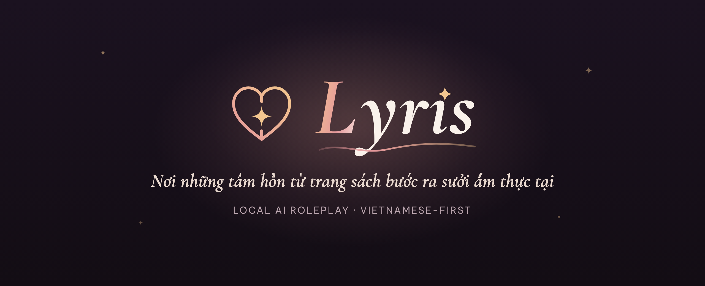
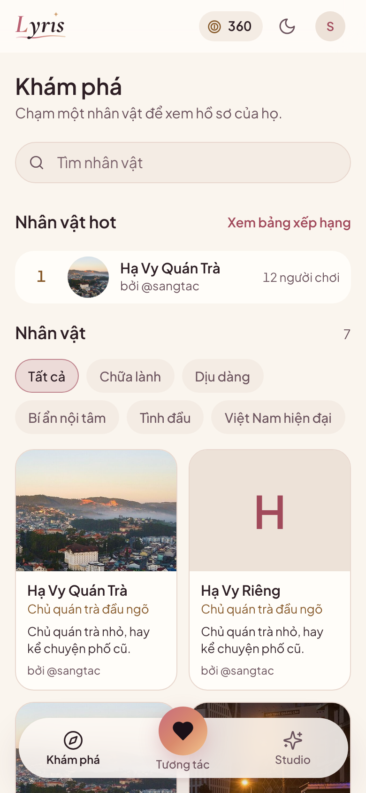
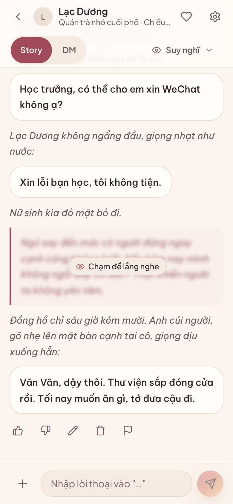
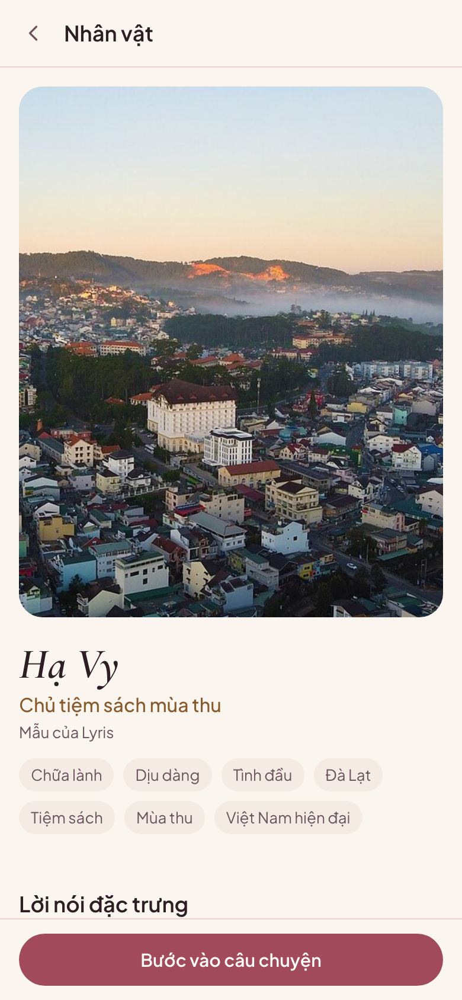
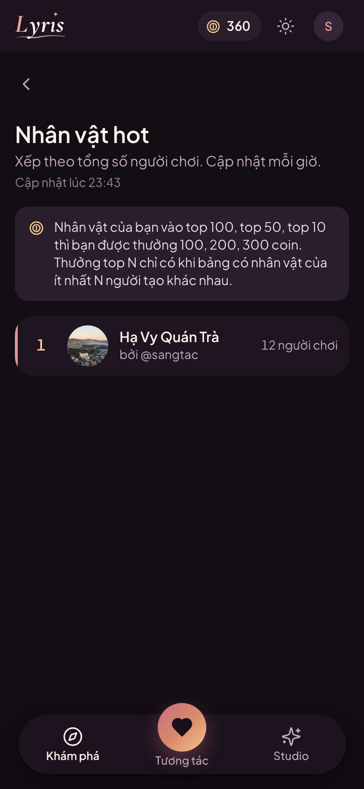
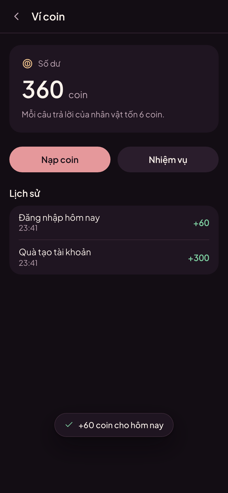
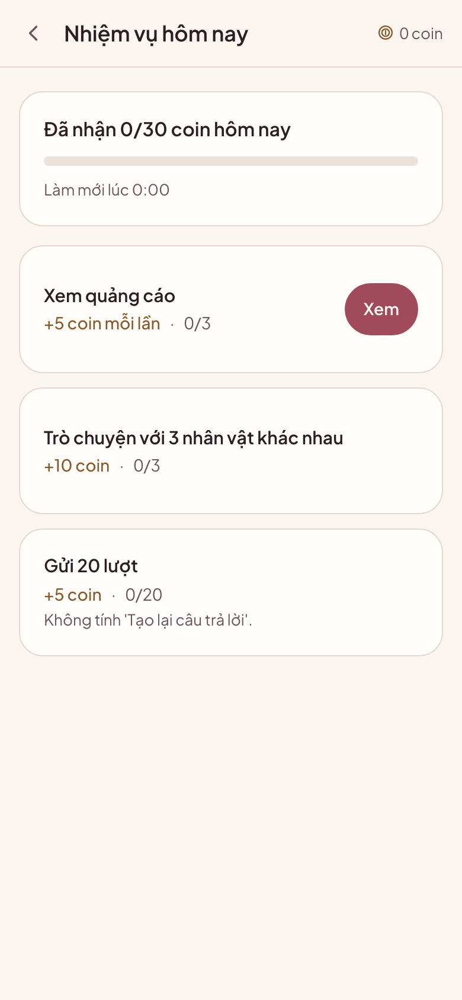
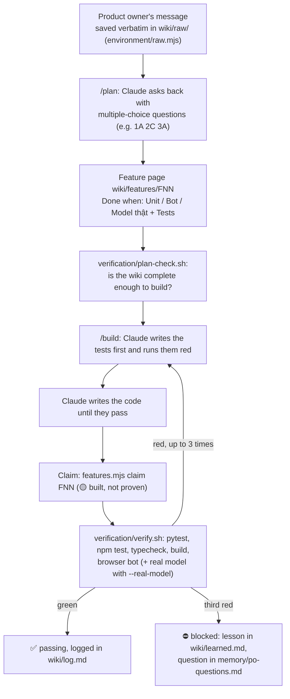
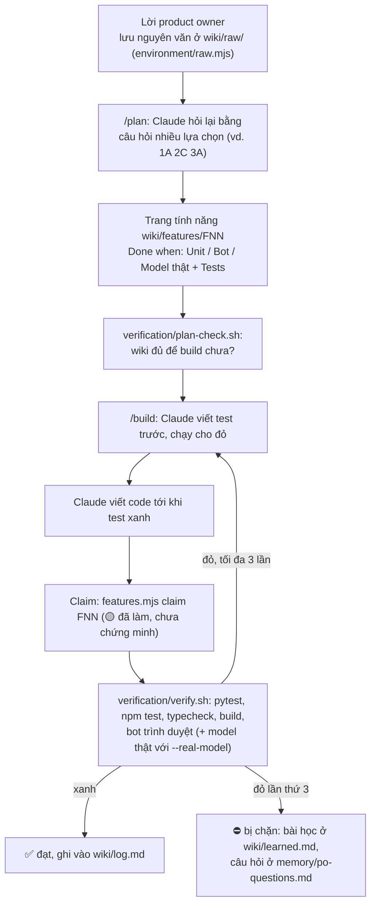

<p align="center">
  
</p>

# Lyris

> *Nơi những tâm hồn từ trang sách bước ra sưởi ấm thực tại.*
> Where the souls of storybook pages step out to warm the real world.

**English** · [Tiếng Việt](#tiếng-việt)

### For reviewers: assignment checklist

Where each part of the brief is answered (English half; the Vietnamese half has the same sections and its own [checklist](#dành-cho-người-chấm-đối-chiếu-đề-bài)).

| Brief | Where to look |
|---|---|
| **Deliverable 1:** full source code | `backend/` (FastAPI + SQLite), `frontend/` (React + Vite), [Repository map](#repository-map) |
| **Deliverable 2:** name and one-paragraph pitch | [Pitch](#pitch) |
| Problem, target users | [The problem](#the-problem), [Target users](#target-users), [Positioning and why now](#positioning-and-why-now) |
| Core features | [Core loop and out of scope](#core-loop-and-out-of-scope), [Core features](#core-features) |
| Launch channel, users and revenue | [Launch channel and business model](#launch-channel-and-business-model), [Unit economics](#unit-economics-estimates-to-validate), [Launch plan](#launch-plan-first-90-days-proposed) |
| How to build, run or access | [Try it as a reviewer](#try-it-as-a-reviewer), [Build, run and access](#build-run-and-access) |
| AI-native workflow (how we used Claude, what worked and what didn't) | [AI-native workflow](#ai-native-workflow-how-we-built-lyris-with-claude), [Harness](#harness-based-on-aperos-mini-harness) |
| Team members, roles and contributions | [Team](#team) |
| **Deliverable 3:** tracking plan | [docs/tracking-plan.md](docs/tracking-plan.md) (57 events; summary under [Tracking plan](#tracking-plan)) |
| **Deliverable 4:** demo video (2–3 min) | [Demo video](#demo-video) (2:22), [Screenshots](#screenshots) |
| Criterion: product thinking | [The problem](#the-problem), [Jobs to be done](#jobs-to-be-done), [Core loop and out of scope](#core-loop-and-out-of-scope), [Unit economics](#unit-economics-estimates-to-validate) |
| Criterion: execution | [Evidence](#evidence) (last full `verify.sh` run, bot checks, real-model runs), [Screenshots](#screenshots) |
| Criterion: AI-native process | [By the numbers](#by-the-numbers), [Lifecycle of a feature](#lifecycle-of-a-feature), [One feature end to end](#one-feature-end-to-end-f47-character-search) |
| Criterion: publish readiness | [Tracking plan](#tracking-plan), [Privacy and compliance](#privacy-and-compliance) (16+ (Terms); safe content on by default; 18+ mode later behind a toggle and 18+ confirmation), [docs/compliance.md](docs/compliance.md) (Vietnamese) |
| Criterion: documentation and teamwork | This README, [Team](#team), [Shared Claude accounts](#shared-claude-accounts) |
| Ownership and publishing | [Ownership and publishing](#ownership-and-publishing), [Handover to Apero](#handover-to-apero) |

[Demo video](#demo-video) · [Problem](#the-problem) · [Jobs to be done](#jobs-to-be-done) · [Target users](#target-users) · [Core loop](#core-loop-and-out-of-scope) · [Core features](#core-features) · [Launch and revenue](#launch-channel-and-business-model) · [Build and run](#build-run-and-access) · [Launch and deploy](#launch-and-deploy) · [Roadmap](#roadmap-hosted-lyris) · [Limitations](#limitations-and-future-evaluation) · [Tracking plan](#tracking-plan) · [Privacy and compliance](#privacy-and-compliance) · [AI-native workflow](#ai-native-workflow-how-we-built-lyris-with-claude) · [Harness](#harness-based-on-aperos-mini-harness) · [Team](#team) · [Ownership](#ownership-and-publishing)

**Labels used in this README:** **Built** = code and tests in this repository today. **Planned** = what we expect Lyris to have; not built yet. Exact per-feature status (✅ passing `verify.sh`, 🟡 built and waiting for verification, ⏳ planned) is in the [Harness tally](#harness-based-on-aperos-mini-harness).

---

## English

### Pitch

**Lyris is a Vietnamese-first AI roleplay app for young Vietnamese adults who love reading and fiction and want to live inside a story, not only read it, with a character who remembers them or with characters and worlds of their own.** You pick a character, or write your own in the Studio, and step into a story where the AI narrates and plays the character while you alone control your own persona. Lyris keeps you the author (the AI never writes your lines), uses the right Vietnamese forms of address for each character and story, and gives every character a memory and feelings that rise and fall with what you do; creators can turn their characters and worlds into ones other people can play. Chatting costs coins: every account gets free coins on sign-up and every day, and more come in packs from 10.000đ (test mode today, no real money yet). The submitted version (built) runs on one machine with a local open model and invite-only accounts; after the course Lyris goes to the open web as a hosted app, then to Google Play and the App Store (planned, see [Roadmap](#roadmap-hosted-lyris)).

**Launch channel:** the open web (a PWA served over HTTPS), starting as an invite-only beta released in waves; Google Play and the App Store come later (planned). See [Launch plan](#launch-plan-first-90-days-proposed).

### Demo video

**Demo video (2:22):** [watch on Google Drive](https://drive.google.com/file/d/1ew4_fgywsVmjGFwK4U-7Vl9aLGexrYvS/view?usp=drive_link)

### Screenshots

Captured by the browser bot (`node environment/bot.mjs --look`) at phone width (390 px) on the test server with a scripted fake model, so the chat text is test data. More: [docs/assets/screenshots/](docs/assets/screenshots/).

| Explore: search and the "Nhân vật hot" (hot characters) strip | A Story turn | Character profile |
|---|---|---|
|  |  |  |
| **Hot characters ranking (dark theme)** | **Coin wallet (dark theme)** | **Daily missions** |
|  |  |  |

Also in the folder: the login screen (`login-light.png`) and Explore in the dark theme (`explore-search-and-hot-strip-dark.png`).

### The problem

**Market context.** AI roleplay is an established paid consumer category. According to Appfigures data reported by TechCrunch (Perez, 2025), 337 active, revenue-generating AI companion apps had reached 220 million lifetime downloads and $221 million in lifetime consumer spending by July 2025. This shows commercial activity in the global category; it does not prove demand or willingness to pay among Vietnamese users specifically.

Immersive roleplay needs more than a coherent next reply. The AI has to keep each character's identity, remember what happened, react consistently to the relationship, and leave the player's own persona to the player. Vietnamese makes this harder: forms of address (anh/em, tớ/cậu, ta/ngươi…) carry age, status, intimacy and context, and a wrong pronoun breaks the character.

| Problem | What goes wrong | Supporting research |
|---|---|---|
| **1. Player agency** | Roleplay models drift from standing instructions such as "never write for the player" within a few turns. In the team's own use, hosted apps such as WHIF sometimes ignored what the player just wrote, spoke and acted *for* the player's character, and drifted off the scene. | Li et al. (2024) measured significant instruction drift within eight rounds of conversation. |
| **2. Vietnamese adaptation** | Models are neither evaluated nor tuned for relationship-dependent forms of address. English-trained roleplay models get them wrong, mix in English or Chinese words, and forget how two characters address each other. | Truong et al. (2024) evaluate Vietnamese LLMs on 10 tasks and 31 metrics; none targets forms of address in dialogue. |
| **3. Memory and continuity** | Characters lose names, promises, facts and personality over long sessions, even with long context or retrieval, and their attitude never changes whatever the player does. | Maharana et al. (2024). |

Together, these make roleplay feel like a series of disconnected chats rather than an ongoing story.

#### Jobs to be done

The same problems seen from the user's side: what progress people "hire" Lyris to make, independent of any feature. This analysis follows the research above and the [personas](#customer-personas-hypotheses-to-validate) below. Every part of it is a **hypothesis to validate** with interviews and tracking data after launch.

**Job statements**

The two core jobs come from the team's customer personas.

| Who | Job statement |
|---|---|
| **Group 1: Emotional Companionship Seekers** (persona: Lê Gia Hân) | *When* I feel lonely, stressed or emotionally overwhelmed, *I want to* create and interact with an AI character who understands me and remembers our shared experiences, *so I can* express myself freely and feel emotionally supported. |
| **Group 2: Creative Roleplay & Fiction Enthusiasts** (persona: Phạm Quốc Bảo) | *When* I have a creative idea or want to escape into a fictional world, *I want to* create my own characters, settings and storylines with AI, *so I can* experience immersive, interactive storytelling without limitations. |

**Wellbeing:** Lyris is an entertainment and roleplay app, not a mental-health or counselling service. The safeguards today are a rule in every story and DM prompt that the character answers talk of self-harm with care and never encourages it, a rule in the character-draft and reply-suggestion prompts against any self-harm content, and the [Terms](docs/legal/terms.md) (§2), which say Lyris does not replace professional advice and point to people you trust, a professional or emergency services (115 in Vietnam); in-app crisis detection or a help screen is neither built nor planned yet.

**Dimensions of each job** (the owner's functional, emotional and social jobs, condensed; what Lyris covers today, built or planned, is in the [persona tables](#customer-personas-hypotheses-to-validate))

| | Group 1: companionship (Hân) | Group 2: creative roleplay (Bảo) |
|---|---|---|
| **Functional** | Create a character with the personality, appearance, tone and behaviour I like; define our relationship (best friend, partner, older sibling, mentor); build a personal setting and story around it; have the AI remember my details and our important moments; keep the same personality across sessions | Define characters (appearance, personality, background, interests, voice, motivations); set the world (era, places, rules, cultures, social systems); develop plots, conflicts and twists; define relationships among characters (friends, rivals, allies, romantic partners); roleplay directly and steer how the story unfolds; keep events, character details and past choices; edit, redirect or expand the story |
| **Emotional** | Feel heard, understood and acknowledged; a private-feeling space to share without fear of judgment; familiarity and continuity over time | Freedom to create and imagine; immersion in a world of my own making; enjoying unexpected turns; ownership and control of my world and characters |
| **Social** | Explore the relationship dynamics and communication styles I prefer; express my identity and interests through a character I made | Show creativity and identity through original characters and stories; share characters and worlds with like-minded communities; connect with fandom, creative-writing and roleplay communities |

**Job map: where today's alternatives fail**

| Job step | Where current alternatives fail | What Lyris does (built) |
|---|---|---|
| **1. Create or find a character** that fits today's mood | General-purpose chatbots feel generic; many AI chat apps are English-first or limit how deep a character can be customised; reading platforms such as Wattpad have the characters, but you can only read them | Character Studio (personality, appearance, background, goals, secret, speech style, forms of address, greetings), an AI draft from a one-line idea, Character Card import; Explore with vibe filters, "Tìm nhân vật" search, the "Nhân vật hot" ranking |
| **2. Set up persona, relationship and story** | Few apps let the player set their own persona, the relationship and the setting for each story | "Bước vào câu chuyện" sheet: persona (with a free description, e.g. the relationship to the character), Story or DM, language, setting, opening, relationship type (a romance pairing or "Không lãng mạn"), point of view and narration pronouns for this story ("Ngôi kể", "Đại từ dẫn truyện"); forms of address in dialogue come from the character |
| **3. Play turns** | Generic apps write for the player, ignore the last turn and drift off the scene; wrong forms of address and stray English or Chinese words | Input conventions, a closing instruction to continue from the player's exact turn, Vietnamese-first prompts |
| **4. Keep continuity over days** | Characters forget names, promises and facts; their attitude never changes; human roleplay partners are not always available or drop out | Scene summaries, memories and facts with correct rollback, six emotion dimensions, one timeline for Story and DM, available any time |
| **5. Build worlds, share and create** | Original characters and worlds stay in notes and posts nobody can play; few tools organise a world; nothing rewards a creator whose character others enjoy | Lorebook with "who knows this", public characters, invite codes, ranking-based creator coins; community comments, image posts and follows are planned (F39) |

**Forces of progress** (why someone would switch, or not)
- **Push of the current situation:** general chatbots that feel generic and shallow; AI apps that take over the player's role, get Vietnamese wrong, drift from the character and forget; roleplay partners with matching taste are hard to find and keep their own schedules; sharing private feelings with people risks being judged.
- **Pull of Lyris:** a Vietnamese-first character who remembers within a story and lets the player stay the author; deep character and world tools; stories other accounts cannot read; there whenever the player is.
- **Anxieties:** is a 12B model good enough; will the character stay itself; are intimate stories private; will coins run out; is the content safe. Lyris answers with 300 free coins plus 60 a day and missions, stories no other account (not even the in-app admin) can read, no user text in analytics, data export and account deletion, and safe content by default.
- **Habits:** Wattpad, romance novels and reading apps; anime, manga and fandom groups; AI chat apps people already know; human roleplay in Discord or Facebook groups. Launch channels go to these places (see [Launch channels](#launch-channels)).

**Desired outcomes and how we will measure them**

| Desired outcome (user's view) | Measure | Status |
|---|---|---|
| Minimise the times the AI writes my lines or decisions | Harness: the judge's `godmodding` verdict on model scenarios such as `03-hanh-dong-cho-ai`; in use: dissatisfaction rate (`regenerate_used` + `message_edited` + `reply_rated` down, per `reply_completed`) | Scenario check built and run internally; real-user rate is a hypothesis |
| Minimise wrong forms of address and mixed-in foreign words | Harness machine checks on scenarios `06-viet-hien-dai`, `07-co-trang`, `08-tieng-anh` | Internal only; to be evaluated with users |
| Minimise the effort to pick up an old story where it stopped | `story_resumed` per week; memory scenario `f10-ky-uc` | Hypothesis |
| Keep a story going | Turns per story (`message_sent`); first target ≥ 40 % of started stories reach 5 turns; North Star: weekly engaged stories | Hypothesis ([tracking plan §5.3](docs/tracking-plan.md#53-first-targets-for-round-2)) |
| Come back to the character | D1 ≥ 35 %, D7 ≥ 15 % (first targets) | Hypothesis |
| Minimise waiting for a reply | First token under 10 s for ≥ 90 % of replies after warm-up (`reply_completed` `ttft_bucket`) | About 5 s measured on a 12B model at home; real use is a hypothesis |
| Creator (Group 2): maximise how many people play my character | Players per public character, `story_started` from public characters, `character_published`, `creator_rank_reached` | Hypothesis |

**How Lyris answers each problem.** The approaches below are built; how well they work with real users is **still to be evaluated** (see [Limitations](#limitations-and-future-evaluation)).

| Problem | Lyris approach (built) | Expected outcome |
|---|---|---|
| Limited player agency | A strict split: the AI plays the characters and the world, the player alone writes their persona; [input conventions](#core-features) and a closing instruction to continue from the player's exact turn | Fewer AI-written lines, actions or decisions for the player |
| Inconsistent Vietnamese | Vietnamese-first prompts, forms of address set per character and per story, diacritic-preserving lore matching | More natural, context-appropriate Vietnamese (to be evaluated) |
| Weak long-term memory | Rolling scene summaries, long-term memories, stored facts, correct rollback on regenerate, edit and delete | Better continuity (intended; to be evaluated) |
| Static relationships | Six emotion dimensions that rise and fall with the player's actions | Relationships that respond and evolve |
| Inconsistent worlds | A Lorebook per character, with "who knows this" on every entry | Consistent worlds and controlled reveals |

References: see [References](#references) at the end of this README.

### Target users

**Vietnamese-speaking adults aged 18+ who seek immersive, personalized and interactive experiences with fictional characters.** This is who the launch, the marketing and the personas aim at; the minimum age to use the app is 16 (see *Age* below).

Lyris serves four behavioral segments:

| Segment | Seeking | What Lyris gives them (built) | Persona |
|---|---|---|---|
| **1. Immersive Fiction Readers** (primary) | To participate in the stories they love, not only read them: ngôn tình, đam mỹ, cổ trang, vườn trường. Mobile-first, mostly evenings. | Story mode where the player always stays the author; "Bước vào câu chuyện" in two taps | Lê Gia Hân |
| **2. Relationship-Driven Roleplayers** | Persistent and evolving relationships with AI characters | Six emotions that rise and fall, memory across days, Story and DM modes in one timeline, a story that picks up where it stopped | Lê Gia Hân |
| **3. Fandom & Character Enthusiasts** | Deeper interactions with fictional characters and universes | Character profiles, a Lorebook where each entry says who knows it, Explore search and the "Nhân vật hot" ranking. A fan character made public must respect copyright ([Terms](docs/legal/terms.md)) | Phạm Quốc Bảo |
| **4. Independent Creators & Worldbuilders** (secondary) | To transform their characters and worlds (side characters, places, secrets, plot hooks) into interactive experiences, played faithfully | Character Studio, Lorebook, public characters, the "Nhân vật hot" ranking and creator coin rewards | Phạm Quốc Bảo |

- **Age: 16+** (stated in the Terms; accepting them at sign-up confirms it, with no birth-date field). Safe content is on by default for everyone; an 18+ mode, if it ever comes, sits behind turning off the "Nội dung an toàn" toggle and an 18+ confirmation.
- **Not a revenue segment:** **Self-hosting enthusiasts** with a capable machine can still run Lyris themselves (self-hosting stays possible and free, with coins switched off by `LYRIS_COINS=0`), but the business plan does not count on them.

#### Customer personas (hypotheses to validate)

Two personas written by Huynh Quoc Toi for the team ([original, in English](wiki/raw/2026-11-15-chan-dung-khach-hang.md)), condensed here. **Lê Gia Hân** stands for segments 1 and 2, **Phạm Quốc Bảo** for segments 3 and 4. They are **hypotheses, not research findings**: we will check them against the tracking data (activation funnel, D1/D7 retention, creation events) and short user interviews after launch.

- **Group 1, Emotional Companionship Seekers: Lê Gia Hân, 21.** A third-year university student living in District 7. She enjoys Wattpad stories and romance novels, especially emotionally mature, warm and attentive characters: a caring older sibling, a thoughtful partner, a gentle best friend.
- **Group 2, Creative Roleplay & Fiction Enthusiasts: Phạm Quốc Bảo, 20.** A second-year university student who loves anime, manga and light novels. He follows fandom communities, creates original characters (OCs), and enjoys roleplay, world-building and stories with many characters and plotlines.

| | **Lê Gia Hân** (Group 1) | **Phạm Quốc Bảo** (Group 2) |
|---|---|---|
| **Age** | Typically 18–25 | Typically 16–28; marketing aims at 18+, the app is open from 16 (Terms) |
| **Profile** | Young people seeking emotional connection, companionship and a space to express personal feelings | Creative users who enjoy fictional worlds, interactive storytelling and roleplay |
| **Interests** | Romance novels, Wattpad, films, audio stories, conversations with fictional characters (Lyris is text only today) | Anime, manga, RPGs, fantasy, romance, science fiction, fanfiction, world-building |
| **Behaviours** | Often uses the app at night or in stressful moments; tends to return to the same AI character over time | Often creates characters and settings, roleplays and takes part in fandom communities; may spend long stretches developing one story |
| **Willingness to pay** | May pay for a personalised experience when the character feels consistent, remembers her and gives meaningful interaction. In Lyris: coins per reply (packs from 10.000đ, test mode); paid cosmetic personalisation (chat themes, couple avatar frames) is a later idea, not built ([Revenue model](#revenue-model)) | May pay for advanced features: deeper character creation, long-term memory, world customisation, deeper roleplay. In Lyris what exists of these (Studio, AI draft, Lorebook, memory within a story) is open to everyone and only replies cost coins (test mode); no paid feature tier is planned |
| **Where to reach** | Facebook reading groups, TikTok book communities, Wattpad reading communities | Anime, manga and fandom groups on Facebook and Discord, roleplay communities, TikTok creators, Wattpad writing communities |
| **Signal to validate** | `story_resumed` per week, D7 retention, turns per story (`message_sent`), `heart_drawer_opened` | `character_created` (and its `via: ai_draft` share), `lore_imported`, `character_published`, players per public character, `message_sent` with `has_directive` |

**Lê Gia Hân: pain points and what Lyris does.** Product value, in the persona's words: an AI companion tailored to her (personality, relationship, the story around it) that builds on what they have shared.

| Pain point | What Lyris does | Status |
|---|---|---|
| Uncomfortable sharing private matters with friends or family for fear of being judged | Stories are private: other accounts cannot read them, not even the in-app admin; analytics hold no user text; she can export her data or delete her account. The [Privacy Policy](docs/legal/privacy.md) states the limit: someone with direct access to the server could technically open the database | Built |
| General-purpose chatbots feel generic and emotionally shallow | Characters with their own personality, speech style, example dialogue and forms of address (signature lines show on the profile); six emotions (affection, trust, attraction…) that rise and fall with what she does | Built; quality to be evaluated with users |
| Characters drift from their personality, tone or behaviour | The character card (personality, speech style, example dialogue) goes into every prompt; real-model scenarios check forms of address and repetition | Built; consistency across sessions not yet measured |
| The AI forgets personal details, past conversations and shared moments | Memories, facts (including facts about her persona) and rolling summaries, recalled into later turns; she sees them in "Cảm xúc & ký ức" (Feelings and memories) and can remove one with "Quên" (Forget) | Built, within one story: a new story with the same character starts from zero; memory shared across stories is not planned |
| Wants an ongoing, personal relationship instead of starting from zero | A story picks up where it stopped, days later; Story and DM share one timeline. The relationship (best friend, older sibling, mentor…) is set through the character's forms of address and setting, her persona's description and the story's relationship type (a romance pairing or "Không lãng mạn", not romantic) | Built; there is no separate relationship-role field |

**Phạm Quốc Bảo: pain points and what Lyris does.**

| Pain point or job | What Lyris does | Status |
|---|---|---|
| Platforms limit how deeply characters and settings can be customised | Character Studio: personality, appearance, background, goals, secret, speech style, signature lines, example dialogue, forms of address, default scenario, greetings, starting emotions; "AI viết nháp nhân vật" drafts a full card from a one-line idea; Character Card import (V1, V2, V3) and V2 export (.json, .png) | Built. "Voice" means written speech style; audio and calls are only an idea, not designed |
| Hard to find roleplay partners with compatible interests, style and storytelling skill | An AI partner at any hour that continues from his exact turn and never writes his persona's lines | Built |
| The AI breaks immersion by forgetting events, changing traits or contradicting facts | Memories, facts and summaries with correct rollback on edit, regenerate and delete; Lorebook entries recalled by keyword | Built; to be evaluated on long stories |
| Long stories with many characters, relationships and plotlines are hard to keep | Rolling summaries keep long stories going. A story has one AI character; side characters live as Lorebook "Người" (people) entries, and the card says how the character addresses others | Built; multi-character scenes and a story director are planned (F40, optional) |
| Few integrated tools to organise worlds, characters, relationships and story developments | A Lorebook per character (up to 500 entries: stories and secrets, people, places), each with keywords, priority and "who knows this"; import from `world.md`; an event timeline in the "+" menu. Era, rules and cultures are free-text entries, and so are relationships between characters | Built; a world belongs to one character (no world shared across characters) |
| Language barriers and international pricing | Vietnamese-first app and prompts; a story can be in English; coin packs priced in đồng from 10.000đ | Built (test mode); real payments planned (F56 app stores, F57 VNPay/MoMo) |
| *Job:* edit, redirect or expand the story | `((…))` hidden directions, "Sửa" (edit), "Tạo lại câu trả lời" (regenerate, with versions), "Xoá từ đây" (delete from here), reply suggestions | Built |
| *Job:* share characters and worlds with communities | Public characters that others play as their own private copy, the "Nhân vật hot" ranking, creator coins | Built; comments, image posts and follows planned (F39) |

#### Positioning and why now

- **WHIF**, in one line: a hosted AI character roleplay app with community sharing that the team used before building Lyris; the project started as "an app like WHIF" ([original message](wiki/raw/2026-11-12-plan-goc.md)).
- **Against WHIF:** the gap we documented is player agency. In the team's own use, WHIF sometimes continued the player's actions for them and answered off the scene ([original message](wiki/raw/2026-11-12-quyen-cua-nguoi-choi.md), Vietnamese). Lyris answers with the [input conventions](#core-features) and a closing instruction to continue from the player's exact turn.
- **Against Character.AI and Talkie:** we have not run or documented a side-by-side test of these apps, so this README makes no claims about their Vietnamese or their handling of the player's role.
- **What Lyris bets on (built):** Vietnamese forms of address set per character and per story; the player always stays the author; memory and six emotions that rise and fall; worlds where every lore entry says who knows it; creator rewards from the "Nhân vật hot" (hot characters) ranking.
- **Why now:** an open ~12B model now runs on a 24 GB laptop with a first token in about 5 s on long stories after prefill (measured during development, see [What worked](#what-worked)), so a Vietnamese-first roleplay app does not depend on a paid model API, and the AI companion category already has paying users (Perez, 2025).

### Core loop and out of scope

Lyris v1 is one loop, and every step is a tracked event ([tracking plan](docs/tracking-plan.md)):

1. **Discover:** Explore with search, vibe filters and the hot characters ranking (`explore_viewed`).
2. **Step in:** "Bước vào câu chuyện" (Step into the story): pick a persona, Story or DM, language and forms of address (`story_started`).
3. **Write a turn** with the input conventions below (`message_sent`).
4. **The character replies** for 6 coins (`reply_completed`); emotions, memory and scene update in the background.
5. **Come back another day** to the same story, picked up where it stopped (`story_resumed`); opening the app each day adds 60 free coins.

**North Star:** weekly engaged stories (stories with 3+ player turns in a week). A smaller **writer loop** feeds it: Studio → make a character public → other people play it → it climbs the "Nhân vật hot" ranking → creator coin rewards (`character_published`, `creator_rank_reached`).

**Out of scope for v1** (planned or ideas, not built): 18+ content (later only behind the "Nội dung an toàn" toggle and an 18+ confirmation), phone calls and voice (the "Tender Moment" ideas), sending images, community image posts, comments and follows, the story director, real payments, our own fine-tuned model, native iOS/Android apps and the multi-server hosted backend. They are listed under [Roadmap](#roadmap-hosted-lyris).

### Core features

Everything in these tables is **built** and covered by tests that `verification/verify.sh` runs. Planned features are under [Roadmap](#roadmap-hosted-lyris) and [Limitations](#limitations-and-future-evaluation).

**How you write a turn** (the player-agency mechanism):

| You type | It means | What the AI does |
|---|---|---|
| `"…"` | Your persona's own words | Shown as your dialogue card; the character answers it |
| `*…*` | Your persona's action | Treated as something you did; the AI may describe its visible effect but never adds new actions for you |
| `*"…"*` | A quotation or another person's words | Stays inside the narration, not as your dialogue |
| `((…))` | A hidden direction to the AI, e.g. `((he is jealous but hides it))` | The character follows it in its own voice and never repeats it; in the chat it shows as a small chip |

**Core loop**

| Area | What it does |
|---|---|
| **Explore and profile** | A "Tìm nhân vật" (find a character) search box, a "Nhân vật hot" (hot characters) ranking strip with the full top-100 board at `#/explore/hot`, vibe filters ("Chữa lành" healing, "Tình đầu" first love…), equal-size character cards, and a read-only profile with "Bước vào câu chuyện" (Step into the story). |
| **Story and DM modes** | Story mode reads like a novel: italic narration, speech in dialogue cards, and the character's inner thoughts as blurred cards you tap to read. DM mode looks like a messaging app. Both share one timeline, so a name given by text is known in the story. |
| **Player stays the author** | The AI plays the characters and the world and never writes your dialogue, actions or decisions. A closing instruction in every prompt makes it continue directly from what you just wrote, without jumping scenes. |
| **Six-emotion relationship** | Affection, trust, attraction, possessiveness, fear and aversion (0–100) rise *and fall* with your actions. Jealousy lowers trust, an apology lowers aversion, and small talk barely moves anything. The numbers become acting directions for the character and never appear in the prompt as raw numbers. |
| **Memory** | Rolling scene summaries, long-term memories and facts. Search is by keyword, plus by meaning when an embedding model is present. Regenerating, editing or deleting a turn rolls the state back correctly. |
| **Coins** | A coin wallet with a chip in the header, 6 coins per character reply, a "Nạp coin" (top up) screen in test mode, "Nhiệm vụ" (daily missions) and creator rewards from the hot characters ranking. Details under [Revenue](#revenue-model). |

**Supporting**

| Area | What it does |
|---|---|
| **Lorebook** | Each character can carry a world: side characters, places and lore entries, imported from a Markdown `world.md`. Entries are triggered by Vietnamese-aware keywords, with diacritics preserved. Each entry says who knows it: everyone, only certain characters, or only you. Spoilers that only you know never reach the model. |
| **Character Studio** | Create and edit characters, draft one with AI from a one-line idea, set signature lines, set forms of address, upload an avatar, and import or export Character Card V2. |
| **On-demand helpers** | A "+" menu in the composer: reply suggestions (only when tapped), an event timeline, and image sending (shell). |
| **Accounts** | Owner and invited members, invite codes, password login with scrypt and HttpOnly sessions, an owner-only admin page, and fully private stories. Characters can be made public; others then play their own private copy. |
| **Fast on modest hardware** | Prompt-cache-aware prompt layout and a background "prefill" of the next turn cut the first-token wait on long stories from ~30–47 s to ~5 s on a 12B model. |
| **No technical noise** | No model names, tokens or server status in the UI. Waiting shows typing dots. Technical settings live behind "Nâng cao" (Advanced). |
| **Safety and privacy** | For users aged 16+ (Terms). Safe content by default (no sexual content; romance and jealousy stay non-explicit; nothing sexual involving minors, ever). "Báo cáo" (Report) on every AI reply and on every public character's profile (the owner can hide a reported character), Terms and Privacy Policy with recorded consent, self-service data export and account deletion, and an opt-out for anonymous usage data. |
| **Usage analytics** | 57 tracked events with no user text, an owner "Số liệu" (Analytics) page (DAU/WAU/MAU, funnel, D1/D7) and CSV/JSONL export; optional PostHog forwarding. |

### Launch channel and business model

#### Launch channels

| Channel | Audience | Where | How we execute | Why it should work |
|---|---|---|---|---|
| **1. Community discovery** | Readers of Vietnamese romance web fiction (ngôn tình, đam mỹ, cổ trang, vườn trường), like the persona Lê Gia Hân | Vietnamese Facebook groups, TikTok book and roleplay communities, Discord servers, Wattpad reading communities | Introduce Lyris as Vietnamese-first; short clips of story mode with the hand-written worlds in [`worlds/`](worlds/) (Lục Bắc Uyên, Yến Hoành Sinh, Cố Hoài Dã, Tần Dương; imported in two steps, see [Try it as a reviewer](#try-it-as-a-reviewer)): stepping into a story, talking, keeping control of your own persona. For Wattpad readers: another way to live character-driven fiction. | These communities already love fictional characters and relationship-driven stories. |
| **2. Creator-led discovery** | Writers, original-character creators and fandom roleplayers, like the persona Phạm Quốc Bảo | Wattpad writing communities, Vietnamese Facebook writing groups, anime, manga and fandom groups, TikTok creators, roleplay communities | Character Studio and the Lorebook for writers; publish public characters and share them with followers; the "Nhân vật hot" ranking and creator coin rewards (built) give a reason to promote. Later: collaborations with Vietnamese web-fiction authors, including Wattpad writers, only with the rights holders' permission. | Every writer brings characters, worlds and their own readers. |
| **3. Referral and sharing** | Existing users | Inside the app | Invite codes (built): every invited member gets their own private stories. Referral coin rewards are planned (see Revenue). | A natural reason to bring friends along. |

#### Distribution

- **Submitted version (built):** a web app served from one machine; at home it runs over the LAN on plain HTTP, and it becomes installable as a PWA when served over HTTPS (a single-server HTTPS setup is documented in [docs/deploy.md](docs/deploy.md) (Vietnamese), not yet run on a real server). Sign-up is by invite code, released in waves on purpose: each wave is opened only when the numbers say the machine and the product can take more people (about two replies generated at once per 12B model).
- **Public launch (planned, after the course):** hosted Lyris on the web, the **App Store** and **Google Play**, with open sign-up (email, Sign in with Apple, Google) and real coin payments (Apple IAP, Google Play Billing, VNPay/MoMo). Design: [Roadmap](#roadmap-hosted-lyris) and [docs/server.md](docs/server.md) (Vietnamese).

#### Revenue model

**Main stream: coins.** Chatting costs coins. Every account gets free coins and can earn more; paying buys coin packs, through Apple In-App Purchase and Google Play Billing in the apps and VNPay/MoMo on the web (planned; test mode today). **Later (not built):** a subscription, ads for free users, premium personalization and more creator incentives (table below). Inputs are already measured by the [tracking plan](#tracking-plan): messages per active user per day, compute per turn and every coin event.

**Built now** (design: [docs/coins.md](docs/coins.md) (Vietnamese); features F42–F47; test mode, no real money changes hands yet):
- **An account is required to chat.** A new account gets **300 coins**; every day you open the app adds **60** (a daily check-in; 360 on day one).
- **Pay per reply:** every character reply costs **6 coins**: a sent turn, "Tạo lại câu trả lời" (regenerate), DM and Studio test chat. Reply suggestions and AI character drafting are free. A reply that fails or never starts costs nothing. Out of coins, the message box locks and offers "Nạp coin" (top up) and "Nhiệm vụ" (missions).
- **Coin packs with tiered bonuses:** 100 coins for 10.000đ · 550 (500 + 50 bonus) for 50.000đ · 1.200 (1.000 + 200 bonus) for 100.000đ · 2.500 (2.000 + 500 bonus) for 200.000đ. Until launch the "Nạp coin" screen runs in test mode: prices are expected launch prices and nothing is sold; the operator gives away one-time top-up codes or adds coins by hand, with a reason. Test-mode coins reset to 0 at launch.
- **Earning coins without paying:**
  - **Missions:** up to 30 coins a day: watch a 15-second sample ad (+5, three times; a placeholder for rewarded ads, no ad network yet), chat with 3 different characters (+10), send 20 turns (+5).
  - **Creation:** when your public character enters the top 100, top 50 or top 10 of the "Nhân vật hot" (hot characters) ranking, you get +100, +200 or +300 coins, once per tier per character (jumping straight into the top 10 pays all three, 600). A top-N tier pays only once the board holds characters from at least N different creators, so a small board cannot be filled by one person. The ranking counts all-time players (other accounts who really played it) and refreshes every hour. Your first public character earns +50 once, after it has been public for 24 hours and someone else has played it. A player counts after 3 paid replies on 2 different days; ranking rewards are capped at 600 coins per creator per 7 days (the rest waits, it is not lost), and the machine owner earns none.

  This rewards the creators who bring players in.
- **Self-hosting stays free:** the machine owner never spends coins, and a self-hoster can switch coins off entirely (`LYRIS_COINS=0`).
- **Coins are not money:** no cash-out, no transfers between users, lost when an account is deleted.

**Later** (what we expect Lyris to have; not built):

| Stream | What we expect |
|---|---|
| **First conversion** | A discount on the first coin pack bought within a new account's first 24 hours. Referral rewards: both the inviter and the invited friend get bonus coins once the friend has chatted for a few turns, with a monthly cap per inviter. |
| **In-app purchases** | A low-balance notice before coins run out; auto top-up with a threshold, a spending limit and confirmation settings; paying coins to be among the first to try new features, starting with **phone calls** with a character (part of the "Tender Moment" ideas: the character's emotional voice, ambient sounds, and the player's own voice input). A call is charged per turn: each time {{user}} speaks and the character answers costs coins, like a chat turn; each answer is length-capped to a few short spoken sentences so the call feels like a real conversation and the cost stays predictable. |
| **Premium personalization** | Chat themes, text and chat-bubble colours, and couple profile frames (matching avatar frames for {{user}} and the AI character), bought with coins; the subscription includes a starter set. |
| **Multilingual characters** | Characters who understand and speak two or more languages and switch naturally between them (e.g. a half-Vietnamese character). Today each story can already be set to Vietnamese or English (built). |
| **Advertising** | In-app ads for free users through an ad network; rewarded ads for coins (today the sample ad in missions); ad-free use through a subscription or a premium pack. |
| **Subscription** | A monthly plan: ad-free, a monthly coin allowance, and the starter personalization set. |
| **Creator economy** | On top of the built ranking rewards: performance-based incentives by how much players engage with public characters; creators promoting their characters and inviting readers. |
| **Retention** | On top of the built daily coins and missions: 7-day chat-streak rewards and rewards for finishing story arcs and milestones. |

**Store rules.** In the iOS and Android apps, every digital purchase (coins, subscriptions, personalization, early access) must go through Apple In-App Purchase or Google Play Billing, and every receipt is verified on the server into the same coin ledger ([docs/server.md §11](docs/server.md#11-thanh-toán-po-5a), Vietnamese). Auto top-up and subscriptions therefore follow the stores' purchase-confirmation and auto-renewal rules; VNPay/MoMo are used on the web only. Real ads in the apps need App Tracking Transparency and privacy labels.

#### Unit economics (estimates, to validate)

Reference prices and a design load of 10,000 monthly users (~2.7 million replies a month), from [docs/server.md §8.7 and §15.3](docs/server.md#153-chi-phí-hằng-tháng-giá-tham-khảo-phải-xin-báo-giá) (Vietnamese). None of this is measured yet; the load test planned in F53 replaces the assumptions before any GPU contract.

| Item | Estimate |
|---|---|
| Cost of one reply on the hosted plan | GPU ~26–45đ; all infrastructure ~35–65đ |
| Price of one reply (6 coins) | 600đ (100-coin pack) down to 480đ (2,500-coin pack) |
| Left after store or gateway fees (Apple 15 % or 30 %, gateways ~1–3 %), before tax | ~340–590đ |
| Left after tax (to be confirmed by an accountant) | ~300–530đ, so a paid reply covers about 4.5–15× its infrastructure cost |
| Free allowance, the acquisition cost | 300 coins on sign-up, then 60 a day plus up to 30 from missions: up to 15 free replies a day, about 0.5–1k đ of infrastructure per fully active free user per day |
| Fixed monthly cost of the hosted plan | ~$3,000–6,700, about 80–175 million đ |
| Break-even at 10,000 monthly users | ~8,000–17,500đ net revenue per monthly user, e.g. 5 % of users paying 160,000–350,000đ a month on average |

Paid turns are profitable; the real question is how many users convert and how generous the free allowance can be. The tracking plan already records the coin funnel (`coins_insufficient` → `topup_viewed` → `topup_pack_selected` → `topup_code_redeemed`), which is how we will test it.

#### Launch plan: first 90 days (proposed)

A proposal for after the course; dates, wave sizes and the GPU budget are product-owner decisions that are still open ([docs/server.md §20](docs/server.md#20-câu-hỏi-cho-po), Vietnamese).

| Step | What happens | Code needed | When to move on |
|---|---|---|---|
| **1. Invite-only web beta** (weeks 1–4) | Run today's app on one rented NVIDIA GPU server behind HTTPS, following [docs/deploy.md](docs/deploy.md) (Vietnamese). Reference price for one L40S: $0.9–1.6 an hour, about $650–1,150 a month if it runs all the time ([docs/server.md §15.3](docs/server.md#153-chi-phí-hằng-tháng-giá-tham-khảo-phải-xin-báo-giá)). Invite codes go out in waves through the [launch channels](#launch-channels); coins stay in test mode. | None: it runs on today's code. The deploy guide itself has not been run on a real server yet. | Open the next wave only while fewer than 20 % of replies wait in a queue (`waited` on `reply_completed`, [docs/deploy.md §9](docs/deploy.md#9-sức-chứa-ước-tính)) |
| **2. Measure and adjust** (weeks 5–8) | Weekly review of weekly engaged stories, the activation funnel, D1/D7 and the coin funnel; tune free coins and missions; collect reports and feedback. | None (the "Số liệu" page and CSV/JSONL export exist) | The first targets in [tracking plan §5.3](docs/tracking-plan.md#53-first-targets-for-round-2), e.g. activation ≥ 50 % of invited sign-ups |
| **3. Prepare the hosted version** (weeks 9–12) | Phases G0–G1 of [docs/server.md §18](docs/server.md#18-kế-hoạch-chuyển-đổi-theo-giai-đoạn-bắt-đầu-sau-15112026) (Vietnamese): tag the submitted version, open Apple/Google developer and payment merchant accounts, split interfaces in the code. | G1 code (interfaces for F50–F52) | `verify.sh` green in the self-host mode |

After the 90 days: Postgres, Redis and vLLM (G2–G4, F50–F53), a closed web beta at scale (G5), open sign-up and VNPay/MoMo (G6, F57, F61), then the iOS and Android apps with in-app purchases (G7, F55, F56). None of these is coded yet.

### Build, run and access

#### Try it as a reviewer

There is no public URL for Lyris in this repository: it needs a machine with a GPU or Apple Silicon to run the model. Three ways to see it:

> **Want to try it right away?** Lyris runs its own AI model on the host machine, so the setup is a little unusual. Contact the team at **lethuhang.cv@gmail.com** and we will help you get started, or give you access to a running instance with an invite code.

1. **No install:** watch the [demo video](#demo-video) and look at the [screenshots](#screenshots) and the [evidence](#evidence) of the last full test run.
2. **Look around without a model** (any machine with Python 3.12, `uv` and Node 22): build a demo database with sample characters and stories, then run the production-like server on spare ports. Browsing works; new AI replies need Ollama.
   ```bash
   (cd backend && uv sync)
   backend/.venv/bin/python scripts/make_demo_db.py /tmp/lyris-demo/lyris.db /tmp/lyris-demo/avatars
   LYRIS_DB_PATH=/tmp/lyris-demo/lyris.db LYRIS_AVATARS_DIR=/tmp/lyris-demo/avatars \
     LYRIS_API_PORT=8064 LYRIS_WEB_PORT=8065 bash scripts/serve.sh
   ```
   Open http://localhost:8065 and enter the setup code that the terminal prints.
3. **Full app on a 16 GB machine:** follow [Steps](#steps) below with a smaller model, `ollama pull gemma4:e4b`, then `LYRIS_CHAT_MODEL=gemma4:e4b bash scripts/dev.sh`. Expect weaker replies: `gemma4:12b` is the model we built and evaluated Lyris on.

**Load the four hand-written worlds** (they are in [`worlds/`](worlds/), not in the seed data): Studio → "Nhập card" (Import card) → choose `worlds/<name>/card.json` → save; then, in that character's Lorebook, "Nhập từ file" (Import from file) → `worlds/<name>/world.md`, check the preview and import.

#### Hardware for local AI

Lyris runs a ~12B-parameter instruction model locally through Ollama, with an 8,192-token context. The model and its cache take about 16 GB.

| | Minimum | Recommended |
|---|---|---|
| Memory for the model | 16 GB unified memory or VRAM, running a smaller model (e.g. `gemma4:e4b`) | 24 GB+ unified memory (Apple Silicon) or a 16 GB+ GPU (NVIDIA) for `gemma4:12b` |
| Disk | ~15 GB (model + app) | 30 GB+ if you add an embedding model or fine-tune later |
| OS | macOS on Apple Silicon (tested), Linux with Ollama (expected to work) | macOS on Apple Silicon or Linux with an NVIDIA GPU |

Most phones and ordinary laptops cannot run the model, which is why the public version will be hosted ([Roadmap](#roadmap-hosted-lyris)).

Speed scales with memory bandwidth. The first reply after starting the app reads the whole story (tens of seconds). Later turns start in about 5 s thanks to prefill.

#### Software

- [Ollama](https://ollama.com) 0.40+
- Python 3.12 with [`uv`](https://docs.astral.sh/uv/)
- Node.js 22 with npm

#### Steps

```bash
# 1. Model
ollama pull gemma4:12b          # chat model (default)
ollama pull bge-m3              # optional: memory search by meaning

# Recommended Ollama settings (set them for the Ollama server, then restart it):
#   OLLAMA_FLASH_ATTENTION=1  OLLAMA_KV_CACHE_TYPE=q8_0  OLLAMA_NUM_PARALLEL=2
#   On macOS, scripts/ollama-env.sh installs these as a LaunchAgent.

# 2. Dependencies
(cd backend && uv sync)
(cd frontend && npm ci)         # dev.sh also runs npm install if node_modules is missing

# 3. Run backend (127.0.0.1:8000) and frontend (port 5173) together
bash scripts/dev.sh
```

- **First run:** the terminal prints a one-time **setup code** in a box ("Lyris: đặt mật khẩu cho tài khoản chủ máy"). Open http://localhost:5173, paste the code and choose the owner password. If the box is gone, run `bash scripts/lyris-admin.sh setup-code`.
- **Phone or other devices on the same Wi-Fi:** open the LAN address that `dev.sh` prints (`http://<computer-ip>:5173`) and log in. Use `LYRIS_LAN=0` to keep the app on this computer only.
- **Security note:** over plain Wi-Fi the connection is **not encrypted**, so use it only on a network you trust. Remote access over HTTPS (Tailscale, F37) is planned; a public server must run behind HTTPS with `LYRIS_COOKIE_SECURE=1` ([docs/deploy.md](docs/deploy.md), Vietnamese).
- **Inviting someone:** go to Tài khoản → Quản lý tài khoản → Tạo mã mời, and send the code. The invited member signs up with it and gets their own private stories and coin wallet.
- **Forgot the owner password:** run `bash scripts/lyris-admin.sh reset-password <handle>`.

#### Troubleshooting

- **"Cổng 8000 đang bị chiếm" (port in use):** `dev.sh` needs ports 8000 and 5173 free; stop whatever uses them, or use `scripts/serve.sh` with `LYRIS_API_PORT` and `LYRIS_WEB_PORT`.
- **No reply, or a message that the model is missing:** check that Ollama is running and that `ollama list` shows the model in `LYRIS_CHAT_MODEL` (default `gemma4:12b`).
- **The first reply is slow:** the first turn after start reads the whole story (tens of seconds); later turns are faster thanks to prefill.
- **Machine check:** `node environment/doctor.mjs` lists what is missing (Python virtual environment, `node_modules`, Chrome for the bot).

#### Production-like run on one machine

```bash
bash scripts/serve.sh      # builds frontend/dist, runs uvicorn without --reload (one process),
                           # serves the build with `vite preview` and its /api proxy
LYRIS_API_PORT=8064 LYRIS_WEB_PORT=8065 LYRIS_DB_PATH=/tmp/lyris-demo/lyris.db bash scripts/serve.sh   # other ports and DB
```

Use it for demos and home use. For the public launch (HTTPS, Caddy, systemd, backups), follow [docs/deploy.md](docs/deploy.md) (Vietnamese).

#### Configuration (environment variables)

| Variable | Default | Purpose |
|---|---|---|
| `LYRIS_CHAT_MODEL` | `gemma4:12b` | Chat model, also used for background extraction and summaries. |
| `LYRIS_NUM_CTX` | `8192` | Context window. Keep one value for all calls, because a change makes Ollama reload the model. |
| `LYRIS_EMBED_MODEL` | `bge-m3` if installed | Memory search by meaning. |
| `LYRIS_CHAT_SLOTS` | `2` | Replies generated at once across all accounts. |
| `LYRIS_DB_PATH` | `data/lyris.db` | SQLite database (one file; back it up). |
| `OLLAMA_URL` | `http://127.0.0.1:11434` | Ollama server. |
| `LYRIS_COOKIE_SECURE` | `0` | Set `1` when served over HTTPS: the sign-in cookie always gets `Secure`. |
| `LYRIS_COINS` | `1` | Set `0` to switch coins off (no charges, no wallet chip or missions). |
| `LYRIS_POSTHOG_KEY` | unset | PostHog project key. Set it to forward usage events to PostHog as well as the local database ([tracking plan](docs/tracking-plan.md)). Unset: events stay on the machine. |
| `LYRIS_POSTHOG_HOST` | `https://us.i.posthog.com` | PostHog host (`https://eu.i.posthog.com` for EU projects). |
| `LYRIS_APP_VERSION` | package version | Version tag attached to every usage event. |
| `LYRIS_CONTACT` | `lethuhang.cv@gmail.com` (set by `scripts/dev.sh` / `scripts/serve.sh`) | The operator's support email (or an `https://` page). The login page then offers "Xin mã mời" and "Quên mật khẩu?" links, and the legal texts show it in place of the contact placeholder. |

All variables, with production values: [docs/deploy.md §6](docs/deploy.md#6-biến-môi-trường) (Vietnamese).

#### Tests

Run from the repository root after the [Steps](#steps) above (each line runs in its own subshell, so they can be pasted in order):

```bash
(cd frontend && npm ci)                                              # once, if node_modules is missing
(cd backend && .venv/bin/pytest -q)                                  # 1,649 passed, 113 skipped in the last full run
(cd frontend && npm test && npm run typecheck && npm run build)      # 468 tests in the last full run
backend/.venv/bin/python harness/run_eval.py --model gemma4:12b        # model-behaviour scenarios (needs Ollama)
bash verification/verify.sh                                           # the harness judge: all of the above + the browser bot (see Harness below)
```

Almost all of the 113 skipped backend tests are route and id combinations that do not apply in the two-account data-isolation sweep (`backend/tests/test_isolation_sweep.py`). The last full run is saved in [docs/evidence/verify-2026-11-14.json](docs/evidence/verify-2026-11-14.json).

#### Repository map

| Path | Contents |
|---|---|
| `backend/lyris/` | FastAPI app: `api/`, `prompt/` (prompt builder, vi/en templates), `state/` (emotions, extraction), `memory/`, `lore/`, `jobs/` (background worker, prefill), `auth/`, `analytics/` (event tracking), `compliance/` (terms consent, reports, account deletion and export), `db/` (SQLite and migrations) |
| `frontend/src/` | React app: `pages/` (explore, character, chat, studio, auth, admin), `components/`, `lib/` |
| `worlds/` | Hand-written character worlds (`card.json` and `world.md`) |
| `harness/` | Model bake-off and behaviour checks on the real model (`run_eval.py`; `verify.sh --real-model` calls it) |
| `environment/` | Harness ②: rules for the AI, machine check, the browser bot (`bot.mjs`, `e2e.mjs`, `fake-server.py`) |
| `verification/` | Harness ③: `verify.sh` (the judge) and `plan-check.sh` |
| `memory/` | Harness ④: `features.json` (feature state), `features.mjs`, `progress.md`, `po-questions.md` |
| `training/` | LoRA fine-tuning experiments (planned phase) |
| `docs/` | In Vietnamese: phase designs (`plan.md`, `phase1–4.md`, `auth.md`, `design-impl.md`), [coins](docs/coins.md), [hosted server and App Store plan](docs/server.md), [compliance](docs/compliance.md), [deploy](docs/deploy.md), [demo script](docs/demo-script.md). In English: the [tracking plan](docs/tracking-plan.md) and the [evidence](docs/evidence/) of test runs. Both languages: legal texts (`legal/terms.md`, `legal/privacy.md`). Screenshots in `assets/screenshots/`. |
| `scripts/` | `dev.sh` (development), `serve.sh` (production-like run), `lyris-admin.sh` (setup code, password reset), `ollama-env.sh` (macOS Ollama settings) |
| `wiki/` | Harness ①, the source of truth: original ideas (`raw/`), feature pages `features/F01…F48` (app) and `F50…F62` (hosted plan) with "Done when" and "Tests", screens, decisions, lessons learned |
| `DESIGN.md` | Design system and UI/UX specification |

### Launch and deploy

- **Submitted version (built):** web app running on one machine at home over the LAN (installable as a PWA once served over HTTPS); a single-server HTTPS deployment (Caddy, systemd) is documented in [docs/deploy.md](docs/deploy.md) (Vietnamese) but not yet run on a real server. One machine with an NVIDIA GPU (≥ 16 GB VRAM) or Apple Silicon (≥ 24 GB) runs Ollama and the backend.
- **Public launch (planned):** the hosted app on the web, App Store and Google Play described in the [Roadmap](#roadmap-hosted-lyris).
- **Age and content at launch:** 16+ (Terms); safe content on by default; 18+ mode later behind a toggle and 18+ confirmation. With safe content on and no 18+ content, the App Store rating to weigh is 12+ or 17+; an 18+ mode would need the rating reviewed again (17+/18+) ([docs/compliance.md §5.2, §6](docs/compliance.md)).
- **Production setup:** [docs/deploy.md](docs/deploy.md) (Vietnamese): Ollama service and model, uvicorn as a systemd service (no `--reload`, `--no-proxy-headers`, one process), Caddy serving `frontend/dist` and proxying `/api`, `LYRIS_COOKIE_SECURE=1`, nightly SQLite backups, updates (migrations run on restart), capacity (~2 replies at once per 12B model) and monitoring.
- **Quick production-like run:** `bash scripts/serve.sh`.

### Roadmap: hosted Lyris

The submitted version runs on one machine (SQLite + Ollama) and stays supported as the self-host mode. After the course submission, Lyris becomes a public hosted app on the web, the App Store and Google Play. The full design is in [docs/server.md](docs/server.md) (Vietnamese; planned features F50–F62, nothing coded yet):
- **Scale target:** ~10k monthly users, a few hundred people chatting at once.
- **Backend:** stateless FastAPI pods behind Cloudflare and a load balancer; Postgres (append-only coin ledger kept by triggers and row locks); Redis (session cache, distributed generation gate, resumable SSE); a Postgres-backed job queue; images on S3-compatible storage.
- **AI:** own GPU servers running the same open model (`gemma4:12b`, later our own LoRA fine-tunes) on vLLM, with an 8192-token context, prefix caching and story-sticky routing.
- **Mobile:** the existing React app wrapped with Capacitor plus native plugins (StoreKit 2, Play Billing, Sign in with Apple, push).
- **Payments:** Apple IAP and Google Play Billing in the apps, VNPay/MoMo on the web; every receipt is verified on the server and recorded in the same coin ledger.
- **Reviewed:** the design went through an architecture and App Store/Play review (23 points, accepted or rejected with reasons in [docs/server.md §21](docs/server.md#21-phản-biện-đã-áp-dụng-2026-11-14), Vietnamese): coin holds are fenced in Postgres, the Redis gate cannot leak capacity when a server dies, unsafe text is filtered before it is streamed, and the model keeps its voice when moving from Ollama to vLLM.
- **Rollout after submission:** phases G0–G8 (prepare → interfaces → Postgres → Redis + stateless API → vLLM → S3 + observability + web beta → open sign-up + VNPay/MoMo → iOS/Android apps → import + own LoRA). Every phase must keep `verification/verify.sh` green in the self-host mode.

**Other planned product features** (not built):

| Feature | Notes |
|---|---|
| Own LoRA fine-tune for Vietnamese roleplay (F41) | A 12B training trial did not fit in 24 GB, so it waits for GPU servers |
| Remote HTTPS access for self-hosters via Tailscale (F37) | The hosted version gets HTTPS behind Cloudflare |
| Image interaction: sending images in chat (F38) | The "+" menu item is a locked shell today |
| Hosted coin economy with real payments (F56 Apple IAP / Google Play Billing, F57 VNPay/MoMo) | Same coin rules as the built test mode |
| Community: comments, follows, sharing (F39) | Needs its own moderation and privacy plan |
| Story director and "Khoảnh khắc" moments (F40) | The banner and tab exist; the backend does not generate them yet |
| "Nội dung an toàn" (safe content) toggle and 18+ confirmation (F48) | Only once 18+ content exists: on by default; turning it off needs ticking "Tôi đã đủ 18 tuổi" (I am 18 or older); only the time is stored; the operator can take it back. Store age rating reviewed again then (17+/18+) |
| Tender Moment: phone calls with the character, emotional character voices, ambient sounds, voice input | Idea stage, no design yet; also the first early-access feature in the [revenue model](#revenue-model) |
| Premium personalization, multilingual characters, subscription, real ads, streaks | See [Revenue model](#revenue-model) |

### Limitations and future evaluation

**Limitations today**
- **Hardware barrier:** self-hosting needs about 16 GB of memory just for the model, which rules out most phones and ordinary laptops.
- **Model dependence:** a 12B open model still hallucinates, sometimes contradicts the lore, forgets plans made by text and repeats phrases. Prompt rules and validation reduce this but do not remove it.
- **Internal evaluation only:** unit tests, the browser bot and model-behaviour scenarios show that the app does what its specification says. They do not establish real-world quality, user satisfaction or product-market fit, and the expected outcomes in [The problem](#the-problem) are not yet measured with real users.

**What we will evaluate next**
- Compare local and open models for Vietnamese roleplay (forms of address, player agency, character voice).
- Memory retrieval accuracy over long conversations.
- Character consistency over long sessions.
- Usability studies with Vietnamese users, starting with the two [personas](#customer-personas-hypotheses-to-validate) (Lê Gia Hân, Phạm Quốc Bảo).
- Lightweight fine-tuning (LoRA) and whether it beats prompting alone.

### Tracking plan

Full plan: [docs/tracking-plan.md](docs/tracking-plan.md).
- **57 events** across acquisition, activation, engagement and AI quality, retention, creation, safety, account and coins; most are recorded by the server at the moment an action succeeds. **North Star: weekly engaged stories** (stories with 3+ player turns in a week).
- **No user text ever** goes into analytics (only fixed codes, booleans and bounded numbers; no IP). Events stay in the app database for 180 days and are forwarded to PostHog when `LYRIS_POSTHOG_KEY` is set. Users can opt out in Account settings.
- The owner sees DAU/WAU/MAU, the activation funnel and D1/D7 retention in Quản lý tài khoản → "Số liệu", and exports every event as CSV/JSONL for Round 2 analysis.

### Privacy and compliance

- **Legal texts:** [Terms](docs/legal/terms.md) and [Privacy Policy](docs/legal/privacy.md) (Vietnamese and English), public in the app at `#/terms` and `#/privacy`; consent is required at sign-up and recorded with its version. The contact email comes from `LYRIS_CONTACT`; the run scripts set it to lethuhang.cv@gmail.com.
- **Age: 16+.** The Terms say Lyris is for people aged 16 or older (under-16s are children under Vietnam's Decree 13/2023); accepting the Terms at sign-up confirms it. No birth date is collected; an account found to belong to someone under 16 is deleted.
- **Safe by default:** the "Nội dung an toàn" (safe content) setting is on for everyone: no sexual content; romance, jealousy and possessiveness stay non-explicit; sexual content involving minors is refused absolutely. The rule is in every story, texting and character-draft prompt.
- **User controls:** "Báo cáo" on every AI reply (the reply text reaches the operator only if the reporter allows it) and "Báo cáo nhân vật" on public characters, never linked to the reporter; "Tải dữ liệu của tôi" (JSON export), "Xoá tài khoản", and the usage-data opt-out (which also stops recording on that browser after sign-out).
- **A way in for open-web visitors:** sign-up is by invite code; the login page tells visitors without a code how to get one, and members who forgot their password how to reach the operator (`LYRIS_CONTACT`).
- **Planned, not built:** an 18+ mode later behind a toggle and 18+ confirmation (turning "Nội dung an toàn" off requires ticking "Tôi đã đủ 18 tuổi"; only the time is stored; F48), and coin payments through a compliant payment provider.
- **Checklist** against open-web, Google Play, App Store and Vietnam personal-data rules: [docs/compliance.md](docs/compliance.md) (Vietnamese).

### AI-native workflow: how we built Lyris with Claude

Our team built Lyris between 12 and 15 November 2026 with **Claude Code** (Claude Opus): the brief came out on 12 November, the entries in `wiki/raw/` run from 12 to 15 November and those in `wiki/log.md` from 12 to 14 November, and the last commits are from 15 November. We wrote the vision, the design spec (`DESIGN.md`), the character worlds and every product decision. Claude wrote almost all of the code, tests and design docs. We directed and corrected it in plain Vietnamese.

#### By the numbers

Counted from the repository on 15 November 2026.

| | Count | Source |
|---|---|---|
| Built features passing `verify.sh` | **42 of 42** ✅, 0 🟡, 0 ⛔ (plus 18 planned at that run; F48 added as planned on 2026-11-15) | `node memory/features.mjs brief` |
| Feature pages with "Done when" and "Tests" | 60 | [`wiki/features/`](wiki/features/) |
| Dated original messages from the product owner | 32 | [`wiki/raw/`](wiki/raw/) |
| Decision pages, each with its reason | 71 | [`wiki/decisions/`](wiki/decisions/) |
| Lessons (Wrong · Why · Rule · Source) | 50 | [`wiki/learned.md`](wiki/learned.md) |
| Open questions for the product owner (most with a tentative choice, marked "tạm chọn") | 33 | [`memory/po-questions.md`](memory/po-questions.md) |
| Real-model behaviour scenarios | 22 | [`harness/scenarios/`](harness/scenarios/) |
| Last full `verify.sh` run (2026-11-14, 16:47 UTC) | backend 1,649 passed (113 skipped), frontend 468, typecheck and build green, bot 113/113, 0 regressions | [docs/evidence/verify-2026-11-14.json](docs/evidence/verify-2026-11-14.json) |
| Real bugs the browser bot found that unit tests had missed | 2 (see [Harness](#harness-based-on-aperos-mini-harness)) | [`wiki/learned.md`](wiki/learned.md), [`wiki/log.md`](wiki/log.md) |

#### Lifecycle of a feature



#### Claude at each stage

| Stage | What Claude did | Evidence in the repo | Who decided |
|---|---|---|---|
| Ideation | Reviewed and rewrote the original plan; ran the Phase 0 model bake-off; read the Apero brief as a checklist and listed what was missing for launch | [`wiki/raw/2026-11-12-plan-goc.md`](wiki/raw/2026-11-12-plan-goc.md) → [`docs/plan.md`](docs/plan.md) (Vietnamese); [`wiki/learned.md`](wiki/learned.md) (model choice); [`wiki/log.md`](wiki/log.md) (launch-readiness review, 2026-11-14) | Product owner |
| Specs | Turned each message into feature pages with "Done when" lines, decision pages and design docs; asked multiple-choice questions where the wiki was unclear | [`wiki/features/`](wiki/features/), [`wiki/decisions/`](wiki/decisions/), [`DESIGN.md`](DESIGN.md) → [`docs/design-impl.md`](docs/design-impl.md) (Vietnamese), [`memory/po-questions.md`](memory/po-questions.md) | Product owner answers; Claude marks "(tạm chọn)" (tentative) choices |
| Code | Backend, frontend and migrations, test-first | `backend/lyris/`, `frontend/src/` | Claude, inside the rules in [`environment/rules.md`](environment/rules.md) |
| Test | Unit tests, a browser bot on a fake LLM, real-model scenarios | `backend/tests/`, [`environment/e2e.mjs`](environment/e2e.mjs), [`harness/scenarios/`](harness/scenarios/) | `verify.sh` alone marks ✅ |
| Iterate | Adversarial reviews with verifiers, design look-loops scored a–e at 390 px, lessons after mistakes | [`wiki/log.md`](wiki/log.md), [`memory/progress.md`](memory/progress.md) (design scores), [`wiki/learned.md`](wiki/learned.md), [docs/server.md §21](docs/server.md#21-phản-biện-đã-áp-dụng-2026-11-14) (23-point review, Vietnamese) | Product owner on taste; `verify.sh` on correctness |

#### One feature end to end: F47 character search

1. **Idea.** Answering Claude's questions about the creator rewards, the product owner chose "1A 2C 3A 4A 5A" and asked for a search bar on Explore ([`wiki/raw/2026-11-14-f44-bang-xep-hang-tra-loi.md`](wiki/raw/2026-11-14-f44-bang-xep-hang-tra-loi.md)).
2. **Plan.** `/plan` reworked F44, added F46 (the hot characters ranking) and F47 (search), and logged it ([`wiki/log.md`](wiki/log.md): "/plan F44 làm lại theo câu trả lời 1A 2C 3A 4A 5A").
3. **Spec.** [`wiki/features/F47-tim-nhan-vat.md`](wiki/features/F47-tim-nhan-vat.md): four Unit lines and three Bot lines (diacritic-free matching, 250 ms debounce, no typed text in analytics, fits one line at 390 px), each named under "Tests".
4. **Tests, then code.** [`frontend/src/pages/explore/search.test.ts`](frontend/src/pages/explore/search.test.ts) and three bot checks in [`environment/e2e.mjs`](environment/e2e.mjs), then [`frontend/src/pages/explore/search.ts`](frontend/src/pages/explore/search.ts).
5. **Claim and look.** `F47 🟡 claimed`, then a design score of a5 b5 c5 d5 e5 at 390 px in both themes ([`memory/progress.md`](memory/progress.md)).
6. **Review.** An adversarial review changed matching to the start of words ("ha" finds "Hạ Vy" but not every name containing "thành"); the choice went to the product owner as an open question ([`memory/po-questions.md`](memory/po-questions.md)) and the "Done when" line was updated.
7. **Verified.** `verify.sh` green: "F47 ✅ passing (Tìm nhân vật ở Khám phá)" in [`wiki/log.md`](wiki/log.md).

#### How the work was organised

1. **Plan first, as files.** Claude reviewed and rewrote the original plan into `docs/plan.md`. Each phase starts with a design doc (`docs/phase3.md`, `docs/phase4.md`, `docs/auth.md`) that fixes contracts before any code: tables, API payloads, UI copy and test plan.
2. **Multi-agent workflows for every substantial phase.** One phase is a scripted pipeline of sub-agents:
   - design;
   - an *adversarial critique* that edits the design;
   - backend and frontend implementation;
   - review along 3–4 independent lenses (security, data isolation, cache and performance, UX);
   - an *adversarial verifier* for each finding, which tries to refute it before anyone fixes it;
   - a fix stage with regression tests;
   - an end-to-end smoke test on a copy of real data.

   The big phases (Phase 4 lorebook, Phase 4b accounts) each ran as one such pipeline of sub-agents. The pipeline scripts and agent logs were not kept in the repo; what they produced is: the design docs (`docs/phase4.md`, `docs/auth.md`), the fixes and tests, and the lessons in `wiki/learned.md`.
3. **Measure on the real model, not in theory.** Claims about speed and model behaviour were tested on the local model with timing tables and Ollama cache logs. Before/after scenario tables covered cases such as forgetting a birthday, jealousy and apologies.
4. **Persistent memory of preferences.** Claude keeps short memory notes of standing rules (reply in Vietnamese, say "story" not "câu chuyện", hide technical UI, no quotes in dialogue cards, equal-size grid cards). Corrections then stick across sessions. Those notes live on the developer's machine; the same rules are in the repo in [`CLAUDE.md`](CLAUDE.md) and [`environment/rules.md`](environment/rules.md) (Vietnamese), with permissions in `.claude/settings.json`, and the UI wording rules are checked by a test (`frontend/src/copyWords.test.ts`).
5. **A wiki as the source of truth.** `wiki/` keeps our original messages verbatim (`raw/`), a page per feature with a *Done when* checklist checked against the code, a page per decision with its reason, and `learned.md` for mistakes not to repeat.
6. **A launch-readiness pass against the brief.** Before submission we gave Claude the Apero assignment brief and asked whether Lyris would pass. The gap analysis found what was missing for a public launch: no event tracking, no Terms or Privacy Policy, no consent, no in-app reporting, no account deletion or data export, and no deploy guide, demo script or team section. We made the product decisions (store events locally and in PostHog with no user text; safe content by default with no age gate yet; mature mode only as a plan; on 2026-11-15 the age policy became 16+ in the Terms, with an 18+ toggle and self-confirmation planned as F48), then ran one scripted workflow: backend tracking → backend compliance → frontend → documentation → review and fixes, each stage with the same hard rules and the full test suites green at the end.

#### Shared Claude accounts

Following the brief's rule on shared accounts, we used one Claude Code project for this repository only. Its context and knowledge base are files inside the repo (`CLAUDE.md`, `environment/rules.md`, `wiki/`), so nothing is mixed with other teams' projects, and we did not open, edit or delete any other team's projects or files.

#### Development history

The GitHub repository was first committed on 14 November 2026, so the git history is short (a few large commits). The day-by-day history is in the repo itself:
- [`wiki/raw/`](wiki/raw/): the product owner's original messages, verbatim and dated, from 12 November;
- [`wiki/log.md`](wiki/log.md): every `/plan`, every harness change and every feature that `verify.sh` moved to ✅;
- [`memory/progress.md`](memory/progress.md): claims, notes, red and green runs and design scores;
- [`wiki/learned.md`](wiki/learned.md) and [`memory/po-questions.md`](memory/po-questions.md): mistakes turned into rules, and the questions still open.

#### What worked

- **Adversarial review caught real bugs before the user did.** Examples:
  - parallel wrong-password requests that bypassed the login rate limit;
  - a session surviving a password change;
  - side characters' secrets leaking into the lorebook;
  - the background prefill sending a prompt 6 tokens different from the real one, which made it useless.

  Adversarial verifiers filtered out false alarms, so fix stages worked only on confirmed defects.
- **Measuring beat guessing.** Reading Ollama's prefix-cache logs showed exactly why long stories were slow, and led to the "raw prefill" fix: first-token time on window shifts dropped from 26–30 s to about 5 s. A suspected slow-prompt regression (68 s per extraction) turned out to be the machine running at half speed; the fix that followed still cut extraction to about 15 s.
- **Tests as the contract.** 1,649 passing backend and 468 frontend tests in the last full run, including a route-by-route data-isolation sweep across two accounts and a check that no typed text ever reaches analytics. Large refactors such as adding login to every route stayed safe.
- **Checking ourselves against the brief.** Reading the assignment as a checklist, rather than only building features, surfaced launch work (tracking, consent, deletion, reporting) that a feature-by-feature plan had left for "later".
- **Design docs before code.** Contracts written first let backend and frontend agents work without stepping on each other. A "critique" pass on the design was much cheaper than fixing code later.

#### What didn't work (and what changed)

- **Taste needs the human.** Claude's defaults were often reasonable but not what we wanted:
  - the "Bắt đầu story" wording;
  - Explore cards too large;
  - quotes kept inside dialogue cards;
  - a stretched last card in the grid;
  - a placeholder too long for a phone;
  - the featured character listed twice.

  Each correction became a rule in memory or in `wiki/learned.md`.
- **Prompting can't fix everything in a 12B model.** DM replies kept ending with "ngủ sớm đi", and the character sometimes contradicted the lore or forgot a text-message plan. Prompt changes and validation rules reduced these but did not remove them. That is the case for the planned LoRA fine-tune.
- **Shared hardware got in the way.** Real-model tests share one local GPU with our own chatting. We had to stop the app during measurements, and long workflows were paused and resumed several times. One measurement was wrong because the machine was under memory pressure.
- **Agents slip on the rules.** Agents occasionally broke house rules, such as calling the system Python instead of the project's virtual environment, or echoing a temporary secret into a log. Explicit hard rules in every agent prompt, plus a review stage, contained this.
- **Cost.** Thorough multi-agent phases use far more tokens than direct edits (we did not keep per-phase token counts). They pay off for security-sensitive or cross-cutting work; small UI fixes are faster done directly.
- **Some things cannot be verified by an agent.** The production Caddy setup was written from documentation, not run on a server; the demo video and the parallel-generation speed on a GPU need a person and real hardware. These are marked as such in the docs instead of being claimed as done.

### Harness (based on Apero's mini-harness)

Lyris is built and checked with a harness adapted from Apero's teaching *mini-harness*, with the same rules: the model may only **claim** a feature (🟡); only the verification script can mark it passing (✅); after 3 red runs on one feature the model stops (⛔) and writes a lesson in `wiki/learned.md`; open product questions go to `memory/po-questions.md`; and the wiki is the source of truth.

| Part | Folder | What it holds |
|---|---|---|
| ① Wiki | `wiki/` | One page per feature: `features/F01-…` to `F48-…` for the app and `F50-…` to `F62-…` for the hosted plan. Each page has "Done when" lines of three kinds (`Unit:`, `Bot:`, `Model thật:`) and a "Tests" list naming the tests that prove them. Also screens, decisions, `learned.md`, `log.md` and `plan-checklist.md`. `raw/` keeps the owner's original messages and is never edited. |
| ② Environment | `environment/` | `rules.md`, the AI's working rules (pulled in by `CLAUDE.md`), and `doctor.mjs`, a machine check. Also the browser bot: `bot.mjs` drives headless Chrome over the DevTools Protocol (no extra dependencies), `e2e.mjs` holds 113 named checks, and `fake-server.py` runs the real backend with a scripted fake LLM and a temporary database on ports 8066/8067. The bot never touches `data/`, Ollama or ports 8000/5173. |
| ③ Verification | `verification/` | `verify.sh`, the judge, and `plan-check.sh`, which checks that the wiki is complete enough to build. |
| ④ Memory | `memory/` | `features.json` holds only the state of each feature and is written by `features.mjs`, never by hand. Also `progress.md` and `po-questions.md`. |

`harness/` is separate: it holds the model bake-off and the behaviour scenarios on the real model (`run_eval.py`). `verify.sh --real-model` calls it.

**How Lyris adapted the mini-harness.** The core loop is the mini-harness one (claim 🟡 → only the judge marks ✅ → 3 reds → ⛔ with a lesson; the wiki is the source of truth). On top of it, this repo has these Lyris-specific rules and tools:

| Area | Lyris version | Where |
|---|---|---|
| "Done when" lines | Three kinds: `Unit:`, `Bot:` and `Model thật:` (real model); a real-model line must name a scenario id, or the promotion is refused | [`environment/rules.md`](environment/rules.md), [`harness/scenarios/`](harness/scenarios/) |
| UI checks | A browser bot driving headless Chrome over the DevTools Protocol, with no extra dependencies, against the real backend and a scripted fake LLM on ports 8066/8067 with a scratch database | `environment/bot.mjs`, `environment/e2e.mjs`, `environment/fake-server.py` |
| Fair red counts | Tooling failures (busy port, missing Chrome) are recorded as `infra` and do not count as a red run | `environment/bot.mjs`, [`wiki/log.md`](wiki/log.md) |
| Regressions | A ✅ feature drops back to ⏳ when its tests go red in a later run, or when its "Done when" or "Tests" change | `memory/features.mjs`, [`wiki/log.md`](wiki/log.md) |
| Design | A look-loop: the bot takes screenshots at 390 px in both themes and Claude scores them a–e before claiming | `node environment/bot.mjs --look`, [`memory/progress.md`](memory/progress.md) |
| Guard rails | Claude may not edit `memory/features.json`, `wiki/raw/`, `verification/` or `data/`, nor promote features by hand; `wiki/raw/` only grows through `environment/raw.mjs` | `.claude/settings.json`, [`environment/rules.md`](environment/rules.md) |
| Hardening | The harness itself went through an adversarial review on 2026-11-14 (automatic ⛔ on the third red, `reopen` keeps the red count, bot timeouts and dialog logging) | [`wiki/log.md`](wiki/log.md) |

What was hard: a full `verify.sh` run takes 3–5 minutes, and real-model lines need the GPU free of anyone chatting.

**Claude Code commands** (`.claude/commands/`):
- `/plan`: a new idea becomes wiki pages and a feature plan. The raw message is saved with `environment/raw.mjs`, then the command runs `plan-check`.
- `/build`: the model builds features until verification is green (claim, then `verify.sh`).
- `/play`: runs the bot and shows the report with screenshots.

**By hand:**

```bash
node environment/doctor.mjs                    # is the machine ready?
bash verification/plan-check.sh                # is the wiki complete enough to build?
node memory/features.mjs sync                  # read wiki/features/F*.md into memory/features.json
node memory/features.mjs claim F07             # the model says "built, not proven yet" (🟡)
bash verification/verify.sh                    # judge every claimed feature (full suites + bot)
bash verification/verify.sh --quick F07        # fast loop; never marks ✅
bash verification/verify.sh --real-model F07   # also run harness/run_eval.py on Ollama, only when nobody is using the app
node environment/bot.mjs                       # the bot alone; report in reports/latest/report.html
node memory/features.mjs list                  # the tally
```

`verify.sh` runs five steps:
1. Every referenced test exists.
2. The tests each feature names pass.
3. The full suites pass: backend pytest, frontend tests, typecheck and build.
4. The bot is green and every `bot: …` check a feature names is green.
5. The real model: skipped without `--real-model`, and a feature with `Model thật` lines then stays 🟡.

Exit codes: 0 green, 1 red, 3 green with features still 🟡.

**Tally on 2026-11-14** (last full `verify.sh` run at 16:47 UTC: backend 1,649 passed and 113 skipped, frontend 468, typecheck and build green, bot 113/113, no regressions): **✅ 42 · 🟡 0 · ⏳ 18 · ⛔ 0.**
- ✅ passing: F01–F36 and F42–F47, including machine-checked real-model scenarios for the features that have "Model thật" lines (judge off: machine rules only, see [Evidence](#evidence)).
- ⏳ planned: F37–F41 (iPhone over Tailscale, sending images, community, story director, model fine-tuning) and F50–F62 (hosted server and App Store, after the course). F48 (safe-content toggle and 18+ confirmation) was added as planned on 2026-11-15, after this run.

The bot found two real bugs that unit tests had missed:
- On its first pass: the character editor validated the card after cleaning, and cleaning keeps only 3 "Lời nói đặc trưng" (signature lines), so a 4th line was dropped silently instead of blocking the save. It is fixed and covered by a unit test (`saveProblems`).
- After the harness review: in the character editor, leaving with unsaved changes through a real link or the Back button did not ask first, because the guard ran after the router. It is fixed in the router and covered by a bot check and `frontend/src/lib/router.test.ts`.

#### Evidence

`reports/` and `harness/results/` are git-ignored, so copies of the latest results are committed in [`docs/evidence/`](docs/evidence/):
- [verify-2026-11-14.json](docs/evidence/verify-2026-11-14.json): the last full `verify.sh` run (suites, bot, promoted features, no regressions).
- [bot-checks.md](docs/evidence/bot-checks.md): all 113 bot checks with their results.
- [real-model-eval.md](docs/evidence/real-model-eval.md): the real-model runs on `gemma4:12b`, scenario by scenario (judge off, so only machine rules were scored).
- Screenshots: [docs/assets/screenshots/](docs/assets/screenshots/) (see [Screenshots](#screenshots)).

### Team

| Name | Student ID | Role | Contributions |
|---|---|---|---|
| **Le Thu Hang** | 240116 | Product owner, lead builder | Product vision and every product decision; built the app with Claude Code (wiki as source of truth, harness, verification); hands-on QA; demo video |
| Nguyen Ngoc Anh Thu | 240065 | Research, tester | Problem statement, market data and research review, Jobs to be done, personas; app testing and bug reports |
| Nguyen Thi Hai An | 240032 | Content and design, tester | Sample characters, character worlds and descriptions, UI feedback; app testing and bug reports |
| Nguyen Anh Hong | 240169 | Business | Revenue model and coin pricing, launch channels |
| Huynh Quoc Toi | 240193 | Tracking and QA | Customer personas, tracking plan review, privacy and terms review, app testing |

### Ownership and publishing

We have read the brief: if Lyris passes Apero's gating, it will be published under Apero's name and the copyright will belong to Apero. For that reason the repository carries no open-source licence. Third-party parts keep their own licences, all listed in [wiki/design/credits.md](wiki/design/credits.md) (Vietnamese):
- background photos of the sample characters from Wikimedia Commons (CC BY-SA 4.0, CC BY 4.0, CC0, CC BY-SA 3.0), cropped;
- the fonts Cormorant Garamond, Plus Jakarta Sans and Be Vietnam Pro, self-hosted under the SIL Open Font License 1.1;
- icons drawn after Lucide's shapes (ISC licence);
- the chat model (`gemma4:12b`) is not in the repository: the operator downloads it through Ollama under the model's own terms.

Two assets need attention before any public use: the avatars of the four hand-written characters live only in the owner's local data and have no recorded source yet ([credits §4](wiki/design/credits.md)), and the demo video's soundtrack is a copyrighted song ([docs/demo-video-plan.md](docs/demo-video-plan.md), Vietnamese), so it must be replaced for any public or commercial use.

### Handover to Apero

What Apero (or any operator) needs to run Lyris for real users:

| Need | Why | Where it is described |
|---|---|---|
| A GPU machine: NVIDIA with ≥ 16 GB VRAM, or Apple Silicon with ≥ 24 GB | Runs Ollama, the model and the backend | [Launch and deploy](#launch-and-deploy), [docs/deploy.md](docs/deploy.md) (Vietnamese) |
| A domain with HTTPS (Caddy) and `LYRIS_COOKIE_SECURE=1` | Secure sign-in cookies; makes the PWA installable | [docs/deploy.md §5](docs/deploy.md#5-ra-mắt-open-web-caddy--systemd-linux) (Vietnamese) |
| An operator contact (`LYRIS_CONTACT`) | Shown on the login page and in the Terms and Privacy Policy | [Configuration](#configuration-environment-variables) |
| A PostHog project key (`LYRIS_POSTHOG_KEY`), or the CSV/JSONL export | Round 2 data | [docs/tracking-plan.md](docs/tracking-plan.md) |
| A legal entity for Apple Developer, Google Play Console, VNPay/MoMo and e-invoices | Real payments and store releases | [memory/po-questions.md](memory/po-questions.md), [docs/server.md §11](docs/server.md#11-thanh-toán-po-5a) (Vietnamese) |
| Before opening the doors | Run the pre-launch checklist; test-mode coins reset to 0 at launch | [docs/deploy.md §10](docs/deploy.md#10-kiểm-trước-khi-mở-cửa) (Vietnamese), [Revenue model](#revenue-model) |

---

## Tiếng Việt

### Dành cho người chấm: đối chiếu đề bài

Mỗi phần của đề bài được trả lời ở đâu trong nửa tiếng Việt.

| Đề bài | Xem ở |
|---|---|
| **Sản phẩm 1:** toàn bộ mã nguồn | `backend/` (FastAPI + SQLite), `frontend/` (React + Vite), [Repository map](#repository-map) |
| **Sản phẩm 2:** tên và đoạn giới thiệu | [Giới thiệu](#giới-thiệu) |
| Vấn đề, người dùng mục tiêu | [Vấn đề](#vấn-đề), [Người dùng mục tiêu](#người-dùng-mục-tiêu), [Định vị và vì sao là lúc này](#định-vị-và-vì-sao-là-lúc-này) |
| Tính năng chính | [Vòng lặp chính và ngoài phạm vi](#vòng-lặp-chính-và-ngoài-phạm-vi), [Tính năng chính](#tính-năng-chính) |
| Kênh ra mắt, cách có người dùng và doanh thu | [Kênh ra mắt và mô hình doanh thu](#kênh-ra-mắt-và-mô-hình-doanh-thu), [Kinh tế đơn vị](#kinh-tế-đơn-vị-ước-tính-cần-kiểm-chứng), [Kế hoạch ra mắt](#kế-hoạch-ra-mắt-90-ngày-đầu-đề-xuất) |
| Cách build, chạy, truy cập | [Dùng thử cho người chấm](#dùng-thử-cho-người-chấm), [Cài đặt, chạy và truy cập](#cài-đặt-chạy-và-truy-cập) |
| Quy trình AI-native (dùng Claude thế nào, điều làm tốt và chưa tốt) | [Quy trình cùng AI](#quy-trình-làm-việc-cùng-ai-nhóm-đã-xây-lyris-cùng-claude-thế-nào), [Harness](#harness-theo-mẫu-mini-harness-của-apero) |
| Thành viên, vai trò, đóng góp | [Nhóm](#nhóm) |
| **Sản phẩm 3:** kế hoạch tracking | [docs/tracking-plan.md](docs/tracking-plan.md) (tiếng Anh, 57 sự kiện; tóm tắt ở [Kế hoạch theo dõi sự kiện](#kế-hoạch-theo-dõi-sự-kiện)) |
| **Sản phẩm 4:** video demo (2–3 phút) | [Video demo](#video-demo) (2:22), [Ảnh chụp màn hình](#ảnh-chụp-màn-hình) |
| Tiêu chí: tư duy sản phẩm | [Vấn đề](#vấn-đề), [Công việc cần làm](#công-việc-cần-làm-jobs-to-be-done), [Vòng lặp chính](#vòng-lặp-chính-và-ngoài-phạm-vi), [Kinh tế đơn vị](#kinh-tế-đơn-vị-ước-tính-cần-kiểm-chứng) |
| Tiêu chí: thực thi | [Bằng chứng](#bằng-chứng) (lần `verify.sh` đầy đủ gần nhất, check của bot, lần chạy model thật), [Ảnh chụp màn hình](#ảnh-chụp-màn-hình) |
| Tiêu chí: quy trình AI-native | [Con số](#con-số), [Vòng đời một tính năng](#vòng-đời-một-tính-năng), [Một tính năng từ đầu đến cuối](#một-tính-năng-từ-đầu-đến-cuối-f47-tìm-nhân-vật) |
| Tiêu chí: sẵn sàng phát hành | [Kế hoạch theo dõi sự kiện](#kế-hoạch-theo-dõi-sự-kiện), [Quyền riêng tư và tuân thủ](#quyền-riêng-tư-và-tuân-thủ) (16+ (Điều khoản); nội dung an toàn bật sẵn; chế độ 18+ sau này nằm sau nút gạt và xác nhận 18+), [docs/compliance.md](docs/compliance.md) |
| Tiêu chí: tài liệu và làm việc nhóm | README này, [Nhóm](#nhóm), [Tài khoản Claude dùng chung](#tài-khoản-claude-dùng-chung) |
| Quyền sở hữu và phát hành | [Quyền sở hữu và phát hành](#quyền-sở-hữu-và-phát-hành), [Bàn giao cho Apero](#bàn-giao-cho-apero) |

[Video demo](#video-demo) · [Vấn đề](#vấn-đề) · [Công việc cần làm](#công-việc-cần-làm-jobs-to-be-done) · [Người dùng mục tiêu](#người-dùng-mục-tiêu) · [Vòng lặp chính](#vòng-lặp-chính-và-ngoài-phạm-vi) · [Tính năng chính](#tính-năng-chính) · [Ra mắt và doanh thu](#kênh-ra-mắt-và-mô-hình-doanh-thu) · [Cài đặt và chạy](#cài-đặt-chạy-và-truy-cập) · [Ra mắt và triển khai](#ra-mắt-và-triển-khai) · [Lộ trình](#lộ-trình-lyris-trên-máy-chủ) · [Giới hạn](#giới-hạn-và-đánh-giá-tiếp-theo) · [Theo dõi sự kiện](#kế-hoạch-theo-dõi-sự-kiện) · [Quyền riêng tư](#quyền-riêng-tư-và-tuân-thủ) · [Quy trình cùng AI](#quy-trình-làm-việc-cùng-ai-nhóm-đã-xây-lyris-cùng-claude-thế-nào) · [Harness](#harness-theo-mẫu-mini-harness-của-apero) · [Nhóm](#nhóm) · [Quyền sở hữu](#quyền-sở-hữu-và-phát-hành)

**Nhãn dùng trong README:** **Đã có** = code và test có trong repo này. **Kế hoạch** = điều nhóm muốn Lyris sẽ có, chưa làm. Trạng thái chính xác của từng tính năng (✅ qua `verify.sh`, 🟡 đã làm và chờ chấm, ⏳ kế hoạch) ở [bảng đếm Harness](#harness-theo-mẫu-mini-harness-của-apero).

### Giới thiệu

**Lyris là app nhập vai với nhân vật AI, ưu tiên tiếng Việt, dành cho người trẻ Việt từ 18 tuổi mê đọc truyện và mê thế giới hư cấu, muốn sống trong câu chuyện chứ không chỉ đọc: cùng một nhân vật nhớ mình, hoặc với nhân vật và thế giới do chính mình tạo.** Bạn chọn một nhân vật (hoặc tự viết trong Studio) rồi bước vào một story: AI dẫn truyện và đóng vai nhân vật, còn persona của bạn chỉ bạn điều khiển. Lyris để bạn làm tác giả (AI không bao giờ viết lời thay bạn), xưng hô tiếng Việt đúng theo từng nhân vật và từng story, cho mỗi nhân vật trí nhớ và cảm xúc tăng giảm theo việc bạn làm; người sáng tác biến nhân vật và thế giới của mình thành thứ người khác chơi được. Chat tốn coin: tài khoản nào cũng được coin miễn phí khi đăng ký và mỗi ngày, muốn thêm thì mua gói từ 10.000đ (hiện là chế độ thử, chưa có tiền thật). Bản nộp bài (đã có) chạy trên một máy với model mở chạy local và tài khoản theo lời mời; sau môn học, Lyris lên web mở dưới dạng app chạy trên máy chủ, rồi tới Google Play và App Store (kế hoạch, xem [Lộ trình](#lộ-trình-lyris-trên-máy-chủ)).

**Kênh ra mắt:** web mở (PWA chạy qua HTTPS), bắt đầu bằng bản beta theo lời mời, phát mã theo đợt; Google Play và App Store đến sau (kế hoạch). Xem [Kế hoạch ra mắt](#kế-hoạch-ra-mắt-90-ngày-đầu-đề-xuất).

### Video demo

**Video demo (2:22):** [xem trên Google Drive](https://drive.google.com/file/d/1ew4_fgywsVmjGFwK4U-7Vl9aLGexrYvS/view?usp=drive_link)

### Ảnh chụp màn hình

Bot trình duyệt chụp (`node environment/bot.mjs --look`) ở bề ngang điện thoại (390 px), trên server test với model giả có kịch bản, nên chữ trong chat là dữ liệu test. Thêm ảnh: [docs/assets/screenshots/](docs/assets/screenshots/).

| Khám phá: ô tìm và dải "Nhân vật hot" | Một lượt Story | Hồ sơ nhân vật |
|---|---|---|
|  |  |  |
| **Bảng xếp hạng Nhân vật hot (theme tối)** | **Ví coin (theme tối)** | **Nhiệm vụ hôm nay** |
|  |  |  |

Trong thư mục còn có màn đăng nhập (`login-light.png`) và Khám phá ở theme tối (`explore-search-and-hot-strip-dark.png`).

### Vấn đề

**Bối cảnh thị trường.** Nhập vai với AI đã là một mảng ứng dụng tiêu dùng có người trả tiền. Theo số liệu Appfigures do TechCrunch đưa tin (Perez, 2025), tới tháng 7/2025 có 337 app bạn đồng hành AI đang hoạt động và có doanh thu, tổng cộng 220 triệu lượt tải và 221 triệu USD người dùng chi trả. Con số này cho thấy mảng này có hoạt động thương mại trên thế giới; nó chưa chứng minh người dùng Việt Nam cần hay sẵn sàng trả tiền.

Nhập vai cuốn hút cần nhiều hơn một câu trả lời trôi chảy. AI phải giữ đúng bản sắc từng nhân vật, nhớ chuyện đã xảy ra, phản ứng nhất quán với mối quan hệ, và để persona của người chơi cho người chơi. Tiếng Việt khó hơn: xưng hô (anh/em, tớ/cậu, ta/ngươi…) mang theo tuổi, vai vế, độ thân và hoàn cảnh, và một đại từ sai là nhân vật vỡ.

| Vấn đề | Sai ở đâu | Nghiên cứu liên quan |
|---|---|---|
| **1. Quyền của người chơi** | Model nhập vai trôi khỏi chỉ dẫn cố định như "không bao giờ viết thay người chơi" chỉ sau vài lượt. Theo trải nghiệm của chính nhóm, các app chạy trên server như WHIF đôi khi bỏ qua điều người chơi vừa viết, nói và làm thay nhân vật của người chơi, rồi trôi khỏi cảnh. | Li và cộng sự (2024) đo được độ trôi chỉ dẫn đáng kể trong vòng tám lượt hội thoại. |
| **2. Thích ứng tiếng Việt** | Model không được đánh giá hay tinh chỉnh cho xưng hô theo quan hệ. Model nhập vai huấn luyện bằng tiếng Anh dùng sai xưng hô, chêm chữ Anh hay chữ Trung, và quên hai nhân vật gọi nhau thế nào. | Truong và cộng sự (2024) đánh giá LLM tiếng Việt trên 10 tác vụ và 31 chỉ số; không chỉ số nào nhắm vào xưng hô trong hội thoại. |
| **3. Trí nhớ và mạch truyện** | Nhân vật quên tên, lời hứa, sự kiện và tính cách qua các phiên dài, kể cả khi có context dài hay truy xuất, và thái độ không đổi dù người chơi làm gì. | Maharana và cộng sự (2024). |

Gộp lại, các vấn đề này khiến nhập vai giống một chuỗi cuộc chat rời rạc hơn là một câu chuyện đang tiếp diễn.

#### Công việc cần làm (Jobs to be done)

Cùng các vấn đề trên, nhìn từ phía người dùng: họ "thuê" Lyris để tiến tới điều gì, không phụ thuộc tính năng nào. Phân tích này dựa trên nghiên cứu ở trên và [chân dung khách hàng](#chân-dung-khách-hàng-giả-thuyết-cần-kiểm-chứng) bên dưới. Mọi phần đều là **giả thuyết cần kiểm chứng** bằng phỏng vấn và số liệu theo dõi sau khi ra mắt.

**Câu phát biểu công việc**

Hai công việc chính lấy từ chân dung khách hàng của nhóm.

| Ai | Câu phát biểu |
|---|---|
| **Nhóm 1: Người tìm sự đồng hành về cảm xúc** (chân dung: Lê Gia Hân) | *Khi* thấy cô đơn, căng thẳng hay ngợp cảm xúc, *tôi muốn* tạo và trò chuyện với một nhân vật AI hiểu mình và nhớ những điều hai bên đã cùng trải qua, *để* tự do bày tỏ và thấy mình được nâng đỡ về cảm xúc. |
| **Nhóm 2: Người mê nhập vai sáng tạo và truyện hư cấu** (chân dung: Phạm Quốc Bảo) | *Khi* có một ý tưởng sáng tác hoặc muốn trốn vào một thế giới hư cấu, *tôi muốn* cùng AI tạo nhân vật, bối cảnh và mạch truyện của riêng mình, *để* trải nghiệm kể chuyện tương tác, cuốn hút, không bị giới hạn. |

**Sức khoẻ tinh thần:** Lyris là app giải trí và nhập vai, không phải dịch vụ sức khoẻ tâm thần hay tư vấn tâm lý. Lớp an toàn hiện có gồm một dòng luật trong mọi prompt story và nhắn tin (ai nhắc tới tự hại thì nhân vật đáp lại bằng sự quan tâm, không bao giờ cổ vũ), luật cấm nội dung tự hại trong prompt viết nháp nhân vật và gợi ý trả lời, và [Điều khoản](docs/legal/terms.md) (§2) ghi rõ Lyris không thay thế lời khuyên chuyên môn, khuyên liên hệ người thân, chuyên gia hoặc dịch vụ cấp cứu (115 tại Việt Nam); việc nhận biết khủng hoảng hay màn hỗ trợ trong app chưa có và chưa nằm trong kế hoạch.

**Ba khía cạnh của mỗi công việc** (công việc chức năng, cảm xúc, xã hội theo chân dung của chủ dự án, viết gọn; Lyris đáp ứng tới đâu, đã có hay kế hoạch, xem [bảng chân dung](#chân-dung-khách-hàng-giả-thuyết-cần-kiểm-chứng))

| | Nhóm 1: đồng hành (Hân) | Nhóm 2: nhập vai sáng tạo (Bảo) |
|---|---|---|
| **Chức năng** | Tạo nhân vật có tính cách, ngoại hình, giọng điệu và cách cư xử mình thích; đặt mối quan hệ (bạn thân, người yêu, anh chị, người dẫn dắt); dựng bối cảnh và câu chuyện riêng quanh mối quan hệ đó; để AI nhớ chuyện của mình và những khoảnh khắc quan trọng; giữ tính cách như cũ qua nhiều phiên | Định nghĩa nhân vật (ngoại hình, tính cách, quá khứ, sở thích, giọng, động cơ); dựng thế giới (thời đại, nơi chốn, luật lệ, văn hoá, hệ thống xã hội); phát triển cốt truyện, xung đột, cú twist; đặt quan hệ giữa các nhân vật (bạn, đối thủ, đồng minh, người yêu); nhập vai trực tiếp và lái câu chuyện; giữ lại sự kiện, chi tiết nhân vật và lựa chọn cũ; sửa, đổi hướng hay mở rộng câu chuyện |
| **Cảm xúc** | Được lắng nghe, thấu hiểu và ghi nhận; một chỗ riêng tư để chia sẻ mà không sợ bị phán xét; cảm giác quen thuộc, liền mạch theo thời gian | Tự do sáng tạo và tưởng tượng; đắm chìm trong thế giới do mình dựng; thích thú với diễn biến bất ngờ; thấy mình làm chủ thế giới và nhân vật của mình |
| **Xã hội** | Thử những kiểu quan hệ và cách giao tiếp mình thích; thể hiện bản thân và sở thích qua nhân vật mình tạo | Thể hiện sự sáng tạo và bản sắc qua nhân vật và câu chuyện tự tạo; chia sẻ nhân vật, thế giới với cộng đồng cùng sở thích; kết nối với cộng đồng fandom, viết sáng tạo và nhập vai |

**Các bước của công việc: cách làm hiện nay hỏng ở đâu**

| Bước | Cách làm hiện nay hỏng ở đâu | Lyris làm gì (đã có) |
|---|---|---|
| **1. Tạo hoặc tìm nhân vật** hợp tâm trạng hôm nay | Chatbot đa năng nghe chung chung; nhiều app chat AI ưu tiên tiếng Anh hoặc hạn chế độ sâu khi tuỳ chỉnh nhân vật; nền tảng đọc như Wattpad có nhân vật nhưng chỉ đọc được | Studio nhân vật (tính cách, ngoại hình, hoàn cảnh, mục tiêu, bí mật, cách nói, xưng hô, lời mở đầu), AI viết nháp từ một dòng ý tưởng, nhập Character Card; Khám phá có lọc theo cảm xúc, ô "Tìm nhân vật", bảng "Nhân vật hot" |
| **2. Thiết lập persona, mối quan hệ và story** | Ít app cho người chơi đặt persona riêng, mối quan hệ và bối cảnh cho từng story | Sheet "Bước vào câu chuyện": persona (có phần mô tả tự do, ví dụ quan hệ với nhân vật), Story hay DM, ngôn ngữ, bối cảnh, lời mở đầu, kiểu quan hệ (một cặp đôi lãng mạn hoặc "Không lãng mạn"), ngôi kể và đại từ dẫn truyện cho story này ("Ngôi kể", "Đại từ dẫn truyện"); xưng hô trong lời thoại lấy theo nhân vật |
| **3. Chơi từng lượt** | App phổ thông viết thay người chơi, bỏ qua lượt vừa rồi, trôi khỏi cảnh; xưng hô sai, lẫn chữ Anh hay chữ Trung | Quy ước nhập lượt, chỉ dẫn cuối prompt bảo tiếp nối đúng lượt người chơi, prompt ưu tiên tiếng Việt |
| **4. Giữ mạch truyện qua nhiều ngày** | Nhân vật quên tên, lời hứa, sự kiện; thái độ không đổi; bạn nhập vai là người thật thì không phải lúc nào cũng rảnh, hoặc bỏ dở | Tóm tắt cảnh, ký ức và điều đã biết, lùi lại đúng khi sửa; sáu chỉ số cảm xúc; Story và DM chung một dòng thời gian; lúc nào cũng có mặt |
| **5. Dựng thế giới, chia sẻ và sáng tác** | Nhân vật và thế giới tự tạo nằm trong ghi chú, bài đăng, không ai chơi được; ít công cụ sắp xếp thế giới; không gì thưởng cho người tạo khi người khác thích nhân vật của họ | Sổ thế giới có "ai biết", nhân vật công khai, mã mời, coin thưởng sáng tác theo bảng xếp hạng; bình luận, đăng ảnh và theo dõi trong cộng đồng là kế hoạch (F39) |

**Các lực khi đổi sang Lyris** (vì sao người ta đổi, hay không đổi)
- **Lực đẩy từ hiện tại:** chatbot đa năng nghe chung chung, hời hợt; app AI chiếm vai người chơi, tiếng Việt sai, nhân vật lệch tính cách và hay quên; khó tìm bạn nhập vai hợp gu, mà bạn người thật thì có lịch riêng; kể chuyện riêng với người quen thì sợ bị phán xét.
- **Lực hút của Lyris:** nhân vật ưu tiên tiếng Việt, nhớ trong suốt một story, để người chơi làm tác giả; công cụ tạo nhân vật và thế giới chi tiết; story mà tài khoản khác không đọc được; có mặt bất cứ lúc nào.
- **Lo lắng:** model 12B có đủ hay không; nhân vật có giữ đúng mình không; story riêng tư có thật riêng tư; hết coin thì sao; nội dung có an toàn. Lyris trả lời bằng 300 coin miễn phí, thêm 60 mỗi ngày và nhiệm vụ; story không tài khoản nào khác đọc được, kể cả quản trị viên trong app; không ghi chữ người dùng vào số liệu; tự tải dữ liệu và xoá tài khoản; nội dung mặc định an toàn.
- **Thói quen:** Wattpad, tiểu thuyết lãng mạn và app đọc truyện; nhóm anime, manga, fandom; app chat AI đã quen; nhập vai với người thật trên Discord hay Facebook. Kênh ra mắt đi thẳng tới những nơi này (xem [Kênh ra mắt](#kênh-ra-mắt)).

**Kết quả mong muốn và cách đo**

| Kết quả mong muốn (theo lời người dùng) | Cách đo | Trạng thái |
|---|---|---|
| Ít lần AI viết lời hay quyết định thay mình nhất | Harness: kết luận `godmodding` của model chấm trên các kịch bản như `03-hanh-dong-cho-ai`; khi dùng thật: tỉ lệ không hài lòng (`regenerate_used` + `message_edited` + `reply_rated` chê, trên mỗi `reply_completed`) | Kịch bản đã có và chạy nội bộ; tỉ lệ với người dùng thật là giả thuyết |
| Ít xưng hô sai và ít chữ nước ngoài chêm vào nhất | Kiểm tra máy của harness trên các kịch bản `06-viet-hien-dai`, `07-co-trang`, `08-tieng-anh` | Chỉ nội bộ; cần đánh giá với người dùng |
| Ít công sức nhất để quay lại story cũ đúng chỗ đang dừng | `story_resumed` mỗi tuần; kịch bản ký ức `f10-ky-uc` | Giả thuyết |
| Giữ story tiếp diễn | Số lượt mỗi story (`message_sent`); mục tiêu đầu ≥ 40 % story đã bắt đầu đạt 5 lượt; North Star: số story "sống" mỗi tuần | Giả thuyết ([tracking plan §5.3](docs/tracking-plan.md#53-first-targets-for-round-2)) |
| Quay lại với nhân vật | D1 ≥ 35 %, D7 ≥ 15 % (mục tiêu đầu) | Giả thuyết |
| Chờ câu trả lời ít nhất | Chữ đầu tiên dưới 10 giây cho ≥ 90 % câu trả lời sau khi máy đã nóng (`ttft_bucket` của `reply_completed`) | Đo nội bộ khoảng 5 giây với model 12B ở nhà; dùng thật là giả thuyết |
| Người sáng tác (Nhóm 2): nhiều người chơi nhân vật của mình nhất | Số người chơi mỗi nhân vật công khai, `story_started` từ nhân vật công khai, `character_published`, `creator_rank_reached` | Giả thuyết |

**Lyris trả lời từng vấn đề thế nào.** Các cách dưới đây đã có; hiệu quả với người dùng thật **vẫn cần đánh giá** (xem [Giới hạn](#giới-hạn-và-đánh-giá-tiếp-theo)).

| Vấn đề | Cách của Lyris (đã có) | Kết quả mong đợi |
|---|---|---|
| Người chơi bị lấn quyền | Tách bạch: AI đóng nhân vật và thế giới, chỉ người chơi viết persona của mình; [quy ước nhập lượt](#tính-năng-chính) và chỉ dẫn cuối prompt bảo tiếp nối đúng lượt người chơi | Ít lời, hành động hay quyết định do AI viết thay người chơi hơn |
| Tiếng Việt không nhất quán | Prompt ưu tiên tiếng Việt, xưng hô đặt theo nhân vật và theo story, so khớp lore giữ dấu | Tiếng Việt tự nhiên, đúng hoàn cảnh hơn (cần đánh giá) |
| Trí nhớ dài hạn yếu | Tóm tắt cảnh theo đợt, ký ức dài hạn, điều đã biết, lùi lại đúng khi tạo lại, sửa, xoá | Mạch truyện liền hơn (dự định; cần đánh giá) |
| Quan hệ đứng yên | Sáu chỉ số cảm xúc tăng giảm theo việc người chơi làm | Quan hệ có phản ứng và thay đổi |
| Thế giới không nhất quán | Sổ thế giới riêng cho từng nhân vật, mỗi mục ghi "ai biết" | Thế giới nhất quán, tiết lộ có kiểm soát |

**Tài liệu tham khảo:** xem [References](#references) ở cuối README.

### Người dùng mục tiêu

**Người trưởng thành từ 18 tuổi nói tiếng Việt, muốn có trải nghiệm nhập vai sâu, cá nhân hoá và tương tác với nhân vật hư cấu.** Đây là nhóm mà việc ra mắt, quảng bá và các chân dung khách hàng nhắm tới; tuổi tối thiểu để dùng app là 16 (xem *Tuổi* bên dưới).

Lyris phục vụ bốn phân khúc theo hành vi:

| Phân khúc | Tìm kiếm | Lyris cho gì (đã có) | Chân dung |
|---|---|---|---|
| **1. Người đọc muốn nhập vai vào truyện** (phân khúc chính) | Được tham gia vào những câu chuyện mình yêu thích, không chỉ đọc: ngôn tình, đam mỹ, cổ trang, vườn trường. Dùng điện thoại là chính, thường vào buổi tối. | Chế độ Story, người chơi luôn là người viết vai của mình; "Bước vào câu chuyện" sau hai lần chạm | Lê Gia Hân |
| **2. Người nhập vai vì mối quan hệ** | Mối quan hệ lâu dài và thay đổi theo thời gian với nhân vật AI | Sáu chỉ số cảm xúc lên xuống, trí nhớ qua nhiều ngày, Story và DM chung một dòng thời gian, story tiếp đúng chỗ đã dừng | Lê Gia Hân |
| **3. Người hâm mộ nhân vật và fandom** | Tương tác sâu hơn với nhân vật và thế giới hư cấu | Hồ sơ nhân vật, sổ thế giới ghi rõ ai biết điều gì, ô tìm ở Khám phá và bảng "Nhân vật hot". Nhân vật fan làm khi để Công khai phải tôn trọng bản quyền ([Điều khoản](docs/legal/terms.md)) | Phạm Quốc Bảo |
| **4. Người sáng tác và dựng thế giới độc lập** (phân khúc phụ) | Biến nhân vật và thế giới của mình (nhân vật phụ, nơi chốn, bí mật, móc sự kiện) thành trải nghiệm tương tác, được đóng đúng | Studio nhân vật, sổ thế giới, nhân vật công khai, bảng "Nhân vật hot" và coin thưởng sáng tác | Phạm Quốc Bảo |

- **Tuổi: 16+** (ghi trong Điều khoản; đồng ý Điều khoản khi tạo tài khoản là xác nhận điều này, không có ô năm sinh). Nội dung an toàn bật sẵn cho mọi người; chế độ 18+, nếu sau này có, nằm sau việc tắt nút "Nội dung an toàn" và xác nhận 18+.
- **Không phải phân khúc mang doanh thu:** **Người thích tự chạy AI**, có máy đủ mạnh, vẫn tự chạy Lyris được (tự chạy vẫn làm được và miễn phí, tắt coin bằng `LYRIS_COINS=0`), nhưng kế hoạch kinh doanh không dựa vào nhóm này.

#### Chân dung khách hàng (giả thuyết cần kiểm chứng)

Hai chân dung do Huỳnh Quốc Tới viết cho nhóm ([bản gốc, tiếng Anh](wiki/raw/2026-11-15-chan-dung-khach-hang.md)), ở đây viết gọn lại. **Lê Gia Hân** đại diện cho phân khúc 1 và 2, **Phạm Quốc Bảo** cho phân khúc 3 và 4. Đây là **giả thuyết, không phải kết quả nghiên cứu**: nhóm sẽ đối chiếu với số liệu theo dõi (phễu kích hoạt, D1/D7, sự kiện sáng tác) và phỏng vấn ngắn sau khi ra mắt.

- **Nhóm 1, Người tìm sự đồng hành về cảm xúc: Lê Gia Hân, 21 tuổi.** Sinh viên năm ba, sống ở Quận 7. Thích truyện Wattpad và tiểu thuyết lãng mạn, nhất là những nhân vật trưởng thành về cảm xúc, ấm áp, thấu hiểu và chu đáo: một người anh chị biết quan tâm, một người yêu tinh tế, một người bạn thân dịu dàng.
- **Nhóm 2, Người mê nhập vai sáng tạo và truyện hư cấu: Phạm Quốc Bảo, 20 tuổi.** Sinh viên năm hai, mê anime, manga và light novel. Theo dõi các cộng đồng fandom, tự tạo nhân vật (OC), thích nhập vai, dựng thế giới và phát triển câu chuyện có nhiều nhân vật, nhiều tuyến truyện.

| | **Lê Gia Hân** (Nhóm 1) | **Phạm Quốc Bảo** (Nhóm 2) |
|---|---|---|
| **Tuổi** | Thường 18–25 | Thường 16–28; quảng bá nhắm tới người từ 18 tuổi, app mở cho người từ 16 tuổi (Điều khoản) |
| **Chân dung** | Người trẻ tìm sự kết nối cảm xúc, sự đồng hành và một chỗ để bày tỏ cảm xúc riêng | Người dùng sáng tạo, thích thế giới hư cấu, kể chuyện tương tác và nhập vai |
| **Sở thích** | Tiểu thuyết lãng mạn, Wattpad, phim, truyện audio, trò chuyện với nhân vật hư cấu (Lyris hiện chỉ có chữ) | Anime, manga, game nhập vai (RPG), giả tưởng, lãng mạn, khoa học viễn tưởng, fanfiction, dựng thế giới |
| **Hành vi** | Hay dùng app vào ban đêm hoặc lúc căng thẳng; thường quay lại với cùng một nhân vật AI | Thường tạo nhân vật và bối cảnh, nhập vai, tham gia cộng đồng fandom; có thể dành nhiều thời gian phát triển một câu chuyện |
| **Sẵn sàng trả tiền** | Có thể trả cho trải nghiệm cá nhân hoá khi nhân vật nhất quán, nhớ mình và tương tác có ý nghĩa. Trong Lyris: coin cho mỗi câu trả lời (gói từ 10.000đ, chế độ thử); cá nhân hoá trả phí dạng trang trí (theme khung chat, khung avatar đôi) là ý tưởng về sau, chưa làm ([Mô hình doanh thu](#mô-hình-doanh-thu)) | Có thể trả cho tính năng nâng cao: tạo nhân vật sâu hơn, trí nhớ dài hạn, tuỳ chỉnh thế giới, nhập vai sâu hơn. Trong Lyris, phần đã có của những thứ này (Studio, AI viết nháp, sổ thế giới, trí nhớ trong một story) mở cho mọi người, chỉ câu trả lời tốn coin (chế độ thử); chưa có kế hoạch gói tính năng trả phí |
| **Gặp ở đâu** | Nhóm đọc truyện trên Facebook, cộng đồng sách trên TikTok, cộng đồng đọc trên Wattpad | Nhóm anime, manga, fandom trên Facebook và Discord, cộng đồng nhập vai, nhà sáng tạo TikTok, cộng đồng viết trên Wattpad |
| **Tín hiệu cần kiểm** | `story_resumed` mỗi tuần, D7, số lượt mỗi story (`message_sent`), `heart_drawer_opened` | `character_created` (và tỉ lệ `via: ai_draft`), `lore_imported`, `character_published`, số người chơi mỗi nhân vật công khai, `message_sent` có `has_directive` |

**Lê Gia Hân: khó khăn và Lyris làm gì.** Giá trị sản phẩm, theo bản chân dung: một người bạn đồng hành AI làm theo ý cô (tính cách, mối quan hệ, câu chuyện xung quanh), biết tiếp nối những gì hai bên đã chia sẻ.

| Khó khăn | Lyris làm gì | Trạng thái |
|---|---|---|
| Ngại kể chuyện riêng với bạn bè, gia đình vì sợ bị phán xét | Story là riêng tư: tài khoản khác không đọc được, kể cả quản trị viên trong app; số liệu sử dụng không chứa chữ người dùng; cô tự tải dữ liệu hoặc xoá tài khoản được. [Chính sách quyền riêng tư](docs/legal/privacy.md) ghi rõ giới hạn: người có quyền truy cập trực tiếp máy chủ về kỹ thuật có thể mở cơ sở dữ liệu | Đã có |
| Chatbot đa năng nghe chung chung, hời hợt về cảm xúc | Nhân vật có tính cách, cách nói, ví dụ thoại và xưng hô riêng (lời nói đặc trưng hiện trên trang nhân vật); sáu chỉ số cảm xúc (thương mến, tin cậy, rung động…) lên xuống theo việc cô làm | Đã có; chất lượng cần đánh giá với người dùng |
| Nhân vật lệch khỏi tính cách, giọng điệu, cách cư xử ban đầu | Thẻ nhân vật (tính cách, cách nói, ví dụ thoại) nằm trong mọi prompt; kịch bản model thật kiểm xưng hô và việc lặp lại | Đã có; độ nhất quán qua nhiều phiên chưa được đo |
| AI quên chuyện riêng, cuộc trò chuyện cũ và những khoảnh khắc đã cùng trải qua | Ký ức, điều đã biết (cả điều về persona của cô) và tóm tắt theo đợt, được gợi lại ở các lượt sau; cô xem được trong "Cảm xúc & ký ức" và xoá từng mục bằng "Quên" | Đã có, trong một story: story mới với cùng nhân vật bắt đầu từ đầu; trí nhớ chung giữa các story chưa nằm trong kế hoạch |
| Muốn một mối quan hệ riêng, tiếp diễn, không phải lần nào cũng bắt đầu lại | Story tiếp đúng chỗ đã dừng, kể cả nhiều ngày sau; Story và DM chung một dòng thời gian. Mối quan hệ (bạn thân, anh chị, người dẫn dắt…) được đặt qua xưng hô và bối cảnh của nhân vật, phần mô tả persona và kiểu quan hệ của story (một cặp đôi lãng mạn hoặc "Không lãng mạn") | Đã có; chưa có ô riêng cho vai trò trong quan hệ |

**Phạm Quốc Bảo: khó khăn và Lyris làm gì.**

| Khó khăn hoặc công việc | Lyris làm gì | Trạng thái |
|---|---|---|
| Nền tảng hiện có hạn chế độ sâu khi tuỳ chỉnh nhân vật và bối cảnh | Studio nhân vật: tính cách, ngoại hình, hoàn cảnh, mục tiêu, bí mật, cách nói, lời nói đặc trưng, ví dụ thoại, xưng hô, bối cảnh mặc định, lời mở đầu, cảm xúc ban đầu; "AI viết nháp nhân vật" viết cả thẻ từ một dòng ý tưởng; nhập Character Card (V1, V2, V3) và xuất V2 (.json, .png) | Đã có. "Giọng" ở đây là cách nói bằng chữ; truyện audio và gọi điện mới là ý tưởng, chưa thiết kế |
| Khó tìm bạn nhập vai hợp sở thích, văn phong và khả năng kể chuyện | Một bạn nhập vai AI có mặt bất cứ lúc nào, tiếp nối đúng lượt của cậu và không bao giờ viết lời cho persona của cậu | Đã có |
| AI phá mạch nhập vai vì quên sự kiện, đổi tính cách hay mâu thuẫn với điều đã đặt | Ký ức, điều đã biết và tóm tắt, lùi lại đúng khi sửa, tạo lại, xoá; mục sổ thế giới được gợi lại theo từ khoá | Đã có; cần đánh giá trên story dài |
| Câu chuyện dài nhiều nhân vật, nhiều mối quan hệ, nhiều tuyến truyện khó giữ | Tóm tắt theo đợt giúp story dài tiếp diễn. Mỗi story có một nhân vật AI; nhân vật phụ nằm trong sổ thế giới dưới loại "Người", và thẻ nhân vật ghi cách xưng hô với người khác | Đã có; cảnh nhiều nhân vật và đạo diễn truyện là kế hoạch (F40, tuỳ chọn) |
| Thiếu công cụ gom thế giới, nhân vật, quan hệ và diễn biến truyện vào một chỗ | Sổ thế giới cho từng nhân vật (tới 500 mục: chuyện và bí mật, người, nơi chốn), mỗi mục có từ khoá, độ ưu tiên và "ai biết"; nhập từ `world.md`; dòng thời gian sự kiện trong menu "+". Thời đại, luật lệ, văn hoá là mục viết tự do, quan hệ giữa các nhân vật cũng vậy | Đã có; thế giới thuộc về một nhân vật (chưa có thế giới dùng chung nhiều nhân vật) |
| Rào cản ngôn ngữ và giá quốc tế | App và prompt ưu tiên tiếng Việt; story có thể viết bằng tiếng Anh; gói coin tính bằng đồng, từ 10.000đ | Đã có (chế độ thử); thanh toán thật là kế hoạch (F56 cho kho ứng dụng, F57 cho VNPay/MoMo) |
| *Công việc:* sửa, đổi hướng hay mở rộng câu chuyện | Chỉ dẫn ẩn `((…))`, "Sửa", "Tạo lại câu trả lời" (có các phiên bản), "Xoá từ đây", gợi ý trả lời | Đã có |
| *Công việc:* chia sẻ nhân vật và thế giới với cộng đồng | Nhân vật công khai, người khác chơi bản riêng của họ; bảng "Nhân vật hot"; coin thưởng sáng tác | Đã có; bình luận, đăng ảnh và theo dõi là kế hoạch (F39) |

#### Định vị và vì sao là lúc này

- **WHIF**, nói gọn: một app nhập vai với nhân vật AI chạy trên máy chủ, có phần cộng đồng chia sẻ, mà nhóm đã dùng trước khi làm Lyris; dự án bắt đầu từ ý "một app như WHIF" ([lời gốc](wiki/raw/2026-11-12-plan-goc.md)).
- **So với WHIF:** khoảng trống nhóm đã ghi lại là quyền của người chơi. Theo trải nghiệm của chính nhóm, WHIF đôi khi viết tiếp hành động thay người chơi và trả lời lệch cảnh ([lời gốc](wiki/raw/2026-11-12-quyen-cua-nguoi-choi.md)). Lyris trả lời bằng [quy ước nhập lượt](#tính-năng-chính) và chỉ dẫn cuối prompt bảo tiếp nối đúng lượt người chơi.
- **So với Character.AI và Talkie:** nhóm chưa chạy hay ghi lại một lần so sánh trực tiếp nào, nên README này không khẳng định gì về tiếng Việt hay cách các app đó giữ vai của người chơi.
- **Lyris đặt cược vào (đã có):** xưng hô tiếng Việt đặt theo nhân vật và theo story; người chơi luôn là tác giả; trí nhớ và sáu chỉ số cảm xúc tăng giảm; thế giới có "ai biết" cho từng mục; thưởng coin cho người tạo theo bảng "Nhân vật hot".
- **Vì sao là lúc này:** một model mở khoảng 12B giờ chạy được trên laptop 24 GB, chữ đầu tiên ở story dài tới trong khoảng 5 giây nhờ prefill (đo trong lúc làm, xem [Điều làm tốt](#điều-làm-tốt)), nên app nhập vai ưu tiên tiếng Việt không phải phụ thuộc API model trả phí; và mảng app bạn đồng hành AI đã có người trả tiền (Perez, 2025).

### Vòng lặp chính và ngoài phạm vi

Lyris v1 là một vòng lặp, và bước nào cũng là một sự kiện được theo dõi ([tracking plan](docs/tracking-plan.md)):

1. **Tìm:** Khám phá có ô tìm, lọc theo cảm xúc và bảng "Nhân vật hot" (`explore_viewed`).
2. **Bước vào:** "Bước vào câu chuyện": chọn persona, Story hay DM, ngôn ngữ và xưng hô (`story_started`).
3. **Viết một lượt** theo quy ước nhập lượt bên dưới (`message_sent`).
4. **Nhân vật trả lời**, tốn 6 coin (`reply_completed`); cảm xúc, trí nhớ và cảnh cập nhật ở nền.
5. **Hôm khác quay lại** đúng story đó, đúng chỗ đang dừng (`story_resumed`); mỗi ngày mở app được thêm 60 coin miễn phí.

**North Star:** số story "sống" mỗi tuần (story có từ 3 lượt người chơi trong tuần). Một **vòng của người viết** nhỏ hơn nuôi vòng này: Studio → bật công khai nhân vật → người khác chơi → nhân vật lên bảng "Nhân vật hot" → coin thưởng sáng tác (`character_published`, `creator_rank_reached`).

**Ngoài phạm vi của v1** (kế hoạch hoặc ý tưởng, chưa làm): nội dung 18+ (sau này chỉ mở sau nút "Nội dung an toàn" và xác nhận 18+), gọi điện và giọng nói (nhóm ý tưởng "Tender Moment"), gửi ảnh, đăng ảnh, bình luận và theo dõi trong cộng đồng, đạo diễn story, thanh toán thật, model tự fine-tune, app iOS/Android native và backend nhiều máy chủ. Danh sách ở [Lộ trình](#lộ-trình-lyris-trên-máy-chủ).

### Tính năng chính

Mọi thứ trong các bảng này **đã có** và có test do `verification/verify.sh` chạy. Tính năng kế hoạch nằm ở [Lộ trình](#lộ-trình-lyris-trên-máy-chủ) và [Giới hạn](#giới-hạn-và-đánh-giá-tiếp-theo).

**Cách viết một lượt** (cơ chế giữ quyền người chơi):

| Bạn gõ | Nghĩa là | AI làm gì |
|---|---|---|
| `"…"` | Lời của chính persona bạn | Hiện thành ô thoại của bạn; nhân vật đáp lại |
| `*…*` | Hành động của persona bạn | Xem như việc bạn đã làm; AI có thể tả hệ quả nhìn thấy được nhưng không thêm hành động mới cho bạn |
| `*"…"*` | Trích dẫn hoặc lời của người khác | Ở lại trong dẫn truyện, không thành lời thoại của bạn |
| `((…))` | Chỉ đạo ngầm cho AI, vd. `((anh ấy ghen nhưng giấu))` | Nhân vật làm theo bằng giọng của mình và không nhắc lại; trong chat hiện thành một chip nhỏ |

**Vòng lặp chính**

| Mảng | Làm gì |
|---|---|
| **Khám phá và hồ sơ** | Ô "Tìm nhân vật", dải "Nhân vật hot" với bảng đầy đủ top 100 ở `#/explore/hot`, lọc theo cảm xúc ("Chữa lành", "Tình đầu"…), lưới thẻ đều nhau, hồ sơ chỉ xem với nút "Bước vào câu chuyện". |
| **Chế độ Story và DM** | Story đọc như tiểu thuyết: dẫn truyện chữ nghiêng, lời thoại trong ô thoại, suy nghĩ của nhân vật trong thẻ làm mờ, chạm để đọc. DM giống app nhắn tin. Hai chế độ chung một dòng thời gian: xưng tên qua tin nhắn thì trong story nhân vật vẫn biết. |
| **Người chơi là tác giả** | AI đóng nhân vật và thế giới, không bao giờ viết lời, hành động hay quyết định thay bạn. Chỉ dẫn cuối mọi prompt bảo AI tiếp nối đúng từ điều bạn vừa viết, không nhảy cảnh. |
| **Sáu chỉ số cảm xúc** | Thương mến, tin cậy, rung động, chiếm hữu, sợ mất, chán ghét (0–100) tăng *và giảm* theo việc bạn làm. Ghen thì tin cậy giảm, xin lỗi thì chán ghét giảm, chuyện thường ngày hầu như không đổi gì. Chỉ số được đổi thành chỉ dẫn diễn xuất cho nhân vật, không bao giờ đưa con số thô vào prompt. |
| **Trí nhớ** | Tóm tắt cảnh theo đợt, ký ức dài hạn và các điều đã biết. Tìm theo từ khoá, và theo nghĩa nếu máy có model embedding. Tạo lại, sửa hay xoá một lượt thì trạng thái cũng lùi lại đúng. |
| **Coin** | Ví coin có chip trên đầu trang, 6 coin mỗi câu trả lời của nhân vật, màn "Nạp coin" (chế độ thử), "Nhiệm vụ" hằng ngày và thưởng sáng tác theo bảng "Nhân vật hot". Chi tiết ở [Mô hình doanh thu](#mô-hình-doanh-thu). |

**Phần hỗ trợ**

| Mảng | Làm gì |
|---|---|
| **Sổ thế giới (lorebook)** | Mỗi nhân vật mang theo thế giới riêng: nhân vật phụ, nơi chốn, các mục lore, nhập từ file Markdown `world.md`. Mục được gợi ra bằng từ khoá, so khớp đúng tiếng Việt và giữ dấu. Mỗi mục ghi rõ ai biết: mọi người, chỉ một số nhân vật, hay chỉ bạn. Spoiler chỉ bạn biết không bao giờ tới model. |
| **Studio nhân vật** | Tạo và sửa nhân vật, AI viết nháp từ một dòng ý tưởng, lời nói đặc trưng, xưng hô, ảnh đại diện, nhập và xuất Character Card V2. |
| **Trợ giúp khi cần** | Nút "+" ở ô chat: gợi ý trả lời (chỉ khi bấm), dòng thời gian sự kiện, gửi hình ảnh (mới có khung). |
| **Tài khoản** | Chủ máy và thành viên được mời, mã mời, đăng nhập bằng mật khẩu (scrypt, phiên HttpOnly), trang quản lý chỉ chủ máy thấy, story riêng tư hoàn toàn. Nhân vật có thể bật công khai; người khác chơi trên bản sao riêng của họ. |
| **Nhanh trên máy vừa phải** | Prompt được sắp theo cách giữ được cache, và lượt sau được chuẩn bị trước ("prefill") khi bạn đang gõ. Thời gian chờ chữ đầu tiên ở story dài giảm từ khoảng 30–47 giây xuống khoảng 5 giây với model 12B. |
| **Không chữ kỹ thuật** | Giao diện không có tên model, token hay trạng thái máy. Lúc chờ chỉ hiện ba chấm nhảy. Thiết lập kỹ thuật nằm trong "Nâng cao". |
| **An toàn và quyền riêng tư** | Dành cho người từ 16 tuổi (Điều khoản). Nội dung mặc định an toàn (không nội dung tình dục; tình cảm, ghen tuông kín đáo; tuyệt đối không gì tình dục với trẻ vị thành niên). "Báo cáo" trên mọi câu trả lời của AI và trên hồ sơ mọi nhân vật công khai (chủ máy ẩn được nhân vật bị báo cáo), Điều khoản và Chính sách có lưu lần đồng ý, tự tải dữ liệu và xoá tài khoản, tắt được chia sẻ dữ liệu sử dụng ẩn danh. |
| **Số liệu sử dụng** | 57 sự kiện, không chứa chữ người dùng; trang "Số liệu" của chủ máy (DAU/WAU/MAU, phễu, D1/D7), xuất CSV/JSONL; tuỳ chọn gửi sang PostHog. |

### Kênh ra mắt và mô hình doanh thu

#### Kênh ra mắt

| Kênh | Đối tượng | Ở đâu | Làm thế nào | Vì sao hợp |
|---|---|---|---|---|
| **1. Khám phá qua cộng đồng** | Độc giả truyện mạng lãng mạn tiếng Việt (ngôn tình, đam mỹ, cổ trang, vườn trường), như chân dung Lê Gia Hân | Nhóm Facebook Việt Nam, cộng đồng sách và nhập vai trên TikTok, máy chủ Discord, cộng đồng đọc trên Wattpad | Giới thiệu Lyris là app ưu tiên tiếng Việt; clip ngắn về chế độ Story với các thế giới viết tay trong [`worlds/`](worlds/) (Lục Bắc Uyên, Yến Hoành Sinh, Cố Hoài Dã, Tần Dương; nhập vào app qua hai bước, xem [Dùng thử cho người chấm](#dùng-thử-cho-người-chấm)): bước vào story, trò chuyện, tự làm chủ persona. Với độc giả Wattpad: một cách khác để sống trong truyện xoay quanh nhân vật. | Các cộng đồng này vốn mê nhân vật hư cấu và truyện xoay quanh quan hệ. |
| **2. Khám phá nhờ tác giả** | Người viết, người tự tạo nhân vật (OC) và người nhập vai trong fandom, như chân dung Phạm Quốc Bảo | Cộng đồng viết trên Wattpad, nhóm viết trên Facebook, nhóm anime, manga và fandom, nhà sáng tạo TikTok, cộng đồng nhập vai | Studio nhân vật và sổ thế giới cho người viết; đăng nhân vật công khai và chia sẻ với người theo dõi; bảng "Nhân vật hot" và coin thưởng sáng tác (đã có) cho tác giả lý do để quảng bá. Về sau: hợp tác với tác giả truyện mạng Việt Nam, kể cả tác giả Wattpad, chỉ khi có phép của người giữ bản quyền. | Mỗi tác giả mang theo nhân vật, thế giới và độc giả của mình. |
| **3. Giới thiệu và chia sẻ** | Người dùng hiện có | Trong app | Mã mời (đã có): mỗi thành viên được mời có story riêng tư của mình. Thưởng coin khi giới thiệu bạn bè là kế hoạch (xem Doanh thu). | Lý do tự nhiên để rủ bạn bè. |

#### Phân phối

- **Bản nộp bài (đã có):** web app chạy từ một máy; ở nhà nó chạy qua mạng LAN bằng HTTP thường, và cài được dạng PWA khi chạy qua HTTPS (cách chạy HTTPS trên một máy chủ đã viết ở [docs/deploy.md](docs/deploy.md), chưa chạy trên máy chủ thật). Đăng ký bằng mã mời phát theo đợt, có chủ đích: chỉ mở đợt tiếp khi số liệu cho thấy máy và sản phẩm nhận thêm người được (khoảng hai câu trả lời cùng lúc cho mỗi model 12B).
- **Ra mắt công khai (kế hoạch, sau môn học):** Lyris trên máy chủ, có trên web, **App Store** và **Google Play**, đăng ký mở (email, Sign in with Apple, Google) và thanh toán coin thật (Apple IAP, Google Play Billing, VNPay/MoMo). Thiết kế: [Lộ trình](#lộ-trình-lyris-trên-máy-chủ) và [docs/server.md](docs/server.md).

#### Mô hình doanh thu

**Nguồn chính: coin.** Chat tốn coin. Tài khoản nào cũng được coin miễn phí và kiếm thêm được; trả tiền thì mua gói coin, qua Apple In-App Purchase và Google Play Billing trong app, VNPay/MoMo trên web (kế hoạch; hiện là chế độ thử). **Về sau (chưa làm):** gói tháng, quảng cáo cho người dùng miễn phí, cá nhân hoá cao cấp và thêm ưu đãi cho người sáng tạo (bảng bên dưới). Đầu vào đã được [kế hoạch theo dõi sự kiện](#kế-hoạch-theo-dõi-sự-kiện) đo sẵn: số tin nhắn mỗi người mỗi ngày, chi phí tính toán mỗi lượt và mọi sự kiện coin.

**Đã có** (thiết kế: [docs/coins.md](docs/coins.md); tính năng F42–F47; chế độ thử, chưa có tiền thật):
- **Phải có tài khoản mới chat được.** Tài khoản mới được **300 coin**; mỗi ngày mở app được thêm **60** (điểm danh hằng ngày; ngày đầu là 360).
- **Trả theo câu trả lời:** mỗi câu trả lời của nhân vật tốn **6 coin**: lượt gửi, "Tạo lại câu trả lời", DM và chat thử ở Studio. Gợi ý trả lời và AI viết nháp nhân vật thì miễn phí. Câu trả lời lỗi hay chưa kịp bắt đầu thì không mất coin. Hết coin thì ô nhập khoá, có nút "Nạp coin" và "Nhiệm vụ".
- **Gói coin có thưởng theo bậc:** 100 coin giá 10.000đ · 550 (500 + 50 thưởng) giá 50.000đ · 1.200 (1.000 + 200 thưởng) giá 100.000đ · 2.500 (2.000 + 500 thưởng) giá 200.000đ. Trước khi ra mắt, màn "Nạp coin" chạy chế độ thử: giá là giá dự kiến khi ra mắt, chưa bán gì; người quản lý tặng mã nạp dùng một lần hoặc cộng coin tay kèm lý do. Coin của chế độ thử về 0 khi ra mắt.
- **Kiếm coin không cần trả tiền:**
  - **Làm nhiệm vụ:** tối đa 30 coin mỗi ngày: xem quảng cáo mẫu 15 giây (+5, ba lần; chỗ giữ cho quảng cáo có thưởng, chưa nối mạng quảng cáo), trò chuyện với 3 nhân vật khác nhau (+10), gửi 20 lượt (+5).
  - **Sáng tác:** nhân vật công khai của bạn vào top 100, top 50, top 10 của bảng "Nhân vật hot" thì bạn được +100, +200, +300 coin, mỗi bậc một lần cho mỗi nhân vật (lên thẳng top 10 nhận đủ 600). Bậc top N chỉ được trả khi bảng có nhân vật của ít nhất N người tạo khác nhau, để một người không tự lấp được bảng nhỏ. Bảng xếp theo tổng số người chơi từ trước tới nay (tài khoản khác đã thật sự chơi), cập nhật mỗi giờ. Nhân vật công khai đầu tiên được +50 một lần, sau khi đã công khai đủ 24 giờ và có người khác chơi. Người chơi được đếm khi có 3 câu trả lời đã trả coin ở 2 ngày khác nhau; thưởng xếp hạng tối đa 600 coin mỗi người tạo trong 7 ngày (phần dư chờ, không mất); chủ máy không nhận.

  Cách này thưởng cho những người mang người chơi tới.
- **Tự chạy trên máy mình vẫn miễn phí:** chủ máy không bao giờ tốn coin, và người tự chạy có thể tắt hẳn coin (`LYRIS_COINS=0`).
- **Coin không phải tiền:** không đổi ra tiền, không chuyển cho người khác, mất khi xoá tài khoản.

**Về sau** (điều nhóm muốn Lyris sẽ có; chưa làm):

| Nguồn | Nhóm muốn có |
|---|---|
| **Chuyển đổi lần đầu** | Giảm giá gói coin đầu tiên mua trong 24 giờ đầu của tài khoản mới. Thưởng giới thiệu: người mời và người được mời cùng được thêm coin khi người được mời đã chat vài lượt, có trần mỗi tháng cho mỗi người mời. |
| **Mua trong app** | Báo trước khi sắp hết coin; tự động nạp theo ngưỡng, có hạn mức chi tiêu và cài đặt xác nhận; trả coin để được thử trước tính năng mới, bắt đầu với **gọi điện** với nhân vật (thuộc nhóm ý tưởng "Tender Moment": giọng nói có cảm xúc của nhân vật, âm thanh nền, và người chơi nói bằng giọng của mình). Cuộc gọi tính coin theo lượt: mỗi lần {{user}} nói và nhân vật đáp lại tốn coin như một lượt chat; mỗi câu đáp bị giới hạn độ dài (vài câu nói ngắn) để giống cuộc gọi thật và chi phí dễ đoán. |
| **Cá nhân hoá cao cấp** | Theme khung chat, màu chữ và màu bong bóng chat, khung avatar đôi (khung avatar cặp cho {{user}} và nhân vật AI), mua bằng coin; gói tháng có sẵn một bộ cơ bản. |
| **Nhân vật đa ngôn ngữ** | Nhân vật hiểu và nói hai thứ tiếng trở lên, chuyển qua lại tự nhiên (vd. nhân vật lai Việt). Hiện mỗi story đã đặt được tiếng Việt hoặc tiếng Anh (đã có). |
| **Quảng cáo** | Quảng cáo trong app cho người dùng miễn phí qua mạng quảng cáo; quảng cáo có thưởng để nhận coin (hiện là quảng cáo mẫu trong nhiệm vụ); bỏ quảng cáo bằng gói tháng hoặc gói cao cấp. |
| **Gói tháng** | Gói theo tháng: không quảng cáo, một lượng coin mỗi tháng, và bộ cá nhân hoá cơ bản. |
| **Kinh tế người sáng tạo** | Thêm vào thưởng bảng xếp hạng đã có: thưởng theo hiệu quả, tức mức người chơi tương tác với nhân vật công khai; tác giả quảng bá nhân vật và mời độc giả. |
| **Giữ chân** | Thêm vào coin hằng ngày và nhiệm vụ đã có: thưởng chuỗi 7 ngày chat liên tiếp và thưởng khi đi hết mạch truyện hay đạt cột mốc. |

**Luật cửa hàng.** Trong app iOS và Android, mọi giao dịch số (coin, gói tháng, cá nhân hoá, thử sớm) phải đi qua Apple In-App Purchase hoặc Google Play Billing, và mọi biên nhận được server xác minh rồi ghi vào cùng một sổ coin ([docs/server.md §11](docs/server.md#11-thanh-toán-po-5a)). Vì vậy tự động nạp và gói tháng theo đúng luật xác nhận mua và tự gia hạn của cửa hàng; VNPay/MoMo chỉ dùng trên web. Quảng cáo thật trong app cần App Tracking Transparency và nhãn quyền riêng tư.

#### Kinh tế đơn vị (ước tính, cần kiểm chứng)

Giá tham khảo và tải thiết kế 10.000 người dùng mỗi tháng (khoảng 2,7 triệu câu trả lời mỗi tháng), lấy từ [docs/server.md §8.7 và §15.3](docs/server.md#153-chi-phí-hằng-tháng-giá-tham-khảo-phải-xin-báo-giá). Chưa có số nào được đo; bài tải dự kiến ở F53 sẽ thay các giả định này trước khi ký hợp đồng GPU.

| Khoản | Ước tính |
|---|---|
| Chi phí một câu trả lời trên bản máy chủ | GPU khoảng 26–45đ; toàn bộ hạ tầng khoảng 35–65đ |
| Giá bán một câu trả lời (6 coin) | 600đ (gói 100 coin) tới 480đ (gói 2.500 coin) |
| Còn lại sau phí cửa hàng hay cổng thanh toán (Apple 15 % hoặc 30 %, cổng khoảng 1–3 %), trước thuế | khoảng 340–590đ |
| Còn lại sau thuế (kế toán cần xác nhận) | khoảng 300–530đ, tức một lượt trả tiền bù được khoảng 4,5–15 lần chi phí hạ tầng của nó |
| Lượng miễn phí, tức chi phí thu hút người dùng | 300 coin khi đăng ký, rồi 60 mỗi ngày cộng tối đa 30 từ nhiệm vụ: tối đa 15 câu trả lời miễn phí mỗi ngày, khoảng 0,5–1 nghìn đồng hạ tầng cho mỗi người dùng miễn phí dùng hết lượng mỗi ngày |
| Chi phí cố định mỗi tháng của bản máy chủ | khoảng 3.000–6.700 USD, tức khoảng 80–175 triệu đồng |
| Hoà vốn với 10.000 người dùng mỗi tháng | khoảng 8.000–17.500đ doanh thu ròng mỗi người dùng mỗi tháng, ví dụ 5 % người dùng trả trung bình 160.000–350.000đ mỗi tháng |

Lượt trả tiền có lãi; câu hỏi thật là bao nhiêu người chuyển sang trả tiền và lượng miễn phí rộng tay tới đâu. Tracking plan đã ghi phễu nạp coin (`coins_insufficient` → `topup_viewed` → `topup_pack_selected` → `topup_code_redeemed`), và đó là cách nhóm sẽ kiểm.

#### Kế hoạch ra mắt: 90 ngày đầu (đề xuất)

Đề xuất cho giai đoạn sau môn học; ngày, quy mô mỗi đợt và ngân sách GPU là quyết định của product owner, hiện còn mở ([docs/server.md §20](docs/server.md#20-câu-hỏi-cho-po)).

| Bước | Làm gì | Cần thêm code | Khi nào sang bước sau |
|---|---|---|---|
| **1. Beta web theo lời mời** (tuần 1–4) | Chạy app hiện tại trên một máy chủ GPU NVIDIA thuê, sau HTTPS, theo [docs/deploy.md](docs/deploy.md). Giá tham khảo một L40S: 0,9–1,6 USD mỗi giờ, khoảng 650–1.150 USD mỗi tháng nếu chạy liên tục ([docs/server.md §15.3](docs/server.md#153-chi-phí-hằng-tháng-giá-tham-khảo-phải-xin-báo-giá)). Mã mời phát theo đợt qua các [kênh ra mắt](#kênh-ra-mắt); coin vẫn ở chế độ thử. | Không: chạy được với code hiện tại. Riêng hướng dẫn triển khai chưa chạy thử trên máy chủ thật. | Chỉ mở đợt tiếp khi dưới 20 % câu trả lời phải xếp hàng (`waited` của `reply_completed`, [docs/deploy.md §9](docs/deploy.md#9-sức-chứa-ước-tính)) |
| **2. Đo và chỉnh** (tuần 5–8) | Mỗi tuần xem số story "sống", phễu kích hoạt, D1/D7 và phễu nạp coin; chỉnh lượng coin miễn phí và nhiệm vụ; gom báo cáo và góp ý. | Không (đã có trang "Số liệu" và xuất CSV/JSONL) | Mục tiêu đầu ở [tracking plan §5.3](docs/tracking-plan.md#53-first-targets-for-round-2), ví dụ kích hoạt ≥ 50 % số người đăng ký bằng mã mời |
| **3. Chuẩn bị bản máy chủ** (tuần 9–12) | Giai đoạn G0–G1 ở [docs/server.md §18](docs/server.md#18-kế-hoạch-chuyển-đổi-theo-giai-đoạn-bắt-đầu-sau-15112026): gắn tag bản nộp bài, mở tài khoản nhà phát triển Apple/Google và tài khoản merchant thanh toán, tách giao diện trong code. | Code G1 (giao diện cho F50–F52) | `verify.sh` xanh ở chế độ tự chạy |

Sau 90 ngày: Postgres, Redis và vLLM (G2–G4, F50–F53), beta web đóng ở quy mô lớn (G5), đăng ký mở và VNPay/MoMo (G6, F57, F61), rồi app iOS và Android có mua trong app (G7, F55, F56). Chưa phần nào có code.

### Cài đặt, chạy và truy cập

#### Dùng thử cho người chấm

Repo này không có URL công khai của Lyris: app cần một máy có GPU hoặc Apple Silicon để chạy model. Ba cách để xem:

> **Muốn dùng thử ngay?** Lyris tự chạy model AI trên máy chủ của nó nên cách cài hơi đặc biệt. Hãy liên hệ nhóm qua **lethuhang.cv@gmail.com**: nhóm sẽ hướng dẫn chi tiết, hoặc cấp mã mời để bạn vào một bản đang chạy.

1. **Không cài gì:** xem [video demo](#video-demo), [ảnh chụp màn hình](#ảnh-chụp-màn-hình) và [bằng chứng](#bằng-chứng) của lần chạy test đầy đủ gần nhất.
2. **Xem app mà không cần model** (máy nào có Python 3.12, `uv` và Node 22): tạo DB demo có sẵn nhân vật mẫu và story, rồi chạy bản kiểu production ở cổng khác. Duyệt app được; câu trả lời AI mới thì cần Ollama.
   ```bash
   (cd backend && uv sync)
   backend/.venv/bin/python scripts/make_demo_db.py /tmp/lyris-demo/lyris.db /tmp/lyris-demo/avatars
   LYRIS_DB_PATH=/tmp/lyris-demo/lyris.db LYRIS_AVATARS_DIR=/tmp/lyris-demo/avatars \
     LYRIS_API_PORT=8064 LYRIS_WEB_PORT=8065 bash scripts/serve.sh
   ```
   Mở http://localhost:8065 và nhập mã thiết lập mà Terminal in ra.
3. **App đầy đủ trên máy 16 GB:** làm theo [Các bước](#các-bước) bên dưới với model nhỏ hơn, `ollama pull gemma4:e4b`, rồi `LYRIS_CHAT_MODEL=gemma4:e4b bash scripts/dev.sh`. Câu trả lời sẽ kém hơn: Lyris được làm và đánh giá trên `gemma4:12b`.

**Nạp bốn thế giới viết tay** (nằm trong [`worlds/`](worlds/), không có trong dữ liệu seed): Studio → "Nhập card" → chọn `worlds/<tên>/card.json` → lưu; rồi trong sổ thế giới của nhân vật đó, "Nhập từ file" → `worlds/<tên>/world.md`, xem trước rồi nhập.

#### Phần cứng để chạy AI local

Lyris chạy một model khoảng 12 tỷ tham số qua Ollama, context 8.192 token. Model và bộ nhớ đệm chiếm khoảng 16 GB.

| | Tối thiểu | Khuyên dùng |
|---|---|---|
| Bộ nhớ cho model | 16 GB (bộ nhớ hợp nhất hoặc VRAM), dùng model nhỏ hơn (vd. `gemma4:e4b`) | Từ 24 GB bộ nhớ hợp nhất (Apple Silicon) hoặc GPU NVIDIA từ 16 GB cho `gemma4:12b` |
| Ổ đĩa | ~15 GB (model + app) | Từ 30 GB nếu thêm model embedding hoặc fine-tune |
| Hệ điều hành | macOS trên Apple Silicon (đã thử), Linux có Ollama (dự kiến chạy được) | macOS trên Apple Silicon hoặc Linux có GPU NVIDIA |

Phần lớn điện thoại và laptop thường không chạy nổi model, nên bản công khai sẽ chạy trên máy chủ ([Lộ trình](#lộ-trình-lyris-trên-máy-chủ)).

Tốc độ tăng theo băng thông bộ nhớ. Lượt trả lời đầu tiên sau khi mở app phải đọc cả story (vài chục giây). Các lượt sau bắt đầu trong khoảng 5 giây nhờ prefill.

#### Phần mềm

- [Ollama](https://ollama.com) 0.40 trở lên
- Python 3.12 và [`uv`](https://docs.astral.sh/uv/)
- Node.js 22 và npm

#### Các bước

```bash
# 1. Model
ollama pull gemma4:12b          # model chat (mặc định)
ollama pull bge-m3              # tuỳ chọn: tìm ký ức theo nghĩa

# Thiết lập Ollama nên dùng (đặt cho server Ollama rồi khởi động lại):
#   OLLAMA_FLASH_ATTENTION=1  OLLAMA_KV_CACHE_TYPE=q8_0  OLLAMA_NUM_PARALLEL=2
#   Trên macOS, scripts/ollama-env.sh cài sẵn các biến này qua LaunchAgent.

# 2. Thư viện
(cd backend && uv sync)
(cd frontend && npm ci)         # dev.sh cũng tự npm install nếu thiếu node_modules

# 3. Chạy backend (127.0.0.1:8000) và frontend (cổng 5173) cùng lúc
bash scripts/dev.sh
```

- **Lần đầu chạy:** Terminal in một **mã thiết lập** trong khung "Lyris: đặt mật khẩu cho tài khoản chủ máy". Mở http://localhost:5173, dán mã và đặt mật khẩu chủ máy. Không thấy khung thì chạy `bash scripts/lyris-admin.sh setup-code`.
- **Điện thoại hoặc máy khác cùng Wi-Fi:** mở địa chỉ LAN mà `dev.sh` in ra (`http://<ip-máy>:5173`) rồi đăng nhập. Đặt `LYRIS_LAN=0` nếu chỉ muốn mở trên máy này.
- **Lưu ý bảo mật:** qua Wi-Fi thường, đường truyền **chưa được mã hoá**, nên chỉ dùng trong mạng mình tin. Truy cập từ xa qua HTTPS (Tailscale, F37) đang trong kế hoạch; máy chủ công khai phải chạy sau HTTPS với `LYRIS_COOKIE_SECURE=1` ([docs/deploy.md](docs/deploy.md)).
- **Mời người khác:** vào Tài khoản → Quản lý tài khoản → Tạo mã mời, rồi gửi mã. Người được mời đăng ký bằng mã đó và có story riêng tư cùng ví coin của mình.
- **Quên mật khẩu chủ máy:** chạy `bash scripts/lyris-admin.sh reset-password <handle>`.

#### Khi gặp lỗi

- **"Cổng 8000 đang bị chiếm":** `dev.sh` cần cổng 8000 và 5173 trống; tắt tiến trình đang dùng cổng, hoặc dùng `scripts/serve.sh` với `LYRIS_API_PORT` và `LYRIS_WEB_PORT`.
- **Không có câu trả lời, hoặc báo thiếu model:** kiểm Ollama đang chạy và `ollama list` có model ghi trong `LYRIS_CHAT_MODEL` (mặc định `gemma4:12b`).
- **Câu trả lời đầu tiên chậm:** lượt đầu sau khi mở app phải đọc cả story (vài chục giây); các lượt sau nhanh hơn nhờ prefill.
- **Kiểm máy:** `node environment/doctor.mjs` liệt kê thứ còn thiếu (môi trường Python, `node_modules`, Chrome cho bot).

#### Chạy kiểu production trên một máy

```bash
bash scripts/serve.sh      # build frontend/dist, uvicorn không --reload (một tiến trình),
                           # phục vụ bản build bằng `vite preview` kèm proxy /api
LYRIS_API_PORT=8064 LYRIS_WEB_PORT=8065 LYRIS_DB_PATH=/tmp/lyris-demo/lyris.db bash scripts/serve.sh   # cổng và DB khác
```

Dùng để demo và dùng ở nhà. Ra mắt công khai (HTTPS, Caddy, systemd, sao lưu): xem [docs/deploy.md](docs/deploy.md).

Biến môi trường và sơ đồ thư mục: xem [Configuration](#configuration-environment-variables) và [Repository map](#repository-map) ở phần tiếng Anh (dùng chung cho cả hai bản).

#### Chạy test

Chạy từ thư mục gốc của repo, sau [Các bước](#các-bước) ở trên (mỗi dòng chạy trong subshell riêng, dán lần lượt được):

```bash
(cd frontend && npm ci)                                              # một lần, nếu chưa có node_modules
(cd backend && .venv/bin/pytest -q)                                  # lần chạy đầy đủ gần nhất: 1.649 qua, 113 bỏ qua
(cd frontend && npm test && npm run typecheck && npm run build)      # lần chạy đầy đủ gần nhất: 468 test
backend/.venv/bin/python harness/run_eval.py --model gemma4:12b        # kịch bản hành vi model (cần Ollama)
bash verification/verify.sh                                           # giám khảo của harness: tất cả các dòng trên + bot trình duyệt (xem mục Harness)
```

Gần như toàn bộ 113 test backend bị bỏ qua là các tổ hợp route và loại id không áp dụng trong bài quét tách dữ liệu hai tài khoản (`backend/tests/test_isolation_sweep.py`). Kết quả lần chạy đầy đủ gần nhất lưu ở [docs/evidence/verify-2026-11-14.json](docs/evidence/verify-2026-11-14.json).

### Ra mắt và triển khai

- **Bản nộp bài (đã có):** web app chạy trên một máy ở nhà qua LAN (cài được dạng PWA khi chạy qua HTTPS); triển khai HTTPS trên một máy chủ (Caddy, systemd) đã viết ở [docs/deploy.md](docs/deploy.md) nhưng chưa chạy trên máy chủ thật. Một máy có GPU NVIDIA (từ 16 GB VRAM) hoặc Apple Silicon (từ 24 GB) chạy Ollama và backend.
- **Ra mắt công khai (kế hoạch):** app trên máy chủ, có trên web, App Store và Google Play, như mô tả ở [Lộ trình](#lộ-trình-lyris-trên-máy-chủ).
- **Tuổi và nội dung khi ra mắt:** 16+ (Điều khoản); nội dung an toàn bật sẵn; chế độ 18+ sau này nằm sau nút gạt và xác nhận 18+. Với nội dung an toàn bật sẵn và chưa có nội dung 18+, xếp hạng App Store cần cân nhắc là 12+ hoặc 17+; có chế độ 18+ thì phải xem lại xếp hạng (17+/18+) ([docs/compliance.md §5.2, §6](docs/compliance.md)).
- **Cài production:** [docs/deploy.md](docs/deploy.md): Ollama và model, uvicorn chạy bằng systemd (không `--reload`, `--no-proxy-headers`, một tiến trình), Caddy phục vụ `frontend/dist` và proxy `/api`, `LYRIS_COOKIE_SECURE=1`, sao lưu SQLite mỗi đêm, cập nhật (migration tự chạy khi khởi động lại), sức chứa (~2 câu trả lời cùng lúc mỗi model 12B), theo dõi.
- **Chạy nhanh kiểu production:** `bash scripts/serve.sh`.

### Lộ trình: Lyris trên máy chủ

Bản nộp bài chạy trên một máy (SQLite + Ollama) và vẫn được giữ làm chế độ tự chạy. Sau khi nộp bài, Lyris thành app công khai trên web, App Store và Google Play. Thiết kế đầy đủ: [docs/server.md](docs/server.md) (tính năng kế hoạch F50–F62, chưa có code):
- **Quy mô:** khoảng 10 nghìn người dùng mỗi tháng, vài trăm người chat cùng lúc.
- **Backend:** nhiều máy chủ FastAPI không trạng thái sau Cloudflare và load balancer; Postgres (sổ coin chỉ thêm, giữ bằng trigger và khoá dòng); Redis (cache phiên, cổng sinh chung, SSE nối lại được); hàng đợi việc nền trên Postgres; ảnh trên kho S3.
- **AI:** máy chủ GPU riêng chạy đúng model mở hiện tại (`gemma4:12b`, sau này bản LoRA tự train) bằng vLLM, context 8192 token, prefix caching, định tuyến mỗi story về cùng một máy.
- **Di động:** bọc app React hiện có bằng Capacitor, thêm plugin native (StoreKit 2, Play Billing, Sign in with Apple, push).
- **Thanh toán:** Apple IAP và Google Play Billing trong app, VNPay/MoMo trên web; mọi giao dịch được server xác minh và ghi vào cùng một sổ coin.
- **Đã phản biện:** thiết kế đã qua một vòng phản biện kiến trúc và duyệt App Store/Play (23 điểm, nhận hay bác kèm lý do ở [docs/server.md §21](docs/server.md#21-phản-biện-đã-áp-dụng-2026-11-14)): giữ chỗ coin có fence ở Postgres, cổng sinh trên Redis không rò chỗ khi một máy chủ chết, chữ không an toàn bị lọc trước khi tới người chơi, model giữ giọng văn khi chuyển từ Ollama sang vLLM.
- **Lộ trình sau khi nộp bài:** các giai đoạn G0–G8 (chuẩn bị → tách giao diện → Postgres → Redis + API không trạng thái → vLLM → S3, quan sát, beta web → đăng ký mở + VNPay/MoMo → app iOS/Android → nhập dữ liệu + LoRA tự train). Giai đoạn nào cũng phải giữ `verification/verify.sh` xanh ở chế độ tự chạy.

**Các tính năng sản phẩm khác trong kế hoạch** (chưa làm):

| Tính năng | Ghi chú |
|---|---|
| Tự fine-tune LoRA cho nhập vai tiếng Việt (F41) | Thử train model 12B không vừa 24 GB, nên chờ máy chủ GPU |
| Truy cập từ xa qua HTTPS cho người tự chạy, dùng Tailscale (F37) | Bản trên máy chủ có HTTPS sau Cloudflare |
| Tương tác bằng hình ảnh: gửi ảnh trong chat (F38) | Mục trong menu "+" hiện mới là khung khoá |
| Kinh tế coin trên máy chủ với thanh toán thật (F56 Apple IAP / Google Play Billing, F57 VNPay/MoMo) | Cùng luật coin với chế độ thử đã có |
| Cộng đồng: bình luận, theo dõi, chia sẻ (F39) | Cần kế hoạch kiểm duyệt và quyền riêng tư riêng |
| Đạo diễn story và "Khoảnh khắc" (F40) | Đã có banner và tab; backend chưa sinh ra |
| Nút "Nội dung an toàn" và xác nhận 18+ (F48) | Chỉ khi đã có nội dung 18+: bật sẵn; tắt phải tích "Tôi đã đủ 18 tuổi"; chỉ lưu thời điểm; người vận hành gỡ quyền được. Khi đó xem lại xếp hạng tuổi của cửa hàng (17+/18+) |
| Tender Moment: gọi điện với nhân vật, giọng nhân vật có cảm xúc, âm thanh nền, nói bằng giọng mình | Mới là ý tưởng, chưa thiết kế; cũng là tính năng thử sớm đầu tiên trong [mô hình doanh thu](#mô-hình-doanh-thu) |
| Cá nhân hoá cao cấp, nhân vật đa ngôn ngữ, gói tháng, quảng cáo thật, chuỗi ngày | Xem [Mô hình doanh thu](#mô-hình-doanh-thu) |

### Giới hạn và đánh giá tiếp theo

**Giới hạn hiện nay**
- **Rào cản phần cứng:** tự chạy cần khoảng 16 GB bộ nhớ chỉ riêng cho model, nên phần lớn điện thoại và laptop thường không chạy được.
- **Phụ thuộc model:** model mở 12B vẫn bịa, thỉnh thoảng nói trái lore, quên hẹn đã nhắn và lặp cụm từ. Luật trong prompt và bước kiểm tra giảm được nhưng không hết.
- **Mới đánh giá nội bộ:** unit test, bot trình duyệt và kịch bản hành vi model cho thấy app làm đúng đặc tả. Chúng chưa chứng minh chất lượng thực tế, mức hài lòng hay độ phù hợp thị trường, và các kết quả mong đợi ở [Vấn đề](#vấn-đề) chưa được đo với người dùng thật.

**Sẽ đánh giá tiếp**
- So các model local và model mở cho nhập vai tiếng Việt (xưng hô, quyền người chơi, giọng nhân vật).
- Độ chính xác khi truy xuất ký ức qua hội thoại dài.
- Độ nhất quán của nhân vật qua các phiên dài.
- Thử nghiệm khả dụng với người dùng Việt, bắt đầu từ hai [chân dung khách hàng](#chân-dung-khách-hàng-giả-thuyết-cần-kiểm-chứng) (Lê Gia Hân, Phạm Quốc Bảo).
- Fine-tune nhẹ (LoRA) và liệu nó có hơn chỉ dùng prompt hay không.

### Kế hoạch theo dõi sự kiện

Đầy đủ: [docs/tracking-plan.md](docs/tracking-plan.md).
- **57 sự kiện** theo cả vòng đời: thu hút, kích hoạt, tương tác và chất lượng AI, giữ chân, sáng tạo, an toàn, tài khoản và coin; phần lớn do server ghi đúng lúc thao tác thành công. **North Star: số story "sống" mỗi tuần** (story có từ 3 lượt người chơi trong tuần).
- **Không bao giờ ghi chữ người dùng** (chỉ mã cố định, true/false, số trong khoảng; không IP). Lưu trong DB của app 180 ngày, gửi thêm sang PostHog khi có `LYRIS_POSTHOG_KEY`. Người dùng tắt được trong Tài khoản.
- Chủ máy xem DAU/WAU/MAU, phễu kích hoạt, D1/D7 ở Quản lý tài khoản → "Số liệu", và xuất mọi sự kiện ra CSV/JSONL để phân tích ở Round 2.

### Quyền riêng tư và tuân thủ

- **Văn bản:** [Điều khoản](docs/legal/terms.md) và [Chính sách quyền riêng tư](docs/legal/privacy.md) (tiếng Việt và tiếng Anh), mở công khai trong app ở `#/terms`, `#/privacy`; phải đồng ý khi tạo tài khoản, lưu kèm phiên bản. Email liên hệ lấy từ `LYRIS_CONTACT`; script chạy app đặt sẵn lethuhang.cv@gmail.com.
- **Tuổi: 16+.** Điều khoản ghi Lyris dành cho người từ đủ 16 tuổi (Nghị định 13/2023 coi người dưới 16 là trẻ em); đồng ý Điều khoản khi tạo tài khoản là xác nhận điều này. Không thu thập ngày sinh; tài khoản của người dưới 16 bị xoá khi phát hiện.
- **Mặc định an toàn:** "Nội dung an toàn" bật sẵn cho mọi người: không nội dung tình dục; tình cảm, ghen tuông, chiếm hữu ở mức kín đáo; tuyệt đối từ chối mọi nội dung tình dục liên quan tới trẻ vị thành niên. Luật này có trong mọi prompt story, nhắn tin và AI viết nháp nhân vật.
- **Người dùng tự quản:** "Báo cáo" trên mọi câu trả lời của AI (chữ của câu trả lời chỉ tới người quản lý nếu người báo cáo cho phép) và "Báo cáo nhân vật" trên nhân vật công khai, không bao giờ gắn với người báo cáo; "Tải dữ liệu của tôi", "Xoá tài khoản", tắt chia sẻ dữ liệu sử dụng (tắt rồi thì trình duyệt đó cũng không bị ghi sau khi đăng xuất).
- **Lối vào cho người lạ trên web:** đăng ký bằng mã mời; trang đăng nhập chỉ cách xin mã, và cách liên hệ người quản lý khi quên mật khẩu (`LYRIS_CONTACT`).
- **Kế hoạch, chưa làm:** chế độ 18+ sau này nằm sau nút gạt và xác nhận 18+ (tắt "Nội dung an toàn" phải tích "Tôi đã đủ 18 tuổi"; chỉ lưu thời điểm; F48); thanh toán coin qua nhà cung cấp thanh toán tuân thủ quy định.
- **Danh sách kiểm** theo web mở, Google Play, App Store và quy định dữ liệu cá nhân của Việt Nam: [docs/compliance.md](docs/compliance.md).

### Quy trình làm việc cùng AI: nhóm đã xây Lyris cùng Claude thế nào

Nhóm làm Lyris từ ngày 12 tới 15/11/2026 cùng **Claude Code** (Claude Opus): đề bài ra ngày 12/11, các mục trong `wiki/raw/` trải từ 12 tới 15/11 và trong `wiki/log.md` từ 12 tới 14/11, commit cuối là ngày 15/11. Nhóm viết tầm nhìn, đặc tả thiết kế (`DESIGN.md`), các thế giới nhân vật và mọi quyết định sản phẩm. Claude viết gần như toàn bộ code, test và tài liệu thiết kế. Nhóm chỉ đạo và sửa bằng tiếng Việt thông thường.

#### Con số

Đếm từ repo ngày 15/11/2026.

| | Số | Nguồn |
|---|---|---|
| Tính năng đã có qua `verify.sh` | **42 / 42** ✅, 0 🟡, 0 ⛔ (thêm 18 kế hoạch lúc chạy; F48 thêm vào kế hoạch ngày 15/11/2026) | `node memory/features.mjs brief` |
| Trang tính năng có "Done when" và "Tests" | 60 | [`wiki/features/`](wiki/features/) |
| Lời gốc có ngày của product owner | 32 | [`wiki/raw/`](wiki/raw/) |
| Trang quyết định, mỗi trang kèm lý do | 71 | [`wiki/decisions/`](wiki/decisions/) |
| Bài học (Sai · Vì sao · Luật rút ra · Nguồn) | 50 | [`wiki/learned.md`](wiki/learned.md) |
| Câu hỏi còn mở cho product owner (phần lớn đã có cách "tạm chọn") | 33 | [`memory/po-questions.md`](memory/po-questions.md) |
| Kịch bản hành vi trên model thật | 22 | [`harness/scenarios/`](harness/scenarios/) |
| Lần `verify.sh` đầy đủ gần nhất (14/11/2026, 16:47 UTC) | backend 1.649 qua (113 bỏ qua), frontend 468, typecheck và build xanh, bot 113/113, không hồi quy | [docs/evidence/verify-2026-11-14.json](docs/evidence/verify-2026-11-14.json) |
| Lỗi thật bot trình duyệt bắt được mà unit test đã bỏ sót | 2 (xem [Harness](#harness-theo-mẫu-mini-harness-của-apero)) | [`wiki/learned.md`](wiki/learned.md), [`wiki/log.md`](wiki/log.md) |

#### Vòng đời một tính năng



#### Claude ở từng giai đoạn

| Giai đoạn | Claude làm gì | Bằng chứng trong repo | Ai quyết |
|---|---|---|---|
| Ý tưởng | Rà và viết lại plan gốc; chạy bake-off chọn model ở Phase 0; đọc đề bài Apero như một danh sách kiểm và liệt kê phần còn thiếu để ra mắt | [`wiki/raw/2026-11-12-plan-goc.md`](wiki/raw/2026-11-12-plan-goc.md) → [`docs/plan.md`](docs/plan.md); [`wiki/learned.md`](wiki/learned.md) (chọn model); [`wiki/log.md`](wiki/log.md) (rà soát sẵn sàng ra mắt, 14/11) | Product owner |
| Đặc tả | Biến mỗi lời nhắn thành trang tính năng có "Done when", trang quyết định và tài liệu thiết kế; hỏi câu nhiều lựa chọn khi wiki chưa rõ | [`wiki/features/`](wiki/features/), [`wiki/decisions/`](wiki/decisions/), [`DESIGN.md`](DESIGN.md) → [`docs/design-impl.md`](docs/design-impl.md), [`memory/po-questions.md`](memory/po-questions.md) | Product owner trả lời; Claude ghi "(tạm chọn)" |
| Code | Backend, frontend và migration, viết test trước | `backend/lyris/`, `frontend/src/` | Claude, trong khuôn luật của [`environment/rules.md`](environment/rules.md) |
| Test | Unit test, bot trình duyệt trên LLM giả, kịch bản model thật | `backend/tests/`, [`environment/e2e.mjs`](environment/e2e.mjs), [`harness/scenarios/`](harness/scenarios/) | Chỉ `verify.sh` được đánh ✅ |
| Lặp lại | Rà soát đối kháng có người kiểm chứng, vòng nhìn giao diện chấm a–e ở 390 px, bài học sau mỗi lần sai | [`wiki/log.md`](wiki/log.md), [`memory/progress.md`](memory/progress.md) (điểm design), [`wiki/learned.md`](wiki/learned.md), [docs/server.md §21](docs/server.md#21-phản-biện-đã-áp-dụng-2026-11-14) (phản biện 23 điểm) | Product owner về gu; `verify.sh` về đúng sai |

#### Một tính năng từ đầu đến cuối: F47 tìm nhân vật

1. **Ý tưởng.** Khi trả lời các câu hỏi của Claude về thưởng sáng tác, product owner chọn "1A 2C 3A 4A 5A" và xin thêm thanh tìm kiếm ở Khám phá ([`wiki/raw/2026-11-14-f44-bang-xep-hang-tra-loi.md`](wiki/raw/2026-11-14-f44-bang-xep-hang-tra-loi.md)).
2. **Kế hoạch.** `/plan` làm lại F44, thêm F46 (bảng "Nhân vật hot") và F47 (tìm kiếm), rồi ghi vào [`wiki/log.md`](wiki/log.md) ("/plan F44 làm lại theo câu trả lời 1A 2C 3A 4A 5A").
3. **Đặc tả.** [`wiki/features/F47-tim-nhan-vat.md`](wiki/features/F47-tim-nhan-vat.md): bốn dòng Unit và ba dòng Bot (khớp không dấu, debounce 250 ms, không đưa chữ đã gõ vào số liệu, vừa một dòng ở 390 px), mỗi dòng có test ghi tên dưới "Tests".
4. **Test rồi mới code.** [`frontend/src/pages/explore/search.test.ts`](frontend/src/pages/explore/search.test.ts) và ba check bot trong [`environment/e2e.mjs`](environment/e2e.mjs), sau đó mới tới [`frontend/src/pages/explore/search.ts`](frontend/src/pages/explore/search.ts).
5. **Claim và nhìn.** `F47 🟡 claimed`, rồi điểm design a5 b5 c5 d5 e5 ở 390 px, cả hai theme ([`memory/progress.md`](memory/progress.md)).
6. **Rà soát.** Một vòng rà soát đối kháng đổi cách khớp sang đầu từ ("ha" ra "Hạ Vy" nhưng không ra mọi tên có chữ "thành"); lựa chọn này được đưa thành câu hỏi mở cho product owner ([`memory/po-questions.md`](memory/po-questions.md)) và dòng "Done when" được sửa theo.
7. **Đã chấm.** `verify.sh` xanh: "F47 ✅ passing (Tìm nhân vật ở Khám phá)" trong [`wiki/log.md`](wiki/log.md).

#### Cách tổ chức công việc

1. **Lên kế hoạch trước, bằng file.** Claude rà và viết lại plan gốc thành `docs/plan.md`. Mỗi phase bắt đầu bằng một tài liệu thiết kế (`docs/phase3.md`, `docs/phase4.md`, `docs/auth.md`) chốt hợp đồng trước khi viết code: bảng dữ liệu, dữ liệu API, chữ trên giao diện, kế hoạch test.
2. **Workflow nhiều agent cho mỗi phase lớn.** Một phase là một chuỗi agent phụ được viết sẵn:
   - thiết kế;
   - *phản biện* sửa thẳng vào thiết kế;
   - làm backend và frontend;
   - soát lỗi theo 3–4 góc nhìn độc lập (bảo mật, tách dữ liệu, cache và tốc độ, trải nghiệm);
   - mỗi lỗi tìm được có một *người kiểm chứng* cố bác bỏ trước khi sửa;
   - bước sửa kèm test chống lặp lỗi;
   - chạy thử từ đầu đến cuối trên bản sao dữ liệu thật.

   Các phase lớn (Phase 4 sổ thế giới, Phase 4b tài khoản) mỗi phase chạy thành một chuỗi agent phụ như vậy. Script của chuỗi và log của agent không được giữ trong repo; thứ còn lại là sản phẩm của chúng: tài liệu thiết kế (`docs/phase4.md`, `docs/auth.md`), các bản sửa kèm test, và bài học trong `wiki/learned.md`.
3. **Đo trên model thật, không đoán.** Mọi nhận định về tốc độ và hành vi model đều được thử trên model local, kèm bảng thời gian và log cache của Ollama. Bảng so trước/sau có các tình huống như quên sinh nhật, ghen, xin lỗi.
4. **Ghi nhớ sở thích lâu dài.** Claude giữ các ghi chú ngắn về quy tắc cố định (trả lời tiếng Việt, gọi "story" thay vì "câu chuyện", giấu chữ kỹ thuật, không để ngoặc trong ô thoại, thẻ lưới đều nhau). Nhờ vậy lời sửa được giữ qua các buổi làm việc. Các ghi chú đó nằm trên máy người làm; cùng các luật ấy có trong repo ở [`CLAUDE.md`](CLAUDE.md) và [`environment/rules.md`](environment/rules.md), quyền ở `.claude/settings.json`, còn luật chữ trên giao diện được một test tự kiểm (`frontend/src/copyWords.test.ts`).
5. **Wiki là nguồn sự thật.** `wiki/` giữ nguyên văn tin nhắn gốc của nhóm (`raw/`), mỗi tính năng một trang kèm danh sách *Done when* đã đối chiếu với code, mỗi quyết định một trang kèm lý do, và `learned.md` ghi những lỗi không được lặp lại.
6. **Rà soát sẵn sàng ra mắt theo đề bài.** Trước khi nộp, nhóm đưa đề bài của Apero cho Claude và hỏi Lyris có qua được không. Bản phân tích thiếu hụt chỉ ra những gì còn thiếu để ra mắt công khai: chưa theo dõi sự kiện, chưa có Điều khoản và Chính sách, chưa hỏi đồng ý, chưa báo cáo nội dung trong app, chưa xoá tài khoản hay xuất dữ liệu, chưa có hướng dẫn triển khai, kịch bản demo và mục nhóm. Nhóm chốt quyết định sản phẩm (lưu sự kiện trong app và gửi PostHog, không có chữ người dùng; nội dung mặc định an toàn, chưa có cổng tuổi; chế độ người lớn chỉ là kế hoạch; ngày 15/11/2026 đổi thành 16+ trong Điều khoản, nút 18+ và tự xác nhận để kế hoạch ở F48), rồi chạy một workflow: theo dõi sự kiện ở backend → tuân thủ ở backend → frontend → tài liệu → soát và sửa; bước nào cũng theo cùng luật cứng và kết thúc khi mọi bộ test đều qua.

#### Tài khoản Claude dùng chung

Theo luật của đề bài về tài khoản dùng chung, nhóm dùng một project Claude Code chỉ cho repo này. Ngữ cảnh và kho kiến thức của nó là các file trong repo (`CLAUDE.md`, `environment/rules.md`, `wiki/`), nên không trộn với project của nhóm khác, và nhóm không mở, sửa hay xoá project hay file nào của nhóm khác.

#### Lịch sử phát triển

Repo GitHub được commit lần đầu ngày 14/11/2026, nên lịch sử git ngắn (vài commit lớn). Lịch sử từng ngày nằm ngay trong repo:
- [`wiki/raw/`](wiki/raw/): lời gốc của product owner, nguyên văn và có ngày, từ 12/11;
- [`wiki/log.md`](wiki/log.md): mọi lần `/plan`, mọi thay đổi harness và mọi tính năng được `verify.sh` chuyển sang ✅;
- [`memory/progress.md`](memory/progress.md): claim, ghi chú, các lần chạy đỏ và xanh, điểm design;
- [`wiki/learned.md`](wiki/learned.md) và [`memory/po-questions.md`](memory/po-questions.md): lỗi đã thành luật, và các câu hỏi còn mở.

#### Điều làm tốt

- **Soát lỗi phản biện bắt được lỗi thật trước khi người dùng gặp.** Ví dụ:
  - gửi song song nhiều lần đoán mật khẩu là vượt được giới hạn đăng nhập;
  - phiên đăng nhập vẫn sống sau khi đổi mật khẩu;
  - bí mật của nhân vật phụ lọt vào sổ thế giới;
  - phần chuẩn bị trước lượt sau gửi prompt lệch 6 token so với prompt thật, nên vô dụng.

  Người kiểm chứng loại bỏ các báo động giả, nên bước sửa chỉ làm trên lỗi đã xác nhận.
- **Đo tốt hơn đoán.** Đọc log cache của Ollama cho thấy chính xác vì sao story dài bị chậm, dẫn tới cách sửa "raw prefill": thời gian chờ chữ đầu tiên ở lượt cắt bớt story giảm từ 26–30 giây xuống khoảng 5 giây. Một nghi ngờ prompt chậm đi (68 giây mỗi lần chấm cảm xúc) hoá ra là do máy đang chạy nửa tốc độ; dù vậy, bản sửa sau đó vẫn rút lần chấm xuống khoảng 15 giây.
- **Test là hợp đồng.** Lần chạy đầy đủ gần nhất có 1.649 test backend qua và 468 test frontend, gồm một bài quét từng route để chắc hai tài khoản không đọc được dữ liệu của nhau, và một bài kiểm không chữ nào người dùng gõ lọt vào số liệu. Nhờ vậy những thay đổi lớn như thêm đăng nhập vào mọi route vẫn an toàn.
- **Tự soát theo đề bài.** Đọc đề bài như một danh sách kiểm, thay vì chỉ làm từng tính năng, giúp lộ ra phần việc ra mắt (số liệu, đồng ý, xoá tài khoản, báo cáo) mà kế hoạch theo tính năng đã để "làm sau".
- **Viết thiết kế trước code.** Hợp đồng viết trước giúp agent backend và frontend làm song song mà không giẫm chân nhau. Phản biện trên giấy rẻ hơn nhiều so với sửa code về sau.

#### Điều chưa tốt (và đã đổi gì)

- **Gu thẩm mỹ cần con người.** Mặc định của Claude thường hợp lý nhưng không đúng ý nhóm:
  - chữ "Bắt đầu story";
  - thẻ Khám phá quá to;
  - ô thoại còn dấu ngoặc;
  - thẻ cuối trong lưới bị kéo giãn;
  - dòng gợi ý quá dài trên điện thoại;
  - nhân vật nổi bật hiện hai lần.

  Mỗi lần sửa trở thành một quy tắc trong bộ nhớ hoặc trong `wiki/learned.md`.
- **Prompt không sửa được hết cho model 12B.** Tin nhắn DM cứ kết bằng "ngủ sớm đi", và nhân vật thỉnh thoảng nói trái lore hoặc quên hẹn đã nhắn. Sửa prompt và thêm luật kiểm tra giảm được nhưng không hết. Đó là lý do cho kế hoạch fine-tune LoRA.
- **Dùng chung phần cứng gây vướng.** Test trên model thật dùng chung một GPU với lúc nhóm đang chat. Nhóm phải tắt app khi đo, và các workflow dài phải tạm dừng rồi chạy tiếp nhiều lần. Có một lần số đo sai vì máy đang thiếu RAM.
- **Agent đôi khi trượt quy tắc.** Agent thỉnh thoảng phạm quy tắc chung, như gọi Python hệ thống thay vì môi trường riêng của project, hoặc in lại một mã bí mật tạm thời vào log. Ghi luật cứng trong prompt của mọi agent cộng với bước soát lỗi đã kiềm chế được.
- **Chi phí.** Các phase nhiều agent tốn token hơn hẳn sửa trực tiếp (nhóm không giữ số token của từng phase). Đáng làm với phần nhạy cảm về bảo mật hoặc đụng nhiều nơi; sửa giao diện nhỏ thì làm trực tiếp nhanh hơn.
- **Có việc agent không tự kiểm được.** Cấu hình Caddy cho production được viết theo tài liệu, chưa chạy trên máy chủ thật; video demo và tốc độ sinh song song trên GPU cần người và phần cứng thật. Tài liệu ghi rõ những phần này thay vì nhận là đã xong.

### Harness (theo mẫu mini-harness của Apero)

Lyris được làm và kiểm bằng một harness chuyển từ *mini-harness* dạy học của Apero, giữ nguyên các luật: Model chỉ được **báo đã làm** (🟡); chỉ script kiểm tra mới được đánh dấu đạt (✅); một tính năng đỏ 3 lần thì Model dừng (⛔) và ghi một bài học vào `wiki/learned.md`; câu hỏi sản phẩm còn mở ghi vào `memory/po-questions.md`; Wiki là nguồn sự thật.

| Phần | Thư mục | Chứa gì |
|---|---|---|
| ① Wiki | `wiki/` | Mỗi tính năng một trang: `features/F01-…` tới `F48-…` cho app và `F50-…` tới `F62-…` cho kế hoạch máy chủ. Mỗi trang có các dòng "Done when" thuộc ba loại (`Unit:`, `Bot:`, `Model thật:`) và danh sách "Tests" ghi tên các test chứng minh chúng. Ngoài ra có màn hình, quyết định, `learned.md`, `log.md` và `plan-checklist.md`. `raw/` giữ nguyên văn lời của chủ dự án và không bao giờ bị sửa. |
| ② Environment | `environment/` | `rules.md`, luật làm việc của AI (`CLAUDE.md` kéo file này vào), và `doctor.mjs` để kiểm máy. Thêm bot trình duyệt: `bot.mjs` điều khiển Chrome headless qua DevTools Protocol (không thêm thư viện), `e2e.mjs` có 113 check có tên, `fake-server.py` chạy backend thật với LLM giả có kịch bản và DB tạm ở cổng 8066/8067. Bot không bao giờ đụng `data/`, Ollama hay cổng 8000/5173. |
| ③ Verification | `verification/` | `verify.sh` là giám khảo; `plan-check.sh` kiểm wiki đã đủ để build chưa. |
| ④ Memory | `memory/` | `features.json` chỉ giữ trạng thái của từng tính năng, do `features.mjs` ghi, không sửa tay. Thêm `progress.md` và `po-questions.md`. |

`harness/` là chuyện khác: thư mục này chứa phần so model và các kịch bản hành vi trên model thật (`run_eval.py`). `verify.sh --real-model` gọi tới nó.

**Lyris đã chuyển mini-harness thế nào.** Vòng lõi giữ đúng như mini-harness (claim 🟡 → chỉ giám khảo đánh ✅ → đỏ 3 lần → ⛔ kèm bài học; wiki là nguồn sự thật). Bên trên vòng đó, repo này có các luật và công cụ riêng của Lyris:

| Mảng | Bản của Lyris | Ở đâu |
|---|---|---|
| Dòng "Done when" | Ba loại: `Unit:`, `Bot:` và `Model thật:`; dòng Model thật phải ghi id một kịch bản, không thì sổ từ chối chuyển ✅ | [`environment/rules.md`](environment/rules.md), [`harness/scenarios/`](harness/scenarios/) |
| Kiểm giao diện | Bot trình duyệt điều khiển Chrome headless qua DevTools Protocol, không thêm thư viện, chạy trên backend thật với LLM giả có kịch bản ở cổng 8066/8067 và DB tạm | `environment/bot.mjs`, `environment/e2e.mjs`, `environment/fake-server.py` |
| Đếm đỏ công bằng | Lỗi đồ nghề (cổng bận, thiếu Chrome) ghi là `infra` và không tính là một lần đỏ | `environment/bot.mjs`, [`wiki/log.md`](wiki/log.md) |
| Hồi quy | Tính năng ✅ tự về ⏳ khi test của nó đỏ ở lần chạy sau, hoặc khi "Done when" hay "Tests" đổi | `memory/features.mjs`, [`wiki/log.md`](wiki/log.md) |
| Design | Vòng nhìn: bot chụp màn hình 390 px cả hai theme, Claude chấm a–e trước khi claim | `node environment/bot.mjs --look`, [`memory/progress.md`](memory/progress.md) |
| Rào chắn | Claude không được sửa `memory/features.json`, `wiki/raw/`, `verification/` hay `data/`, không được tự chuyển ✅; `wiki/raw/` chỉ thêm file mới qua `environment/raw.mjs` | `.claude/settings.json`, [`environment/rules.md`](environment/rules.md) |
| Làm cứng | Chính harness đã qua một vòng rà soát đối kháng ngày 14/11/2026 (tự ⛔ ở lần đỏ thứ 3, `reopen` giữ số lần đỏ, bot có timeout và ghi mọi hộp thoại) | [`wiki/log.md`](wiki/log.md) |

Điều khó: một lần `verify.sh` đầy đủ mất 3–5 phút, và dòng Model thật cần GPU không có ai đang chat.

**Lệnh của Claude Code** (`.claude/commands/`):
- `/plan`: biến một ý tưởng mới thành trang wiki và kế hoạch tính năng. Lời gốc được lưu bằng `environment/raw.mjs`, rồi lệnh chạy `plan-check`.
- `/build`: Model tự làm tính năng tới khi kiểm tra xanh (claim, rồi `verify.sh`).
- `/play`: chạy bot và cho xem báo cáo có ảnh.

**Chạy tay:**

```bash
node environment/doctor.mjs                    # máy đủ đồ nghề chưa
bash verification/plan-check.sh                # wiki đủ để build chưa
node memory/features.mjs sync                  # đọc wiki/features/F*.md vào memory/features.json
node memory/features.mjs claim F07             # Model báo "đã làm, chưa chứng minh" (🟡)
bash verification/verify.sh                    # chấm mọi tính năng đang 🟡 (bộ test đầy đủ + bot)
bash verification/verify.sh --quick F07        # vòng sửa nhanh, không bao giờ đánh ✅
bash verification/verify.sh --real-model F07   # chạy thêm harness/run_eval.py trên Ollama, chỉ khi không ai đang dùng app
node environment/bot.mjs                       # chỉ chạy bot; báo cáo ở reports/latest/report.html
node memory/features.mjs list                  # bảng đếm
```

`verify.sh` chạy năm bước:
1. Mọi test được tham chiếu đều có thật.
2. Các test mà từng tính năng ghi tên đều qua.
3. Bộ test đầy đủ qua: pytest backend, test frontend, typecheck và build.
4. Bot xanh, và mọi check `bot: …` mà tính năng ghi tên đều xanh.
5. Model thật: không có `--real-model` thì bỏ qua, và tính năng có dòng `Model thật` vẫn 🟡.

Mã thoát: 0 là xanh, 1 là đỏ, 3 là xanh nhưng còn tính năng 🟡.

**Bảng đếm ngày 2026-11-14** (lần `verify.sh` đầy đủ gần nhất lúc 16:47 UTC: backend 1.649 test qua và 113 bỏ qua, frontend 468, typecheck và build xanh, bot 113/113, không hồi quy): **✅ 42 · 🟡 0 · ⏳ 18 · ⛔ 0.**
- ✅ đạt: F01–F36 và F42–F47, kể cả kịch bản trên model thật được máy chấm cho các tính năng có dòng "Model thật" (tắt model chấm: chỉ chấm luật máy, xem [Bằng chứng](#bằng-chứng)).
- ⏳ kế hoạch: F37–F41 (iPhone qua Tailscale, gửi hình ảnh, cộng đồng, đạo diễn khoảnh khắc, tự train model) và F50–F62 (máy chủ và App Store, sau môn học). F48 (nút "Nội dung an toàn" và xác nhận 18+) được thêm vào kế hoạch ngày 15/11/2026, sau lần chạy này.

Bot đã tìm ra hai lỗi thật mà unit test bỏ sót:
- Ngay lượt chạy đầu: trình sửa nhân vật kiểm card sau khi làm sạch, mà bước làm sạch chỉ giữ 3 dòng "Lời nói đặc trưng", nên dòng thứ 4 bị bỏ âm thầm thay vì chặn lưu. Lỗi đã được sửa và có unit test (`saveProblems`).
- Sau vòng rà soát harness: ở trình sửa nhân vật, còn thay đổi chưa lưu mà rời trang bằng link thật hay nút Back thì app không hỏi lại, vì guard chạy sau router. Lỗi đã được sửa ở router và có check bot cùng `frontend/src/lib/router.test.ts`.

#### Bằng chứng

`reports/` và `harness/results/` không được đưa lên git, nên bản sao kết quả mới nhất được commit ở [`docs/evidence/`](docs/evidence/) (tiếng Anh):
- [verify-2026-11-14.json](docs/evidence/verify-2026-11-14.json): lần `verify.sh` đầy đủ gần nhất (các bộ test, bot, tính năng được chuyển ✅, không hồi quy).
- [bot-checks.md](docs/evidence/bot-checks.md): đủ 113 check của bot và kết quả.
- [real-model-eval.md](docs/evidence/real-model-eval.md): các lần chạy trên model thật `gemma4:12b`, từng kịch bản (tắt model chấm, nên chỉ chấm luật máy).
- Ảnh chụp màn hình: [docs/assets/screenshots/](docs/assets/screenshots/) (xem [Ảnh chụp màn hình](#ảnh-chụp-màn-hình)).

### Nhóm

| Tên | MSSV | Vai trò | Đóng góp |
|---|---|---|---|
| **Lê Thu Hằng** | 240116 | Product owner, người làm chính | Tầm nhìn và mọi quyết định sản phẩm; xây app cùng Claude Code (wiki làm nguồn sự thật, harness, chấm tự động); dùng thử và báo lỗi; video demo |
| Nguyễn Ngọc Anh Thư | 240065 | Nghiên cứu, kiểm thử | Phát biểu vấn đề, số liệu thị trường và nghiên cứu, Jobs to be done, chân dung khách hàng; dùng thử app và báo lỗi |
| Nguyễn Thị Hải An | 240032 | Nội dung và thiết kế, kiểm thử | Nhân vật mẫu, thế giới nhân vật và phần mô tả, góp ý giao diện; dùng thử app và báo lỗi |
| Nguyễn Anh Hồng | 240169 | Kinh doanh | Mô hình doanh thu và giá coin, kênh ra mắt |
| Huỳnh Quốc Tới | 240193 | Số liệu và kiểm thử | Chân dung khách hàng, rà soát kế hoạch tracking, rà soát quyền riêng tư và điều khoản, kiểm thử app |

### Quyền sở hữu và phát hành

Nhóm đã đọc đề bài: nếu Lyris qua vòng gating của Apero, app sẽ được phát hành dưới tên Apero và bản quyền thuộc về Apero. Vì vậy repo không gắn giấy phép mã nguồn mở. Phần của bên thứ ba giữ giấy phép riêng, liệt kê đủ ở [wiki/design/credits.md](wiki/design/credits.md):
- ảnh bối cảnh của nhân vật mẫu lấy từ Wikimedia Commons (CC BY-SA 4.0, CC BY 4.0, CC0, CC BY-SA 3.0), đã cắt khung;
- font Cormorant Garamond, Plus Jakarta Sans và Be Vietnam Pro, tự host theo SIL Open Font License 1.1;
- icon vẽ theo đường nét của Lucide (giấy phép ISC);
- model chat (`gemma4:12b`) không nằm trong repo: người vận hành tải qua Ollama theo điều khoản riêng của model.

Hai tài sản cần xử lý trước khi dùng công khai: ảnh đại diện của bốn nhân vật viết tay chỉ nằm trong dữ liệu trên máy của chủ dự án và chưa ghi nguồn ([credits §4](wiki/design/credits.md)), và nhạc nền của video demo là một bài hát có bản quyền ([docs/demo-video-plan.md](docs/demo-video-plan.md)), nên phải thay khi dùng công khai hay thương mại.

### Bàn giao cho Apero

Những gì Apero (hay bất kỳ ai vận hành) cần để chạy Lyris cho người dùng thật:

| Cần | Để làm gì | Mô tả ở đâu |
|---|---|---|
| Một máy có GPU: NVIDIA từ 16 GB VRAM, hoặc Apple Silicon từ 24 GB | Chạy Ollama, model và backend | [Ra mắt và triển khai](#ra-mắt-và-triển-khai), [docs/deploy.md](docs/deploy.md) |
| Tên miền có HTTPS (Caddy) và `LYRIS_COOKIE_SECURE=1` | Cookie đăng nhập an toàn; PWA cài được | [docs/deploy.md §5](docs/deploy.md#5-ra-mắt-open-web-caddy--systemd-linux) |
| Liên hệ của người vận hành (`LYRIS_CONTACT`) | Hiện ở trang đăng nhập, Điều khoản và Chính sách | [Configuration](#configuration-environment-variables) |
| Khoá dự án PostHog (`LYRIS_POSTHOG_KEY`), hoặc file xuất CSV/JSONL | Dữ liệu cho Round 2 | [docs/tracking-plan.md](docs/tracking-plan.md) |
| Một pháp nhân cho Apple Developer, Google Play Console, VNPay/MoMo và hoá đơn điện tử | Thanh toán thật và phát hành trên cửa hàng | [memory/po-questions.md](memory/po-questions.md), [docs/server.md §11](docs/server.md#11-thanh-toán-po-5a) |
| Trước khi mở cửa | Chạy danh sách kiểm trước khi mở; coin của chế độ thử về 0 khi ra mắt | [docs/deploy.md §10](docs/deploy.md#10-kiểm-trước-khi-mở-cửa), [Mô hình doanh thu](#mô-hình-doanh-thu) |

---

## References

- Perez, S. (2025, August). AI companion apps on track to pull in $120M in 2025. *TechCrunch* (Appfigures data).
- Li, K., et al. (2024). Measuring and controlling instruction (in)stability in language model dialogs. *Conference on Language Modeling (COLM 2024)*. [arXiv:2402.10962](https://arxiv.org/abs/2402.10962).
- Truong, S. T., et al. (2024). Crossing linguistic horizons: Finetuning and comprehensive evaluation of Vietnamese large language models. *Findings of NAACL 2024*.
- Maharana, A., et al. (2024). Evaluating very long-term conversational memory of LLM agents. *ACL 2024*.
