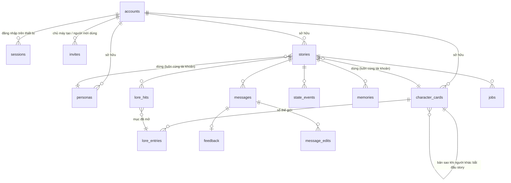

# Phase 4b: Đăng nhập và nhiều tài khoản

Mục tiêu (plan.md §10, Phase 4b): Lyris trên máy Mac có đăng nhập. Bạn là **chủ máy**; người khác chỉ tạo được tài khoản bằng **mã mời** do bạn tạo. Mỗi tài khoản có persona, nhân vật, story riêng. Nhân vật có thể bật "Công khai" để tài khoản khác thấy và bắt đầu story riêng với nhân vật đó.

Làm ngay sau Phase 4. Phase 2c (`docs/accounts.md`) đã chuẩn bị: bảng `accounts`, cột `account_id` trên persona/card/story, `visibility` trên card, và dependency `current_account` trong `backend/lyris/api/deps.py` là chỗ duy nhất quyết định ai đang dùng app. Phase này thay phần thân của `current_account` và rà lại từng route.

Quyết định của người dùng (2026-11-14, đã chốt):
1. **Tạo tài khoản cần mã mời.** Tài khoản đầu tiên (id nhỏ nhất, hiện là `@strawber`, sở hữu mọi dữ liệu hiện có) thành **chủ máy**. Chủ máy tạo mã mời; người khác nhập mã ở trang tạo tài khoản. Người lạ cùng Wi-Fi hay cùng Tailscale không tự tạo được tài khoản.
2. **Chia sẻ:** story, persona, ký ức, state, lore đã mở trong story **luôn riêng tư** với tài khoản của nó. Nhân vật mặc định riêng tư; chủ nhân vật bật được "Công khai" để tài khoản khác thấy nó ở Khám phá, xem hồ sơ chỉ đọc và bắt đầu story **của họ** với nó (không sửa được). Nhân vật mẫu vẫn dùng chung cho mọi người.
3. **Quên mật khẩu:** chủ máy đặt lại từ trang "Quản lý tài khoản" (mật khẩu tạm, người dùng phải đổi ở lần đăng nhập sau). Chủ máy quên mật khẩu của chính mình thì chạy một lệnh trên Mac.

## 0. Ràng buộc

- Không cài thêm thư viện. Băm mật khẩu bằng `hashlib.scrypt`, sinh mã bằng `secrets`, so sánh bằng `hmac.compare_digest`. Đã kiểm tra `backend/.venv`: không có `argon2`, `bcrypt`, `passlib`, `itsdangerous`, và không cần.
- Backend vẫn chỉ nghe ở `127.0.0.1:8000`. Điện thoại vào qua Vite `:5173` (LAN) hoặc Tailscale Serve (Phase 6). Mọi thứ dưới đây phải đúng khi đứng sau proxy.
- Một máy, một Ollama, một file SQLite. Mỗi tài khoản không có model riêng.
- **Giới hạn thật của "riêng tư":** app không cho tài khoản này đọc dữ liệu của tài khoản khác, kể cả chủ máy (trang Quản lý tài khoản không mở được story của người khác). Nhưng ai giữ máy Mac thì đọc được file `data/lyris.db`. Trang tạo tài khoản nói thẳng điều này (§7.3). Mã hoá dữ liệu theo từng tài khoản không nằm trong phase này.
- Dữ liệu train (Phase 5) chỉ lấy từ tài khoản đã đồng ý (`training_opt_in`, mặc định chỉ chủ máy).

## 1. Khái niệm

### 1.1 Vai trò

| | Chủ máy (`owner`) | Thành viên (`member`) |
|---|---|---|
| Là ai | Tài khoản id nhỏ nhất. Đúng **một** chủ máy (index unique). | Người được mời |
| Tạo bằng cách nào | Có sẵn (migration). Đặt mật khẩu lần đầu bằng mã thiết lập (§2.4) | Mã mời + trang tạo tài khoản |
| Persona, nhân vật, story của mình | Có | Có |
| Đọc story/persona/ký ức của người khác | **Không** | Không |
| Thấy nhân vật công khai của người khác | Có | Có |
| Tạo/huỷ mã mời, xem danh sách tài khoản | Có | Không |
| Đặt lại mật khẩu, tạm khoá / mở khoá người khác | Có (không áp lên chính mình) | Không |
| Đổi model mặc định, xem thông tin máy (RAM, Ollama...) | Có | Không |
| Đổi model của từng story | Có | Không (story của thành viên dùng model mặc định) |

Không có API đổi vai trò ở phase này. Chuyển quyền chủ máy (nếu cần) làm bằng lệnh trên Mac về sau.

Lý do khoá model và thông tin máy cho chủ máy: nạp model thứ hai trên máy 24GB đẩy model chat ra khỏi RAM, làm chậm mọi người; thông tin máy là phần kỹ thuật, chỉ người giữ máy cần.

### 1.2 Trạng thái tài khoản

Hai trường độc lập:
- `status`: `active` (dùng bình thường) hoặc `disabled` (tạm khoá: không đăng nhập được, mọi phiên bị xoá, nhân vật công khai ẩn khỏi Khám phá). Dữ liệu giữ nguyên. Chủ máy không tự khoá được mình.
- `must_change_password`: 1 khi đang dùng mật khẩu tạm (do chủ máy hoặc lệnh trên Mac đặt). Đăng nhập được, nhưng mọi API trừ `/api/auth/me`, `/api/auth/change-password`, `/api/auth/logout` trả 403 cho tới khi đổi mật khẩu. Mật khẩu tạm hết hạn sau 72 giờ (`password_expires_at`). Hạn này **chỉ xét lúc đăng nhập**: người đã đăng nhập bằng mật khẩu tạm rồi bỏ dở màn đổi mật khẩu, quay lại sau 72 giờ với phiên còn sống, vẫn đổi được bằng chính mật khẩu tạm đó (không bị kẹt giữa "phải đổi" và "mật khẩu tạm hết hạn").

Tách hai trường vì chúng đi cùng nhau được: một tài khoản đang bị khoá vẫn có thể đang chờ đổi mật khẩu; mở khoá xong vẫn phải đổi.

Một tài khoản chưa có mật khẩu (`password_hash` NULL) không đăng nhập được. Chỉ chủ máy rơi vào trường hợp này, ngay sau khi nâng cấp (§2.4).

### 1.3 Mã mời

- Chủ máy tạo; mỗi mã dùng **một lần**, hết hạn sau 1, 7 (mặc định) hoặc 30 ngày, huỷ được khi chưa dùng.
- Dạng `LYR-7KQ2-M9XD-4TPA`: 12 ký tự Crockford base32 (bỏ I, L, O, U), 60 bit ngẫu nhiên từ `secrets`. Khi nhập: bỏ khoảng trắng, gạch, tiền tố `LYR`, viết hoa, đổi `O→0`, `I/L→1`.
- DB chỉ lưu `sha256` của mã đã chuẩn hoá, kèm 4 ký tự cuối (`code_hint`) để chủ máy nhận ra. Mã đầy đủ chỉ hiện **một lần** lúc tạo (có nút sao chép). Quên mã thì huỷ và tạo mã mới.
- Có thêm "Sao chép liên kết": `http://<máy>:5173/#/signup?code=LYR-...`. Mã nằm sau `#` nên không gửi lên máy chủ, không vào log. Trang tạo tài khoản đọc mã vào ô "Mã mời" rồi `history.replaceState` về `#/signup` ngay, để mã không nằm lại trên thanh địa chỉ (ảnh chụp màn hình) và trong lịch sử trình duyệt.

### 1.4 Phiên đăng nhập

- Đăng nhập thành công: server sinh token 32 byte (`secrets.token_urlsafe(32)`), gửi trong cookie `lyris_session`, chỉ lưu `sha256(token)` trong bảng `sessions`. Lộ file DB không lộ được phiên đang sống.
- Hạn **trượt 30 ngày**: mỗi request hợp lệ mà `last_seen_at` cũ hơn 1 giờ thì cập nhật `last_seen_at`, `expires_at = now + 30 ngày` và gửi lại cookie. Ghi DB tối đa mỗi giờ một lần mỗi phiên. Hạn tuyệt đối 180 ngày từ `created_at`, sau đó phải đăng nhập lại.
- Đăng nhập (hoặc tạo tài khoản, thiết lập chủ máy) mà request đang mang một cookie `lyris_session` cũ thì xoá luôn dòng phiên của cookie đó trước khi cấp token mới (không để phiên cũ hay phiên bị cài sẵn còn sống song song).
- Mỗi tài khoản tối đa 20 phiên; quá thì xoá phiên có `last_seen_at` cũ nhất. Chặn bảng `sessions` phình ra khi có script đăng nhập lặp lại.
- Mỗi thiết bị một phiên. Xoá phiên khi: đăng xuất (phiên đó), "Đăng xuất mọi thiết bị" (mọi phiên của tài khoản), đổi mật khẩu (mọi phiên khác, phiên hiện tại được cấp token mới), chủ máy đặt lại mật khẩu hoặc tạm khoá (mọi phiên của người đó).
- Phiên hết hạn được xoá khi app khởi động và mỗi giờ một lần (cùng vòng dọn `auth_attempts`).

## 2. Cơ sở dữ liệu

### 2.1 Migration `0008_auth.sql`

Chỉ thêm cột và bảng, không xoá dữ liệu. Chạy trong một transaction như các migration trước (`db/connection.py`). Đã chạy thử nguyên văn khối SQL dưới đây trên một DB tạm dựng tới version 7 (2026-11-14): số dòng các bảng cũ giữ nguyên, `foreign_key_check` rỗng, `integrity_check` ok, persona mặc định chuyển sang chủ máy, card `unlisted` thành `private`, thêm chủ máy thứ hai bị index unique chặn. Sau phản biện chạy lại bản có thêm khối "lưới an toàn `account_id`" và cột `auth_attempts.device_hash` (SQLite 3.54.1, DB tạm có một persona `account_id` NULL làm persona mặc định): persona đó về chủ máy rồi được chuyển thành `default_persona_id`; số dòng chỉ khác ở `app_settings` (bớt đúng khoá `default_persona_id`); khoá ngoại và toàn vẹn vẫn ổn.

```sql
-- Phase 4b (docs/auth.md): đăng nhập, mã mời, vai trò, nhân vật công khai cho tài khoản khác.
-- Account id nhỏ nhất (chủ mọi dữ liệu hiện có) thành chủ máy. Không xoá dữ liệu nào.

-- 1. Tài khoản: vai trò, trạng thái, mật khẩu (scrypt), cài đặt riêng.
ALTER TABLE accounts ADD COLUMN role TEXT NOT NULL DEFAULT 'member'
    CHECK (role IN ('owner', 'member'));
ALTER TABLE accounts ADD COLUMN status TEXT NOT NULL DEFAULT 'active'
    CHECK (status IN ('active', 'disabled'));
ALTER TABLE accounts ADD COLUMN must_change_password INTEGER NOT NULL DEFAULT 0
    CHECK (must_change_password IN (0, 1));
-- NULL cả nhóm = chưa có mật khẩu. Có mật khẩu thì đủ cả 5 trường (kiểm ở code, SQLite không thêm
-- được CHECK nhiều cột bằng ALTER). Tham số scrypt lưu theo từng dòng để nâng dần khi đăng nhập.
ALTER TABLE accounts ADD COLUMN password_salt BLOB;          -- 16 byte ngẫu nhiên
ALTER TABLE accounts ADD COLUMN password_hash BLOB;          -- scrypt, 32 byte
ALTER TABLE accounts ADD COLUMN scrypt_n INTEGER;            -- 131072 (2^17)
ALTER TABLE accounts ADD COLUMN scrypt_r INTEGER;            -- 8
ALTER TABLE accounts ADD COLUMN scrypt_p INTEGER;            -- 1
ALTER TABLE accounts ADD COLUMN password_changed_at TEXT;
ALTER TABLE accounts ADD COLUMN password_expires_at TEXT;    -- chỉ mật khẩu tạm (72 giờ); NULL = không hết hạn
ALTER TABLE accounts ADD COLUMN last_login_at TEXT;
ALTER TABLE accounts ADD COLUMN disabled_at TEXT;
ALTER TABLE accounts ADD COLUMN invited_by INTEGER REFERENCES accounts(id) ON DELETE SET NULL;
-- Persona mặc định cho story mới: trước nằm trong app_settings (chung cả máy), giờ theo tài khoản.
ALTER TABLE accounts ADD COLUMN default_persona_id INTEGER REFERENCES personas(id) ON DELETE SET NULL;
-- Phase 5 chỉ lấy dữ liệu train từ tài khoản có cờ này. Thành viên mặc định 0.
ALTER TABLE accounts ADD COLUMN training_opt_in INTEGER NOT NULL DEFAULT 0
    CHECK (training_opt_in IN (0, 1));

UPDATE accounts SET role = 'owner', training_opt_in = 1 WHERE id = (SELECT MIN(id) FROM accounts);
CREATE UNIQUE INDEX idx_accounts_one_owner ON accounts (role) WHERE role = 'owner';

-- Lưới an toàn: cột account_id thêm ở 0005 cho phép NULL. Dòng NULL (không nên có) thì giao cho chủ máy,
-- để sau phase này không còn dòng "không của ai" mà `(? IS NULL OR account_id = ?)` cũ lỡ trả ra.
UPDATE personas        SET account_id = (SELECT id FROM accounts WHERE role = 'owner') WHERE account_id IS NULL;
UPDATE character_cards SET account_id = (SELECT id FROM accounts WHERE role = 'owner') WHERE account_id IS NULL;
UPDATE stories         SET account_id = (SELECT id FROM accounts WHERE role = 'owner') WHERE account_id IS NULL;

-- Chuyển persona mặc định của máy sang chủ máy (chỉ khi persona đó thuộc chủ máy), rồi bỏ khoá cũ.
UPDATE accounts
   SET default_persona_id = (
         SELECT p.id
           FROM app_settings s
           JOIN personas p ON json_valid(s.value_json)
                          AND json_type(s.value_json) = 'integer'
                          AND p.id = json_extract(s.value_json, '$')
          WHERE s.key = 'default_persona_id' AND p.account_id = accounts.id)
 WHERE role = 'owner';
DELETE FROM app_settings WHERE key = 'default_persona_id';

-- 2. Phiên đăng nhập. Token thật chỉ nằm trong cookie của trình duyệt.
CREATE TABLE sessions (
    id           INTEGER PRIMARY KEY,
    account_id   INTEGER NOT NULL REFERENCES accounts(id) ON DELETE CASCADE,
    token_hash   BLOB NOT NULL UNIQUE,         -- sha256(token), 32 byte
    created_at   TEXT NOT NULL,
    last_seen_at TEXT NOT NULL,
    expires_at   TEXT NOT NULL,                -- trượt: last_seen_at + 30 ngày, không quá created_at + 180 ngày
    device_label TEXT NOT NULL DEFAULT '',     -- "Safari · iPhone", rút gọn từ User-Agent, <= 60 ký tự
    ip           TEXT NOT NULL DEFAULT ''      -- IP lúc đăng nhập (sau proxy tin cậy, §3.7)
);
CREATE INDEX idx_sessions_account ON sessions (account_id);
CREATE INDEX idx_sessions_expires ON sessions (expires_at);

-- 3. Mã mời. Chỉ lưu hash; mã đầy đủ hiện một lần lúc tạo.
CREATE TABLE invites (
    id          INTEGER PRIMARY KEY,
    code_hash   BLOB NOT NULL UNIQUE,          -- sha256 của mã đã chuẩn hoá (12 ký tự base32)
    code_hint   TEXT NOT NULL,                 -- 4 ký tự cuối, ví dụ "4TPA"
    note        TEXT NOT NULL DEFAULT '',      -- chủ máy ghi "cho Mai", <= 60 ký tự
    created_by  INTEGER NOT NULL REFERENCES accounts(id),
    created_at  TEXT NOT NULL,
    expires_at  TEXT NOT NULL,
    max_uses    INTEGER NOT NULL DEFAULT 1 CHECK (max_uses = 1),
    used_by     INTEGER REFERENCES accounts(id) ON DELETE SET NULL,
    used_at     TEXT,                          -- khác NULL = đã dùng
    revoked_at  TEXT                           -- khác NULL = đã huỷ
);
CREATE INDEX idx_invites_created ON invites (created_at);

-- 4. Lần thử đăng nhập / thiết lập / tạo tài khoản / đổi mật khẩu, để giới hạn thử sai (§3.4).
-- Giữ 30 ngày. `handle` là chữ người dùng gõ (đã chuẩn hoá), có thể không phải tài khoản thật.
CREATE TABLE auth_attempts (
    id         INTEGER PRIMARY KEY,
    kind       TEXT NOT NULL CHECK (kind IN ('login', 'setup', 'signup', 'change_password')),
    handle     TEXT COLLATE NOCASE,
    ip         TEXT NOT NULL,
    ok         INTEGER NOT NULL CHECK (ok IN (0, 1)),
    device_hash BLOB,                          -- sha256 của cookie thiết bị (§3.4), chỉ ghi ở lần đúng
    created_at TEXT NOT NULL
);
CREATE INDEX idx_auth_attempts_handle ON auth_attempts (kind, handle, created_at);
CREATE INDEX idx_auth_attempts_ip ON auth_attempts (kind, ip, created_at);
CREATE INDEX idx_auth_attempts_device ON auth_attempts (device_hash) WHERE device_hash IS NOT NULL;

-- 5. Nhân vật công khai dùng ở tài khoản khác: bản sao chụp lúc bắt đầu story (§4.3).
ALTER TABLE character_cards ADD COLUMN story_copy INTEGER NOT NULL DEFAULT 0
    CHECK (story_copy IN (0, 1));
ALTER TABLE character_cards ADD COLUMN origin_card_id INTEGER
    REFERENCES character_cards(id) ON DELETE SET NULL;       -- card gốc; NULL khi gốc đã bị xoá
ALTER TABLE character_cards ADD COLUMN origin_account_id INTEGER
    REFERENCES accounts(id) ON DELETE SET NULL;              -- người tạo gốc, để ghi "bởi @handle"
ALTER TABLE character_cards ADD COLUMN origin_updated_at TEXT; -- phiên bản của gốc lúc chụp
CREATE INDEX idx_cards_origin ON character_cards (origin_card_id);
CREATE INDEX idx_cards_visibility ON character_cards (visibility, story_copy);

-- Giao diện chỉ có Riêng tư / Công khai. 'unlisted' chưa từng được đặt từ giao diện; đưa về private để
-- không card nào lộ ra ngoài ý muốn khi có tài khoản thứ hai.
UPDATE character_cards SET visibility = 'private' WHERE visibility = 'unlisted';
```

Không đổi: `stories`, `messages`, `feedback`, `message_edits`, `state_events`, `memories`, `jobs`, `lore_entries`, `lore_hits`. Chúng đã thuộc về một tài khoản qua `stories.account_id` hoặc `character_cards.account_id`.

`app_settings` còn lại là cài đặt **của máy**: `default_chat_model` (chỉ chủ máy đổi), các cờ nội bộ, và `owner_setup` (§2.4).

Mã thiết lập chủ máy không cần bảng: hash và hạn của nó nằm trong `app_settings` khoá `owner_setup` (`{"hash": "<sha256 hex>", "expires_at": "..."}`), xoá ngay khi dùng xong.

### 2.2 Bảng nào thuộc về ai



Cùng sơ đồ ở dạng chữ:

```
accounts (chủ máy | thành viên)
├── sessions            phiên đăng nhập (một dòng mỗi thiết bị)
├── invites             mã mời chủ máy đã tạo (created_by) / mã người này đã dùng (used_by)
├── personas            RIÊNG TƯ
├── character_cards     riêng tư hoặc CÔNG KHAI (visibility)
│   ├── lore_entries    sổ thế giới: chỉ người tạo đọc toàn bộ
│   └── (story_copy=1)  bản sao của card công khai người khác, thuộc tài khoản đã bắt đầu story
└── stories             RIÊNG TƯ; card_id và persona_id luôn trỏ tới card/persona của CHÍNH tài khoản này
    ├── messages ── feedback, message_edits
    ├── state_events, memories (+ memories_fts)
    ├── lore_hits ── lore_entries của card của story
    └── jobs
app_settings            của máy: model mặc định, cờ nội bộ, mã thiết lập chủ máy
auth_attempts           nhật ký thử đăng nhập (theo handle đã gõ + IP), giữ 30 ngày
```

Bất biến quan trọng nhất của phase này: **mọi story chỉ trỏ tới card và persona cùng tài khoản**. Nhân vật công khai của người khác được chụp thành một card `story_copy` của chính người chơi (§4.3). Nhờ vậy mọi truy vấn hiện có vẫn đúng: xoá card chỉ đụng story của người xoá, `lore_hits` luôn trỏ vào sổ thế giới cùng tài khoản, đổi sổ thế giới chỉ hẹn prefill lại story của chính người sửa.

### 2.3 Dữ liệu nào riêng, dữ liệu nào công khai

| Dữ liệu | Thuộc về | Tài khoản khác thấy gì |
|---|---|---|
| Tên hiển thị, @handle, avatar, ảnh bìa, giới thiệu | tài khoản | Có (trang `#/u/<handle>`, "bởi @handle") |
| Persona (và avatar) | tài khoản | Không |
| Story, tin nhắn, đánh giá, bản sửa, prompt snapshot | tài khoản (qua story) | Không. App không trả số lượng; nhưng id tăng dần dùng chung cả máy, nên người tạo story mới đoán được đại khái cả máy đã có bao nhiêu story/tin nhắn (không biết của ai). Chấp nhận |
| Ký ức, fact, cảm xúc, cảnh, gợi ý, dòng thời gian | story | Không |
| Lore đã mở trong story (`lore_hits`) | story | Không |
| Nhân vật riêng tư | tài khoản | Không |
| Nhân vật công khai | người tạo | Hồ sơ công khai (trường trong §4.4), avatar, tên người, nơi chốn mọi người biết (teaser Phase 4). **Không** thấy bí mật, mục tiêu, sổ thế giới, ghi chú người tạo, số story |
| Bản sao `story_copy` | người đã bắt đầu story | Không (không liệt kê ở đâu) |
| Nhân vật mẫu | file trong repo, chung | Mọi người; cài mẫu tạo card riêng của người cài |
| Cài đặt máy, model, RAM | máy | Chỉ chủ máy |
| Danh sách tài khoản, mã mời | máy | Chỉ chủ máy |
| Phiên đăng nhập | tài khoản | Không |

### 2.4 Chủ máy đặt mật khẩu lần đầu (không phải "ai mở trang trước thì thắng")

Sau migration, chủ máy chưa có mật khẩu. Nếu trang thiết lập chỉ cần mật khẩu mới thì bất kỳ ai trên Wi-Fi mở trang trước bạn sẽ chiếm được tài khoản chủ máy cùng toàn bộ dữ liệu. Vì vậy:

1. Mỗi lần backend khởi động mà chủ máy chưa có mật khẩu: sinh **mã thiết lập** 12 ký tự base32 (60 bit, dạng `7KQ2-M9XD-4TPA`), lưu `sha256` và hạn 24 giờ vào `app_settings.owner_setup` (ghi đè mã cũ), rồi in ra **stderr** của tiến trình (cửa sổ Terminal đang chạy `scripts/dev.sh`), dùng `print(..., file=sys.stderr, flush=True)` chứ không qua `logging` (uvicorn không cấu hình logger `lyris`, và mã không được vào file log nào):

   ```
   ────────────────────────────────────────────────────────
    Lyris: đặt mật khẩu cho tài khoản chủ máy
    Mở http://localhost:5173 trên Mac này và nhập mã thiết lập:

        7KQ2-M9XD-4TPA

    Mã dùng một lần. Mỗi lần Lyris khởi động lại sẽ có mã mới.
   ────────────────────────────────────────────────────────
   ```
   Với `uvicorn --reload`, mỗi lần nạp lại code in một mã mới; mã in sau cùng là mã đúng.
2. Trong lúc đó, mọi API trừ `/api/auth/me` và `/api/auth/setup-owner` trả 409 `setup_required`. Giao diện hiện trang thiết lập. "Chủ máy chưa có mật khẩu" đọc từ DB ở mỗi request (một câu có index), **không cache trong bộ nhớ**, để lệnh trên Mac (`reset-password`, `setup-code`) có hiệu lực ngay khi app đang chạy.
3. `POST /api/auth/setup-owner {setup_code, password, display_name?, handle?}` đúng mã thì đặt mật khẩu, xoá `owner_setup`, tạo phiên. Băm mật khẩu **trước**, rồi trong một transaction: `UPDATE accounts SET password_... WHERE role = 'owner' AND password_hash IS NULL`, kiểm `rowcount = 1`, xoá `owner_setup`. Hai request đúng mã cùng lúc thì chỉ một cái thắng, cái sau nhận 409. `display_name`/`handle` chỉ nhận khi `profile_completed = 0` (DB mới tinh, handle mặc định `ban`); với DB của bạn (`@strawber` đã đặt tên) trang không hỏi. Trang biết có cần hỏi hay không nhờ `AuthState.setup_needs_profile` (§6.2), không cần biết handle của chủ máy.
4. Sai mã: giới hạn theo IP như §3.4 (`kind = 'setup'`). **Không** huỷ mã khi sai nhiều và không có ngưỡng chung cho cả máy: bản trước "sai 20 lần thì huỷ mã" cho phép bất kỳ ai trên Wi-Fi gõ bừa 20 lần để huỷ mã mãi, chủ máy không thiết lập được. Mã 60 bit với 5 lần thử mỗi 15 phút mỗi IP thì không đoán được, nên không cần huỷ.
5. Có mật khẩu rồi thì `setup-owner` luôn trả 409 "Lyris đã được thiết lập. Hãy đăng nhập."

Lệnh trên Mac (`backend/lyris/auth/cli.py`, gọi qua `scripts/lyris-admin.sh`), dùng khi không thấy mã hoặc chủ máy quên mật khẩu. Lệnh mở thẳng DB (SQLite WAL, chạy được khi app đang chạy), từ chối nếu DB chưa ở version 8 ("Hãy chạy Lyris một lần để cập nhật dữ liệu"):

```
bash scripts/lyris-admin.sh setup-code              # in mã thiết lập mới (khi chủ máy chưa có mật khẩu)
bash scripts/lyris-admin.sh reset-password strawber # đặt mật khẩu tạm, in ra, buộc đổi, xoá mọi phiên
bash scripts/lyris-admin.sh enable <handle>         # mở khoá tài khoản
bash scripts/lyris-admin.sh list                    # handle, vai trò, trạng thái, lần đăng nhập cuối
```

Ai chạy được lệnh trên Mac thì đã giữ máy và file DB, nên lệnh không hỏi thêm mật khẩu.

### 2.5 Một request tìm ra tài khoản như thế nào

```
Trình duyệt (cookie lyris_session=<token>)
  │  POST /api/stories/12/messages   header X-Lyris: 1, Origin: http://192.168.1.5:5173
  ▼
Vite :5173 (proxy /api, thêm X-Forwarded-For)  ──►  uvicorn 127.0.0.1:8000 (--no-proxy-headers)
  ▼
0. client_ip(): peer là 127.0.0.1 thì lấy phần tử CUỐI của X-Forwarded-For (do Vite thêm), không thì peer (§3.7)
1. Chặn CSRF (middleware, chỉ method ghi): thiếu X-Lyris, Origin khác Host,
   hoặc Sec-Fetch-Site = cross-site  →  403 csrf
2. current_account (dependency, mọi route trừ danh sách mở ở §6.1):
   ├─ chủ máy chưa có mật khẩu              → 409 setup_required
   ├─ không có cookie / sha256(token) không có trong sessions / đã hết hạn
   │                                         → 401 auth_required (xoá cookie)
   ├─ accounts.status = 'disabled'           → xoá phiên, 401 auth_required
   ├─ must_change_password và route không thuộc nhóm đổi mật khẩu
   │                                         → 403 password_change_required
   └─ last_seen_at cũ hơn 1 giờ             → gia hạn, gửi lại cookie
3. Route: repo.get_story(12, account_id=A)  → story của người khác: 404 (như hiện nay)
4. ChatService: khoá story + cổng sinh chung (§5) → Ollama
```

`current_account` vẫn là chỗ duy nhất quyết định ai đang dùng app. Thêm hai dependency dựa trên nó: `OwnerAccount` (403 `owner_only` nếu không phải chủ máy) và `PendingAccount` (cho phép `must_change_password`, chỉ dùng ở `me`, `change-password`, `logout`).

**Mặc định là cấm:** auth gắn ở cấp router (`APIRouter(dependencies=[Depends(current_account)])`) cho mọi router hiện có, router auth riêng có danh sách route mở. Một test duyệt mọi route để chắc chúng đều nằm trong bảng §4.1 (route mới chưa xếp loại thì test đỏ). Lưu ý khi viết test: với FastAPI 0.162 trong `backend/.venv`, `app.routes` chứa đối tượng `_IncludedRouter` (không có `.path`), nên duyệt `app.openapi()["paths"]` (đã thử: ra đúng 70 cặp method/path) hoặc đi sâu vào router con; đừng chỉ lặp `app.routes` cấp ngoài cùng rồi tưởng là đủ.

FastAPI còn tự thêm `/openapi.json`, `/docs`, `/docs/oauth2-redirect`, `/redoc` ngoài `/api`, nên không qua router nào có auth. Hiện Vite chỉ proxy `/api` nên LAN không thấy, nhưng nếu sau này FastAPI tự phục vụ bản build (§3.8) thì chúng lộ toàn bộ danh sách route. Phase này tạo app với `openapi_url=None, docs_url=None, redoc_url=None` (test vẫn gọi `app.openapi()` được).

## 3. Bảo mật

### 3.1 Mật khẩu

- Luật: 8 đến 128 ký tự sau khi chuẩn hoá Unicode NFC; không trùng handle; không nằm trong danh sách ngắn mật khẩu phổ biến (`lyris/auth/common_passwords.txt`, khoảng 200 dòng, gồm cả kiểu Việt như `matkhau123`, `anhyeuem`, `12345678`). Không bắt buộc chữ hoa, số, ký tự đặc biệt. Cho phép dấu tiếng Việt và khoảng trắng; không cắt khoảng trắng.
- Chuẩn hoá NFC trước khi băm: bàn phím iPhone và Mac có thể sinh hai dạng Unicode khác nhau cho cùng một chữ có dấu; không chuẩn hoá thì mật khẩu đặt trên Mac sẽ sai trên iPhone.
- Băm: `hashlib.scrypt(password_nfc.encode(), salt=os.urandom(16), n=2**17, r=8, p=1, maxmem=256 * 1024 * 1024, dklen=32)`. Đây là mức tối thiểu OWASP khuyên cho scrypt; mỗi lần băm dùng 128 MiB RAM.
  - Chạy trong thread (`anyio.to_thread.run_sync`), tối đa 2 lần băm cùng lúc (semaphore), nên đỉnh 256 MiB, không chặn event loop đang stream chat.
  - Không bao giờ băm khi đang giữ khoá của `Repo` hay đang mở transaction: `Repo` dùng một kết nối SQLite và một khoá cho cả app, giữ khoá 0,27 giây là mọi request khác (kể cả stream chat đang ghi tin) phải đứng chờ. Thứ tự: đọc dòng tài khoản → nhả khoá → băm/so sánh → mới mở transaction để ghi (đăng nhập, tạo tài khoản, thiết lập, đổi mật khẩu).
  - Đã đo trên máy này (2026-11-14, lúc không chạy model): `2**17` mất 0.27 giây, `2**16` mất 0.14 giây. Đo lại khi model đang nạp; nếu quá 0.5 giây thì hạ `n` xuống `2**16` và ghi lại lý do ở cuối file này. Tham số lưu theo từng dòng, nên đăng nhập thành công với tham số cũ thì băm lại bằng tham số mới.
- So sánh bằng `hmac.compare_digest`. Handle không tồn tại vẫn chạy một lần scrypt với salt giả, để thời gian trả lời không cho biết handle có hay không.

### 3.2 Cookie phiên

| Thuộc tính | Giá trị | Lý do |
|---|---|---|
| Tên | `lyris_session` (khi Secure: `__Host-lyris_session`) | Tiền tố `__Host-` bắt buộc Secure, Path=/, không Domain |
| `HttpOnly` | có | JavaScript không đọc được token |
| `SameSite` | `Lax` | Chặn gửi cookie trong request ghi từ trang khác; `Strict` sẽ làm liên kết mời mở từ Tin nhắn bị coi như chưa đăng nhập |
| `Secure` | có khi request là HTTPS (Tailscale Serve, `X-Forwarded-Proto: https` từ proxy tin cậy) hoặc `LYRIS_COOKIE_SECURE=1` | Qua LAN `http://` thì không đặt được Secure, nếu không trình duyệt bỏ cookie |
| `Path` | `/` | |
| `Max-Age` | thời gian còn lại tới `expires_at` | Gửi lại mỗi lần gia hạn |

Token không bao giờ nằm trong URL. Stream chat là `fetch` POST (không phải `EventSource`) và ảnh là `` cùng origin, nên cookie tự đi kèm.

Cookie không phân biệt cổng: cookie đặt cho `localhost` cũng được trình duyệt gửi tới mọi dịch vụ khác đang chạy ở `localhost:<cổng khác>` trên Mac. Chấp nhận (tiến trình trên Mac đã đọc được file DB), nhưng là thêm một lý do để không bao giờ để token trong log.

Cache trình duyệt (quan trọng khi hai người dùng chung một máy, ví dụ iPad trong nhà):
- Mọi response JSON dưới `/api` có `Cache-Control: no-store` (middleware, chỉ đặt khi route chưa tự đặt). Đặc biệt `auth/me`, mã mời vừa tạo, mật khẩu tạm.
- Ảnh cần đăng nhập (avatar card, persona, tài khoản) đổi từ `public, max-age=31536000, immutable` (hiện ở `image_file_response`) sang `private, max-age=31536000, immutable`. Ảnh nhân vật mẫu giữ `public`.
- Cookie thiết bị `lyris_device` (khi Secure: `__Host-lyris_device`): 32 byte ngẫu nhiên, HttpOnly, SameSite=Lax, Max-Age 1 năm, đặt ở lần đăng nhập đúng đầu tiên trên trình duyệt đó và **giữ lại khi đăng xuất**. DB chỉ có sha256 của nó trong `auth_attempts.device_hash` (dòng đăng nhập đúng). Nó không đăng nhập được gì; chỉ để giới hạn thử sai nhận ra "trình duyệt này từng đăng nhập đúng tài khoản này" (§3.4).

Cấp token mới mỗi lần đăng nhập, đặt mật khẩu lần đầu, tạo tài khoản, đổi mật khẩu. Xoá phiên như §1.4. Stream đang chạy khi phiên bị xoá vẫn chạy hết lượt đó; request sau bị 401.

### 3.3 Chặn CSRF

Cookie tự gửi kèm nên phải chặn trang khác gửi request ghi thay người dùng. `SameSite=Lax` chưa đủ: `http://192.168.1.5:8080` (một dịch vụ khác trên cùng máy) được coi là **cùng site** với `:5173`.

Middleware cho mọi method không phải GET/HEAD/OPTIONS dưới `/api`:
1. Bắt buộc header `X-Lyris: 1`. Trang khác chỉ gửi được header tuỳ ý qua CORS preflight, mà backend không cho origin nào khác (CORS giữ `allow_credentials=False`). `request()`, `upload()`, `streamChat()` trong `api/client.ts` luôn gửi header này (đã rà: frontend không có `fetch`, `sendBeacon`, `EventSource` hay `<form action>` nào đi ngoài `api/client.ts`). Frontend chỉ gọi `/api` tương đối qua Vite, nên `CORSMiddleware` (đang cho `localhost:5173`, `127.0.0.1:5173` gọi thẳng `:8000`) không còn cần; bỏ nó đi để bớt một đường vào.
2. Có `Origin` thì host:port của nó phải bằng header `Host` của request. Vite proxy giữ `Host` gốc vì không đặt `changeOrigin` (kiểm tra bằng test). Tailscale Serve có giữ `Host` hay không **chưa kiểm**; kiểm ở Phase 6. Nếu nó đổi `Host` thành `127.0.0.1:5173`, so `Origin` với `X-Forwarded-Host` mà Vite đặt (chỉ khi peer là 127.0.0.1), không nới luật.
3. `Sec-Fetch-Site: cross-site` thì từ chối.

DNS rebinding (một tên miền lạ trỏ về IP của Mac): khi đó `Origin` và `Host` cùng là tên miền lạ nên luật 2 không chặn. Thứ chặn là (a) cookie gắn với tên host, trang lạ không có cookie của bạn, và (b) Vite 8 từ chối `Host` không nằm trong `server.allowedHosts` (mặc định chỉ localhost và địa chỉ IP). Không bao giờ đặt `allowedHosts: true`; Phase 6 chỉ thêm đúng tên `*.ts.net` của Mac.

Sai: 403 `{detail: "Yêu cầu không hợp lệ. Hãy tải lại trang.", code: "csrf"}`. Login, signup, setup-owner cũng đi qua middleware này (chặn đăng nhập hộ vào tài khoản của kẻ tấn công).

Mọi route GET hiện có chỉ đọc (đã rà ở §4.1), nên GET không cần header này. Route GET mới không được ghi gì.

### 3.4 Giới hạn thử sai và khoá tạm

Ghi mỗi lần thử vào `auth_attempts`. IP là `client_ip()` của §3.7. Đếm lần sai trong cửa sổ thời gian:

| Khoá | Ngưỡng | Hệ quả |
|---|---|---|
| (handle, IP), `login` | 5 lần sai / 15 phút, kể từ lần đúng gần nhất của cặp đó | Chặn cặp đó 15 phút |
| IP, `login` | 30 lần sai / 15 phút, **không** được làm mới bởi lần đúng | Chặn IP 15 phút |
| handle (mọi IP), `login` | 50 lần sai / 1 giờ, kể từ lần đúng gần nhất của handle | Chặn handle 15 phút, **trừ** trình duyệt đã biết (dưới) |
| (handle, thiết bị đã biết), `login` | 5 lần sai / 15 phút | Chặn thiết bị đó 15 phút |
| IP, `signup` | 10 lần sai / 15 phút | Chặn 15 phút |
| IP, `setup` | 5 lần sai / 15 phút | Chặn IP 15 phút. Không huỷ mã (§2.4) |
| tài khoản, `change_password` | 5 lần sai mật khẩu hiện tại / 15 phút | Chặn 15 phút |

- Bị chặn: 429, header `Retry-After` (giây), `{detail: "Bạn đã thử sai nhiều lần. Hãy đợi 15 phút rồi thử lại.", code: "rate_limited"}`. Khi bị chặn thì không chạy scrypt và **không ghi thêm dòng** vào `auth_attempts` (không thì một vòng lặp gửi request làm bảng phình ra).
- Khoá theo IP không được làm mới bởi lần đúng: nếu được, một thành viên xen 1 lần đăng nhập đúng vào tài khoản của mình sau mỗi 29 lần đoán mật khẩu `@strawber` là thoát ngưỡng theo IP.
- **Trình duyệt đã biết:** request mang cookie `lyris_device` (§3.2) mà sha256 của nó có trong một dòng `login`/`ok = 1` của chính handle đó trong 30 ngày thì bỏ qua khoá theo IP và theo handle, chỉ còn khoá (handle, thiết bị). Lý do: bản trước để người trên Wi-Fi gõ sai 50 lần mỗi giờ là khoá được chủ máy ra ngoài mãi mãi, và chủ máy chạy `reset-password` xong vẫn bị khoá lại ngay. Kẻ tấn công không có cookie này nên vẫn chịu đủ mọi ngưỡng. Không dùng "IP 127.0.0.1 thì miễn": qua Tailscale Serve (Phase 6) mọi máy có thể cùng hiện là 127.0.0.1.
- Nếu vẫn bị khoá (trình duyệt mới, đã xoá dữ liệu trình duyệt), chủ máy dùng lệnh `reset-password` trên Mac (lệnh xoá các lần sai của handle đó).
- Cột `handle` chỉ ghi chữ đã gõ nếu nó đúng luật handle (chữ thường, số, `_`, `.`, độ dài như trang profile); không đúng luật thì ghi NULL và chỉ khoá theo IP. Người dùng hay gõ nhầm mật khẩu vào ô tên đăng nhập; không được để mật khẩu nằm trong DB hay log dưới dạng "handle".
- Dọn dòng cũ hơn 30 ngày khi khởi động và mỗi giờ.

### 3.5 Thông báo lỗi chung chung

- Đăng nhập sai handle hay sai mật khẩu đều là "Tên đăng nhập hoặc mật khẩu không đúng."
- "Tài khoản đang tạm khoá" và "Mật khẩu tạm đã hết hạn" chỉ hiện khi mật khẩu **đúng**, nên người không biết mật khẩu không dò được trạng thái tài khoản.
- Tạo tài khoản: kiểm mã mời **trước**. Mã sai, hết hạn, đã dùng hay đã huỷ đều là "Mã mời không đúng hoặc đã hết hạn." Chỉ khi mã đúng mới báo "handle đã có người dùng", để người lạ không dò được handle. Lỗi 422 (handle trùng, mật khẩu sai luật) rollback cả transaction nên mã **chưa bị dùng**; người được mời sửa rồi gửi lại với cùng mã.
- Mã mời và token phiên được tìm bằng `sha256` qua index, không so từng ký tự, nên thời gian trả lời không lộ mã đúng tới đâu.
- Thông báo lỗi tiếng Việt, không nhắc tới token, cookie, HTTP.

### 3.6 Ghi log gì

Logger `lyris.auth`, mức INFO. Lưu ý: uvicorn chỉ cấu hình logger `uvicorn.*`; logger `lyris.*` hiện không có handler nên dòng INFO bị bỏ (Python chỉ in WARNING trở lên qua handler dự phòng). Phase này gắn một `StreamHandler` ra stderr cho `lyris.auth` trong `create_app` (chỉ khi chưa có handler), nếu không mọi dòng dưới đây biến mất. Nhật ký bền vững là bảng `auth_attempts`; log chỉ để xem trong Terminal.
- đăng nhập đúng/sai (handle đã chuẩn hoá, IP, nhãn thiết bị), bị chặn, tạo tài khoản (handle, mã mời số mấy), tạo/huỷ mã mời (id, `code_hint`), đặt lại mật khẩu (ai đặt cho ai), khoá/mở khoá, đăng xuất mọi thiết bị, đổi mật khẩu.

**Không bao giờ** ghi: mật khẩu (kể cả mật khẩu tạm), token, header `Cookie`/`Set-Cookie`, mã mời đầy đủ, mã thiết lập (chỉ in ra stderr đúng một lần lúc khởi động, §2.4). Mật khẩu tạm chỉ có trong response của `reset-password` (hiện một lần) hoặc trong cửa sổ Terminal của lệnh trên Mac. Log truy cập của uvicorn có method, path và query string; không path hay query nào chứa bí mật (mã mời trong liên kết nằm sau `#`, frontend gửi nó trong body). Không log body của request `/api/auth/*`, kể cả khi lỗi; bộ xử lý 422 hiện chỉ in tên trường và loại lỗi, không in giá trị, giữ nguyên như vậy. "Handle" trong log theo cùng luật với `auth_attempts` (§3.4): chữ không đúng luật handle thì không ghi.

Log và Terminal không được chứa nội dung chat, persona hay card của ai (đã rà: các dòng log hiện có chỉ có id story/job/event). Chủ máy đọc được file DB, nhưng app không nên tự đưa nội dung của thành viên ra màn hình của chủ máy.

### 3.7 IP thật sau proxy

Rate limit theo IP cần IP thật, nhưng backend chỉ thấy `127.0.0.1` (Vite).
- `frontend/vite.config.ts`: thêm `xfwd: true` cho proxy `/api` (cả `server` và `preview`). Vite **nối** IP của người gửi vào cuối `X-Forwarded-For` (`"<giá trị client gửi>,<IP thật>"`) và tương tự với `X-Forwarded-Proto`.
- **Không dùng `proxy_headers` của uvicorn.** Đã thử `_TrustedHosts("127.0.0.1")` của uvicorn 0.54 trong `backend/.venv`: nó lấy phần tử không tin cậy đầu tiên tính từ phải. Với `"1.2.3.4,192.168.1.9"` ra đúng `192.168.1.9`; nhưng với `"1.2.3.4,127.0.0.1"` (request tới Vite từ chính Mac, hoặc từ Tailscale Serve nếu nó không thêm header) ra `1.2.3.4`, tức là IP giả do client tự gửi, và `"127.0.0.1,127.0.0.1"` ra `127.0.0.1`. Như vậy người dùng qua Tailscale có thể đổi "IP" mỗi request để né mọi ngưỡng theo IP, hoặc tự xưng là chính Mac.
- Thay vào đó: chạy uvicorn với `--no-proxy-headers`, và `lyris.auth.client_ip(request)` = nếu peer TCP là `127.0.0.1`/`::1` và có `X-Forwarded-For` thì lấy **phần tử cuối cùng** (phần Vite vừa nối, là địa chỉ thật của kết nối tới Vite), không thì lấy peer. Bỏ tiền tố `::ffff:` của IPv4 dạng IPv6. Client không giả được phần tử cuối.
- Hệ quả với Tailscale Serve (Phase 6): kết nối Tailscale → Vite đến từ 127.0.0.1, nên mọi máy qua Tailscale chung một IP `127.0.0.1` (cùng với trình duyệt trên Mac). Ngưỡng theo IP khi đó gộp chung, không phân biệt được; khoá theo handle và cookie thiết bị (§3.4) vẫn đúng. Nếu Phase 6 thấy cần phân biệt, cho Tailscale Serve trỏ thẳng vào một cổng riêng và đọc header của nó ở đó, đừng nới `client_ip`.
- HTTPS qua Tailscale → Vite: `X-Forwarded-Proto` tới backend sẽ là `"https,http"`; uvicorn bỏ qua giá trị này, nên backend không tự nhận ra HTTPS và sẽ không đặt `Secure`. Không đọc phần tử đầu để đoán HTTPS: điện thoại trên Wi-Fi cũng tự gửi được `X-Forwarded-Proto: https`. Phase 6 chọn một trong hai: đặt `LYRIS_COOKIE_SECURE=1` khi chỉ dùng qua Tailscale, hoặc cho Tailscale Serve vào một cổng riêng mà backend biết chắc là HTTPS. Kèm test.
- Tiến trình khác trên chính Mac gọi thẳng `127.0.0.1:8000` thì tự đặt được `X-Forwarded-For`. Chấp nhận: tiến trình trên Mac đã đọc được file DB.

### 3.8 LAN, Tailscale và chạy bản build

- Hiện tại: Vite nghe `0.0.0.0:5173` (LAN), backend `127.0.0.1:8000`. Sau phase này mọi `/api` cần đăng nhập; phần còn lại Vite phục vụ là mã giao diện, không có dữ liệu.
- **Chặn Vite đọc file ngoài `frontend/`:** Vite cho đọc file trong "workspace root" qua `/@fs/...`. Đã đọc `searchForWorkspaceRoot` của Vite 8.3.8: nó đi ngược lên **tới tận `/`** tìm `pnpm-workspace.yaml`, `lerna.json`, `package.json` có `workspaces`, hay `deno.json` có `workspace`; không thấy thì root là thư mục có `package.json` gần nhất (`frontend/`). `.git` không ảnh hưởng. Hiện không có file nào như vậy ở `/Users/hanghang/nora`, `/Users/hanghang`, `/Users`, `/` (đã kiểm), nên root là `frontend/`. Nhưng chỉ cần một `package.json` có `workspaces` ở gốc repo, **hay ở thư mục home** (một dự án Node khác), là root lan ra và `/@fs/Users/hanghang/nora/data/lyris.db` tải được từ LAN mà không cần đăng nhập. Phase này đặt cứng `server.fs.allow: [thư mục frontend]` và thêm `**/*.db`, `**/*.db-wal`, `**/data/**` vào `server.fs.deny`, kèm một test bằng `curl` trong checklist (§8.3).
- Qua LAN `http://`, mật khẩu đi qua Wi-Fi không mã hoá. Ở nhà thì chấp nhận; ra ngoài thì dùng Tailscale Serve (HTTPS, Phase 6). `dev.sh` in một dòng nhắc (§9.2).
- Nếu sau này FastAPI tự phục vụ bản build (`frontend/dist`) thay Vite: giữ backend ở `127.0.0.1`, đặt Tailscale Serve phía trước, giữ middleware CSRF, và xem lại `client_ip()` cho đúng chặng proxy mới. Không bind `0.0.0.0` khi `client_ip()` còn tin `X-Forwarded-For` từ 127.0.0.1.

## 4. Tách dữ liệu

### 4.1 Bảng rà từng route

Ký hiệu cột "Sau 4b":
- **Mở**: không cần đăng nhập.
- **Đ**: cần đăng nhập (tài khoản active, không đang chờ đổi mật khẩu).
- **Mình**: chỉ dữ liệu của tài khoản đang đăng nhập; của người khác trả 404 (không phải 403, để không lộ là có).
- **Công khai**: thêm card `visibility = 'public'`, `story_copy = 0`, người tạo đang active, của tài khoản khác.
- **Chủ**: chỉ chủ máy (403 `owner_only`).
- **Không bản sao**: card `story_copy = 1` coi như không có (404) ở route này.

Cột "Hôm nay" là cách route lọc trước phase này (đã đọc code 2026-11-14). 70 route hiện có:

| Method | Path | Hôm nay | Sau 4b |
|---|---|---|---|
| GET | /api/health | không lọc; trả danh sách model Ollama | Đ. Thành viên nhận `models: []`, `chat_model: ""`, và `ollama.error` chỉ là `null` hoặc một câu chung "Lyris chưa sẵn sàng." (câu hiện tại có tên model và lệnh `ollama pull`) |
| GET | /api/stories | lọc account | Đ, Mình |
| GET | /api/stories/defaults | card + persona lọc account | Đ. `card_id`: Mình (Không bản sao) hoặc Công khai, cùng luật với `POST /api/stories`; persona Mình |
| POST | /api/stories | card + persona lọc account | Đ. `card_id` Mình (không bản sao) hoặc Công khai → tạo bản sao (§4.3); persona Mình |
| GET | /api/stories/{id} | story lọc; card, persona đọc theo id | Đ, Mình. Story dùng bản sao: `card` là PublicCardView (§4.4), không phải card đầy đủ |
| PATCH | /api/stories/{id} | lọc | Đ, Mình. `model_name`: Chủ |
| DELETE | /api/stories/{id} | lọc | Đ, Mình. Card của story là bản sao và không còn story nào dùng thì xoá luôn bản sao (kèm sổ thế giới, file avatar); xem §4.3 cho mọi đường xoá story khác |
| GET | /api/stories/{id}/messages | lọc | Đ, Mình |
| POST | /api/stories/{id}/messages (SSE) | lọc | Đ, Mình; qua cổng sinh (§5) |
| POST | /api/stories/{id}/reply (SSE) | lọc | Đ, Mình; qua cổng sinh |
| POST | /api/messages/{id}/regenerate (SSE) | lọc qua story | Đ, Mình; qua cổng sinh |
| POST | /api/messages/{id}/variant | lọc qua story | Đ, Mình |
| PATCH | /api/messages/{id} | lọc qua story | Đ, Mình |
| DELETE | /api/messages/{id} | lọc qua story | Đ, Mình |
| PUT | /api/messages/{id}/feedback | lọc qua story | Đ, Mình |
| GET | /api/messages/{id}/snapshot | lọc qua story | Đ, Mình. Story dùng bản sao: 403 "Nhân vật này của người khác nên không xem được phần này." (snapshot chứa bí mật và sổ thế giới) |
| GET | /api/styles | không lọc (file chung) | Đ |
| GET | /api/cards | lọc account | Đ, Mình, Không bản sao |
| POST | /api/cards | gán account | Đ. `avatar_token` phải do chính tài khoản này giữ (§4.6) |
| POST | /api/cards/import | **không có account** | Đ. Token ảnh tạm gắn với tài khoản |
| POST | /api/cards/draft | **không có account**; khoá chung | Đ; qua cổng sinh; khoá viết nháp vẫn chung cả máy |
| POST | /api/cards/preview-prompt | persona lọc; sổ thế giới theo `card.id` nếu card của mình | Đ. Persona Mình; chỉ lấy sổ thế giới khi `card.id` là card Mình, Không bản sao |
| POST | /api/cards/test-chat (SSE) | như trên; khoá chung | Đ, như trên; qua cổng sinh |
| GET | /api/cards/{id} | lọc | Đ, Mình, Không bản sao (người khác dùng `/public`) |
| PUT | /api/cards/{id} | lọc | Đ, Mình, Không bản sao. Bật `public` cho card mẫu đã cài: 422 |
| DELETE | /api/cards/{id} | lọc card, nhưng **xoá mọi story có card_id đó, không lọc account** | Đ, Mình, Không bản sao. Nhờ bất biến §2.2 chỉ còn story của chính mình dùng card này; vẫn thêm `AND account_id = ?` vào câu xoá để chắc |
| POST | /api/cards/{id}/duplicate | lọc | Đ, Mình, Không bản sao |
| PUT | /api/cards/{id}/avatar | lọc | Đ, Mình, Không bản sao |
| DELETE | /api/cards/{id}/avatar | lọc | Đ, Mình, Không bản sao |
| GET | /api/cards/{id}/avatar | của mình, hoặc card không private của người khác | Đ, Mình (cả bản sao) hoặc Công khai |
| GET | /api/cards/{id}/export | lọc | Đ, Mình, Không bản sao |
| GET | /api/personas | lọc | Đ, Mình |
| POST | /api/personas | gán account | Đ |
| PUT | /api/personas/{id} | lọc | Đ, Mình |
| DELETE | /api/personas/{id} | lọc; xoá story theo persona_id không lọc account | Đ, Mình (persona khác tài khoản không bao giờ nằm trong story của người khác; thêm `AND account_id = ?` như card). `with_stories=true` xoá cả story dùng bản sao: phải dọn luôn các bản sao không còn story (§4.3), nếu không chúng mồ côi |
| PUT | /api/personas/{id}/avatar | lọc | Đ, Mình |
| DELETE | /api/personas/{id}/avatar | lọc | Đ, Mình |
| GET | /api/personas/{id}/avatar | lọc | Đ, Mình |
| GET | /api/settings | persona lọc; model chung | Đ. `default_persona_id` của tài khoản (cột mới); `default_chat_model` của máy |
| PUT | /api/settings | persona lọc; ghi chung | Đ. Persona: Mình, ghi vào `accounts.default_persona_id`. Đổi `default_chat_model`: Chủ. Thành viên gửi lại **đúng** giá trị đang lưu (client hiện gửi cả hai trường mỗi lần lưu) thì bỏ qua, không 403; chỉ giá trị khác mới 403. Không thì thành viên không đổi được persona mặc định |
| GET | /api/system | không lọc | Đ, Chủ |
| GET | /api/lore/status | đếm theo account | Đ, Mình, Không bản sao (không đếm sổ thế giới của bản sao vào số của người chơi) |
| GET | /api/templates | file chung + card đã cài của account | Đ |
| POST | /api/templates/{slug}/install | gán account; khoá chung | Đ (cài thành card riêng của người cài) |
| GET | /api/templates/{slug}/image | không lọc | Đ |
| GET | /api/stories/{id}/extras | lọc | Đ, Mình |
| DELETE | /api/stories/{id}/memories/{mid} | lọc | Đ, Mình |
| POST | /api/stories/{id}/state/rebuild | lọc | Đ, Mình |
| POST | /api/stories/{id}/suggestions | lọc | Đ, Mình; qua cổng sinh |
| GET | /api/stories/{id}/timeline | lọc | Đ, Mình |
| GET | /api/account | account hiện tại | Đ |
| PUT | /api/account | account hiện tại | Đ (đổi handle thì đăng nhập bằng handle mới) |
| PUT, DELETE, GET | /api/account/avatar | account hiện tại | Đ |
| PUT, DELETE, GET | /api/account/banner | account hiện tại | Đ |
| GET | /api/accounts/{handle} | **mở**; card `visibility != 'private'` | Đ. Tài khoản bị khoá: 404 với người khác. Card: `visibility = 'public'`, Không bản sao |
| GET | /api/accounts/{handle}/avatar | mở | Đ. Tài khoản bị khoá: 404 với người khác trừ chủ máy (khớp §4.6) |
| GET | /api/accounts/{handle}/banner | mở | Đ. Như trên |
| GET | /api/cards/{id}/lore | lọc | Đ, Mình, Không bản sao (toàn bộ sổ chỉ người tạo đọc) |
| POST | /api/cards/{id}/lore | lọc | Đ, Mình, Không bản sao |
| PUT | /api/cards/{id}/lore/{eid} | lọc | Đ, Mình, Không bản sao |
| PATCH | /api/cards/{id}/lore/{eid} | lọc | Đ, Mình, Không bản sao |
| DELETE | /api/cards/{id}/lore/{eid} | lọc | Đ, Mình, Không bản sao |
| POST | /api/cards/{id}/lore/import | lọc | Đ, Mình, Không bản sao |
| POST | /api/cards/{id}/lore/import-book | lọc | Đ, Mình, Không bản sao |
| GET | /api/cards/{id}/lore/summary | lọc | Đ, Mình (cả bản sao) hoặc Công khai. Teaser đã chỉ có tên người và nơi chốn mọi người biết (phase4.md §10) |
| GET | /api/stories/{id}/lore | lọc | Đ, Mình. Story dùng bản sao: `can_edit` luôn false (hiện `story_lore` tính `card_account_id == account_id`, mà bản sao thuộc người chơi, nên sẽ ra true và giao diện mời "Thêm trong Studio" vào một card 404). Nội dung mục: xem §4.5 |
| GET, GET, GET | /openapi.json, /docs, /redoc (+ /docs/oauth2-redirect) | mở ở `:8000` (Vite không proxy) | Tắt (`openapi_url=None`, `docs_url=None`, `redoc_url=None`) |

Route mới:

| Method | Path | Sau 4b |
|---|---|---|
| GET | /api/auth/me | Mở |
| POST | /api/auth/setup-owner | Mở (chỉ khi chủ máy chưa có mật khẩu) |
| POST | /api/auth/login | Mở |
| POST | /api/auth/signup | Mở (cần mã mời) |
| POST | /api/auth/logout | Đ (kể cả đang chờ đổi mật khẩu) |
| POST | /api/auth/logout-all | Đ |
| POST | /api/auth/change-password | Đ (kể cả đang chờ đổi mật khẩu) |
| GET | /api/public-cards | Đ. Card Công khai của **người khác**, kèm người tạo |
| GET | /api/cards/{id}/public | Đ. Mình (để người tạo xem "người khác thấy gì"), bản sao của mình, hoặc Công khai |
| GET | /api/admin/accounts | Chủ |
| POST | /api/admin/accounts/{id}/reset-password | Chủ |
| POST | /api/admin/accounts/{id}/disable | Chủ |
| POST | /api/admin/accounts/{id}/enable | Chủ |
| GET | /api/admin/invites | Chủ |
| POST | /api/admin/invites | Chủ |
| DELETE | /api/admin/invites/{id} | Chủ |

Việc nền không có request nên không qua `current_account`:
- **Worker** (`jobs/worker.py`): chạy theo `story_id` đã được route kiểm quyền lúc xếp job. Không đổi, trừ thứ tự lấy job (§5.3).
- **StateService** (`state/service.py`): đọc theo story; `extras`, `timeline`, `story_lore` đều được gọi sau khi route đã kiểm story.
- **`ensure_seed`** lúc khởi động: chỉ tạo story mẫu cho chủ máy (như hiện nay). Thành viên mới bắt đầu với hub trống.
- **`POST /api/stories` không có body** (`create_default_story`): với thành viên, `_seed_card_and_persona` tạo card Lạc Dương và persona Lâm Vãn **của thành viên** nếu họ chưa có card nào, như chủ máy hồi Phase 1; không mượn card của chủ máy. Nhưng nó chọn `cards[0]` từ `list_cards(account_id)`, nên `list_cards` phải bỏ bản sao (§4.2), nếu không story mẫu có thể trỏ vào bản sao của người khác.
- **Prefill và cache prompt của Ollama:** Ollama giữ phần đầu prompt gần nhất trong mỗi slot. Không có đường nào để tài khoản này đọc prompt của tài khoản khác qua đó; cùng lắm đo thời gian trả lời lượt đầu để đoán "vừa có người chơi cùng nhân vật này". Chấp nhận, không làm gì.

### 4.2 Lưới an toàn ở tầng repo

`Repo` hiện coi `account_id=None` là "mọi tài khoản" (`_OWNED = "(? IS NULL OR account_id = ?)"`), và các hàm tạo coi `None` là chủ máy (`_owner_id`, `_owner_row_id` = `MIN(id)`). Sau phase này `owner_account()` đọc `WHERE role = 'owner'`, không còn dựa vào `MIN(id)`. Khi chỉ có một tài khoản, quên truyền không sao; khi có hai thì thành rò rỉ hoặc ghi nhầm chủ. Phase này:
- hàm tạo (`create_card`, `create_persona`, `create_story...`) bắt buộc `account_id` (keyword không mặc định);
- hàm đọc dùng ở route nhận một hằng `ANY_ACCOUNT` rõ ràng thay cho `None` khi thật sự cần đọc không lọc (worker, prompt builder);
- mọi hàm **liệt kê hoặc đếm** card bỏ `story_copy = 1` theo mặc định, không để từng route tự nhớ: `list_cards`, `template_card_ids`, `card_ids_by_name`, `account_counts`, `first_*`, và các hàm `seed/` dùng chúng. Chỉ `get_card` theo id (để chat, prompt, avatar của chính bản sao) và hàm dọn bản sao mới thấy bản sao; các route "Không bản sao" của §4.1 gọi `get_card(..., copies=False)`;
- test quét toàn bộ (§8.1) là lưới cuối.

### 4.3 Nhân vật công khai: bản sao khi bắt đầu story

**Chọn:** khi tài khoản B bắt đầu story với nhân vật công khai của A, backend chụp nhân vật đó thành một card mới **của B** (`story_copy = 1`, `origin_card_id`, `origin_account_id = A`, `origin_updated_at`), chép sổ thế giới (mục `enabled = 1`, `removed = 0`) và file avatar, rồi tạo story trỏ vào bản sao. Mỗi story một bản sao.

So với phương án "story của B trỏ thẳng vào card của A":

| Chuyện xảy ra | Trỏ thẳng | Bản sao (đã chọn) |
|---|---|---|
| A sửa tính cách, lời thoại mẫu | Nhân vật trong story đang chơi của B đổi giữa chừng, B không biết vì sao | Story của B không đổi |
| A sửa sổ thế giới | `lore_changed` hẹn prefill lại story của B; `lore_hits` của B trỏ vào mục A vừa sửa/xoá | Không đụng tới B |
| A chuyển về Riêng tư | Phải quyết: B mất quyền đọc card mà prompt vẫn cần | B chơi tiếp bình thường; người mới không bắt đầu được nữa |
| A xoá nhân vật | `delete_card_stories` hiện xoá **mọi** story dùng card, kể cả của B; hoặc phải cấm A xoá vô thời hạn | A xoá được; story của B còn nguyên |
| Quyền riêng tư của B | A đếm được story theo card (`story_count`) | A không biết ai đang chơi |
| Truy vấn hiện có | Phải sửa mọi chỗ đọc card qua story | Giữ nguyên nhờ bất biến §2.2 |

Giá phải trả: B không nhận bản sửa sau này của A; mỗi story tốn thêm một dòng card và vài chục mục lore (vài chục KB). Về sau có thể thêm "Có bản mới của {tên}. Cập nhật cho story này?" dựa trên `origin_updated_at` (không làm ở 4b).

Luật cho bản sao:
- Đọc card gốc (kiểm `visibility = 'public'`, `story_copy = 0`, người tạo active), chép card và sổ thế giới, tạo story: **cùng một transaction**. A vừa chuyển Riêng tư hay vừa xoá thì B nhận 404 "Nhân vật này không còn được chia sẻ." chứ không ra một bản sao nửa chừng. File avatar chép sau khi commit; chép lỗi thì bản sao không có ảnh, story vẫn tạo.
- Bản sao bỏ dấu `extensions.lyris.template` (như `duplicate` đang làm), để nó không bị nhận là "mẫu đã cài" ở Khám phá của B.
- Không bao giờ hiện ở Studio, Khám phá, profile, đếm số nhân vật (`account_counts`, `own_card_count` bỏ `story_copy = 1`; luật ở tầng repo, §4.2).
- B không sửa, xoá, nhân bản, xuất, chat thử, xem trước prompt, xem toàn bộ sổ thế giới của bản sao (404 ở mọi route "Không bản sao"). Riêng chat thử và xem trước prompt: hiện `_lore_for` nạp sổ thế giới cho mọi `card.id` thuộc tài khoản, mà bản sao thuộc B, nên B gửi `card.id` của bản sao kèm lịch sử tự chế là đọc được từng mục sổ (kể cả mục chỉ nhân vật biết) trong prompt trả về. Phải chặn bản sao ở `_lore_for`.
- **Dọn bản sao ở mọi đường xoá story**, không chỉ `DELETE /api/stories/{id}`: xoá persona kèm story (`delete_persona_stories`), xoá card kèm story (card của mình, nhưng hàm dùng chung), và bất cứ chỗ nào sau này xoá story hàng loạt. Cách chắc nhất: một hàm `Repo._drop_orphan_copies()` chạy cuối mọi transaction xoá story, xoá card `story_copy = 1` không còn story nào trỏ tới (sổ thế giới đi theo `ON DELETE CASCADE`) và trả tên file avatar để route xoá sau khi commit. Khi khởi động cũng chạy một lần để dọn phần sót.
- Tên người tạo: `origin_account_id` → "bởi @handle". Người tạo đã bị khoá hay đổi handle thì hiện handle hiện tại; `origin_account_id` NULL thì không ghi.
- `visibility` của bản sao luôn `private`.

Những thứ không được làm công khai:
- Card mẫu đã cài (có dấu `extensions.lyris.template` hoặc được nhận là mẫu): 422 "Nhân vật mẫu đã có sẵn cho mọi người." Công tắc ẩn ở Studio.
- Bản sao.

Nhân vật nhập từ file của người khác (Character Card V2) vẫn bật công khai được; trách nhiệm bản quyền thuộc người bật. Không kiểm tra gì thêm ở phase này.

### 4.4 Người khác thấy gì của một nhân vật công khai (`PublicCardView`)

Danh sách trắng, không phải danh sách đen, để trường mới thêm sau này mặc định không lộ:
- Có: `id`, `uid`, `name`, `role`, `gender`, `language`, `description`, `appearance`, `scenario`, `greeting`, `alternate_greetings`, `tags`, `style_profile`, `address_terms`, `speech_style`, `avatar_url`, `creator_handle`, `creator_name`, `visibility`, và trong `extensions.lyris` chỉ những khoá hồ sơ đang đọc (điểm xuất phát cảm xúc, đại từ dẫn truyện riêng). Chốt danh sách khoá khi làm bằng cách dò `frontend/src/pages/character`.
- Không có: `personality`, `background`, `goals`, `secrets`, `example_dialogues`, `creator_notes`, phần còn lại của `extensions` (gồm `character_book`, dấu mẫu), sổ thế giới, số story.

Đây cũng là dạng `card` trong `GET /api/stories/{id}` khi story dùng bản sao. Giao diện chat chỉ cần tên, avatar, lời mở đầu, giọng nói, nên không mất gì.

### 4.5 Sổ thế giới của nhân vật công khai

- **Toàn bộ sổ** (`GET /api/cards/{id}/lore`): chỉ người tạo. Bản sao cũng không mở được route này.
- **Teaser trên hồ sơ** (`/lore/summary`): ai thấy nhân vật thì thấy, vì nó chỉ có tên người và nơi chốn mà mọi người trong truyện đều biết.
- **Trong story của B:** ngăn "Cảm xúc & ký ức" của B hiện các mục **đã mở trong story của B**, đúng như người tạo thấy trong story của họ: mục mọi người biết, mục "Chỉ bạn biết" (trong story của B, "bạn" chính là B: `{{user}}` là người đang chơi, mục này viết ra để người chơi biết), và mục chỉ nhân vật biết (làm mờ, tắt cùng "Đọc suy nghĩ của nhân vật"). Không có cách nào xem mục chưa mở.
- Vậy mục `{{user}}` **không** bị giấu với người chơi khác. Cái được giấu là sổ chưa mở và nội dung prompt (snapshot, xem trước prompt, chat thử).
- Nói rõ để khỏi hiểu nhầm: "làm mờ" mục chỉ nhân vật biết là việc của **giao diện**. `GET /api/stories/{id}/lore` (`LoreService._unlocked`) trả nguyên `content` của mục đó, nên B đọc được nó trong story của B dù tắt "Đọc suy nghĩ của nhân vật". Phase này giữ như vậy cho giống trải nghiệm của người tạo, và vì trường `secrets` của card cũng nằm trong prompt của B: nhân vật có thể tự kể ra trong lời thoại hay suy nghĩ. Hệ quả cho chữ trên giao diện: công tắc "Công khai" không được hứa "người khác không thấy bí mật"; chỉ hứa "không xem được trong hồ sơ" (§7.3). Muốn giấu thật mục chỉ nhân vật biết với người chơi bản sao thì server bỏ `content` của mục `audience = 'character'` khi card của story là bản sao; để sau, nếu bạn muốn.

### 4.6 Ảnh

| Ảnh | Ai xem được |
|---|---|
| Avatar card | Chủ card (cả bản sao của mình); mọi người đăng nhập nếu card công khai và người tạo active |
| Avatar/ảnh bìa tài khoản | Mọi người đăng nhập (tài khoản bị khoá: chỉ chính họ và chủ máy) |
| Avatar persona | Chỉ chủ persona. Response ảnh cần đăng nhập dùng `Cache-Control: private` (§3.2), không còn `public` |
| Ảnh nhân vật mẫu | Mọi người đăng nhập |
| Ảnh tạm khi nhập card (`avatar_token`) | Chỉ tài khoản đã nhập. Token đã là 128 bit ngẫu nhiên nên khó đoán; thêm id tài khoản vào tên file tạm (`tmp/<account>-<token>.png`) để `claim_temp` từ chối token của người khác |

Bản sao có file avatar riêng (chép lúc bắt đầu story), nên người tạo đổi hay xoá ảnh không làm vỡ story của người khác.

## 5. Dùng chung model

Một Ollama, `OLLAMA_NUM_PARALLEL=2` (hai slot cho `gemma4:12b`: thường là một slot chat, một slot việc nền), worker nền dừng khi có lượt chat đang stream (`JobQueue.streaming`), prefill chỉ cho **một** story "đang chơi" (`Worker._focus`). Tất cả được thiết kế cho một người. Với hai người:

### 5.1 Cổng sinh chung

`GenerationGate` mới trong `chat/` (dùng chung cho `ChatService.send/respond/regenerate/suggest`, `test-chat`, `draft`):
- Tối đa **2 lượt sinh cùng lúc trên cả máy** (`LYRIS_CHAT_SLOTS`, mặc định 2 = số slot Ollama). Hai người chat cùng lúc thì mỗi người được một slot; mỗi lượt chậm hơn khi chạy một mình, nhưng không ai phải chờ người kia viết xong.
- Mỗi tài khoản **tối đa 1 lượt sinh** cùng lúc (trên mọi story của họ). Khoá theo story hiện có giữ nguyên.
- Hết chỗ thì xếp hàng **vào trước ra trước**, không ưu tiên chủ máy. Chờ quá 120 giây thì bỏ.
- Đo khi làm (cần model thật, khi bạn tắt app): TTFT và tok/s khi hai lượt chạy song song. Nếu mỗi lượt chậm quá mức chấp nhận, đặt `LYRIS_CHAT_SLOTS=1` (lần lượt từng người).

### 5.2 Ưu tiên lượt chat và prefill

- Worker vẫn nhường mọi lượt chat của bất kỳ ai (dừng job khi có stream, `preempt`). Hai người chat xen kẽ liên tục thì việc nền (ghi nhớ, cảnh, cảm xúc) chạy chậm lại; giao diện đã có trạng thái "đang ghi nhớ" (`pending`), không cần thêm gì.
- Prefill: giữ luật hiện tại, `_focus` là story của lượt sinh gần nhất, của ai cũng được. Hai người thay phiên nhau thì phần prompt đã gửi trước của người này bị lượt của người kia đẩy ra, mỗi lượt đọc lại vài lượt cũ (TTFT tăng vài giây). Chấp nhận ở quy mô vài người; ghi lại số đo. Thử về sau: prefill hai story (một mỗi slot) nếu đo thấy Ollama giữ cache theo slot.

### 5.3 Hàng việc nền xen kẽ theo tài khoản

`claim_next_job` hiện lấy job cũ nhất. Một người bấm "Đọc lại story" (`state/rebuild`) có thể xếp hàng trăm job, làm người khác chờ ghi nhớ rất lâu. Đổi thành: trong các job `queued`, lấy job cũ nhất của tài khoản **khác** với tài khoản của job vừa chạy, nếu có; không có thì job cũ nhất. Một câu SQL join `stories` để lấy `account_id`.

### 5.4 Khoá chung còn lại

Viết nháp (`draft_lock`), chat thử (`test_chat_lock`), cài mẫu (`template_lock`) vẫn là một khoá cho cả máy. Đổi câu báo bận để không đổ lỗi cho người dùng hiện tại.

### 5.5 Giao diện khi bận (không nói tới model, slot, Ollama)

| Tình huống | Hiện |
|---|---|
| Đang chờ chỗ (cổng đầy) | Dấu ba chấm như khi nhân vật đang viết, kèm dòng nhỏ: "Có người khác đang trò chuyện. {Tên} sẽ trả lời ngay sau." |
| Chờ quá 120 giây | "Lyris đang bận. Tin của bạn đã lưu, hãy thử lại sau ít phút." Nút "Thử lại" gọi `reply` |
| Tài khoản đang có lượt sinh ở story khác (409) | "{Tên khác} vẫn đang trả lời bạn ở story khác. Đợi xong rồi gửi tiếp nhé." |
| Viết nháp khi đang có một bản nháp khác (409; có thể của chính bạn ở tab khác) | "AI đang viết một bản nháp khác. Thử lại sau ít phút." |
| Chat thử khi người khác đang chat thử (409) | "Đang có người chat thử. Thử lại sau ít phút." |

Stream thêm sự kiện SSE `waiting` (`{}`) trước `start` khi phải chờ cổng. Frontend cũ bỏ qua sự kiện lạ (`EVENT_NAMES` trong `api/client.ts`), nên vẫn chạy; frontend mới thêm `waiting` vào danh sách để hiện dòng chữ trên.

## 6. API

### 6.1 Định dạng lỗi

Giữ `{detail, technical?}` như hiện nay, thêm `code` cho lỗi đăng nhập để giao diện xử lý mà không phải đọc chữ:

| HTTP | `code` | `detail` |
|---|---|---|
| 401 | `auth_required` | "Bạn cần đăng nhập." (phiên hết hạn hoặc bị xoá: "Bạn đã bị đăng xuất. Hãy đăng nhập lại.") |
| 403 | `password_change_required` | "Hãy đặt mật khẩu mới để tiếp tục." |
| 403 | `owner_only` | "Chỉ chủ máy làm được việc này." |
| 403 | `csrf` | "Yêu cầu không hợp lệ. Hãy tải lại trang." |
| 403 | `account_disabled` | "Tài khoản này đang tạm khoá. Hãy hỏi chủ máy." (chỉ khi mật khẩu đúng) |
| 409 | `setup_required` | "Lyris cần chủ máy đặt mật khẩu trước." |
| 429 | `rate_limited` | "Bạn đã thử sai nhiều lần. Hãy đợi 15 phút rồi thử lại." (+ `Retry-After`) |

`AuthError(status, detail, code)` trong `lyris/auth/errors.py`, cùng bộ xử lý với `UserFacingError`.

Danh sách route **Mở** (không qua `current_account`): `GET /api/auth/me`, `POST /api/auth/setup-owner`, `POST /api/auth/login`, `POST /api/auth/signup`. Không route nào khác.

### 6.2 `/api/auth/*`

```ts
interface AuthAccount {
  id: number; handle: string; display_name: string; avatar_url: string | null;
  role: "owner" | "member"; must_change_password: boolean; profile_completed: boolean;
}
interface AuthState {
  setup_required: boolean;
  setup_needs_profile: boolean;  // chỉ true khi setup_required và chủ máy chưa đặt tên (DB mới tinh); không lộ handle
  account: AuthAccount | null;
}
```

| Method | Path | Body | Trả | Lỗi |
|---|---|---|---|---|
| GET | /api/auth/me | | `AuthState` (luôn 200; chưa đăng nhập thì `account: null`) | |
| POST | /api/auth/setup-owner | `{setup_code, password, display_name?, handle?}` | `AuthState` + cookie | 400 "Mã thiết lập không đúng. Xem lại dòng in trong cửa sổ Terminal đang chạy Lyris."; 409 "Lyris đã được thiết lập. Hãy đăng nhập."; 422 luật mật khẩu/handle; 429 |
| POST | /api/auth/login | `{handle, password}` (handle có hay không có `@`, không phân biệt hoa thường) | `AuthState` + cookie | 401 "Tên đăng nhập hoặc mật khẩu không đúng."; 403 `account_disabled`; 401 "Mật khẩu tạm đã hết hạn. Hãy nhờ chủ máy đặt lại." (tài khoản chủ máy: "Mật khẩu tạm đã hết hạn. Chạy lại lệnh đặt lại mật khẩu trên Mac.", vì chủ máy không nhờ được ai); 409 `setup_required`; 429 |
| POST | /api/auth/signup | `{invite_code, handle, display_name, password}` | `AuthState` + cookie | 400 "Mã mời không đúng hoặc đã hết hạn."; 422 handle sai luật/đã có người dùng (chỉ sau khi mã đúng), mật khẩu sai luật; 429 |
| POST | /api/auth/logout | | 204, xoá cookie | |
| POST | /api/auth/logout-all | | 204, xoá mọi phiên của tài khoản (kể cả phiên này) | |
| POST | /api/auth/change-password | `{current_password, new_password}` | `AuthState` + cookie mới; xoá mọi phiên khác; bỏ `must_change_password`, `password_expires_at` | 400 "Mật khẩu hiện tại không đúng."; 422 luật (kể cả "Mật khẩu mới phải khác mật khẩu cũ."); 429. Không xét `password_expires_at` ở đây (§1.2) |

Tạo tài khoản: trong một transaction, khoá mã mời (`UPDATE invites SET used_by = ?, used_at = ? WHERE id = ? AND used_at IS NULL AND revoked_at IS NULL AND expires_at > now`, kiểm `rowcount = 1`) rồi mới thêm tài khoản, để hai người dùng cùng một mã cùng lúc chỉ một người thành công. Tài khoản mới: `role = 'member'`, `profile_completed = 1`, `invited_by = created_by` của mã.

### 6.3 `/api/admin/*` (chỉ chủ máy)

```ts
interface AdminAccount {
  id: number; handle: string; display_name: string; avatar_url: string | null;
  role: "owner" | "member"; status: "active" | "disabled"; must_change_password: boolean;
  created_at: string; last_login_at: string | null; invited_by_handle: string | null;
  session_count: number;   // số thiết bị đang đăng nhập
}
interface InviteOut {
  id: number; hint: string; note: string; created_at: string; expires_at: string;
  status: "active" | "used" | "expired" | "revoked"; used_by_handle: string | null;
}
```

Không trả số story, số nhân vật riêng tư hay bất cứ gì bên trong tài khoản người khác.

| Method | Path | Body | Trả | Lỗi |
|---|---|---|---|---|
| GET | /api/admin/accounts | | `AdminAccount[]` (chủ máy trước, rồi theo `created_at`) | |
| POST | /api/admin/accounts/{id}/reset-password | | `{account: AdminAccount, temporary_password: "xxxx-xxxx-xxxx"}` (hiện một lần) | 409 "Bạn hãy đổi mật khẩu của mình trong Tài khoản." (áp lên chính mình); 404 |
| POST | /api/admin/accounts/{id}/disable | | `AdminAccount` | 409 "Không tạm khoá được tài khoản chủ máy." |
| POST | /api/admin/accounts/{id}/enable | | `AdminAccount` | |
| GET | /api/admin/invites | | `InviteOut[]` (mới trước) | |
| POST | /api/admin/invites | `{note?: string (<= 60), expires_in_days?: 1 \| 7 \| 30}` | `{invite: InviteOut, code: "LYR-7KQ2-M9XD-4TPA"}` | 409 khi đang có hơn 20 mã còn hiệu lực |
| DELETE | /api/admin/invites/{id} | | 204 | 409 "Mã này đã được dùng." |

Mật khẩu tạm: 12 ký tự từ bảng chữ không dễ nhầm (bỏ 0/O, 1/l/I), chữ thường, nhóm 4, khoảng 60 bit. Đặt `must_change_password = 1`, `password_expires_at = now + 72 giờ`, xoá mọi phiên và các lần sai của tài khoản đó.

### 6.4 Đổi ở API hiện có

- `PUT /api/cards/{id}`: `visibility` chỉ nhận `private` | `public` từ giao diện (gửi `unlisted` thì 422).
- `CardSummary`/`CardOut` không thêm trường: bản sao không bao giờ đi qua các route này, và `visibility` đã có để Studio hiện nhãn "Công khai".
- `GET /api/public-cards`: `PublicCardSummary[]` = `CardSummary` rút gọn + `creator_handle`, `creator_name`, `creator_avatar_url`. Chỉ người tạo active, mới sửa trước, tối đa 200.
- `GET /api/cards/{id}/public`: `PublicCardView` (§4.4) + `can_start: boolean` (false với bản sao).
- `POST /api/stories` với `card_id` công khai của người khác: tạo bản sao rồi tạo story như cũ. Response như cũ; `card_id` là id bản sao.
- `AppSettings` giữ hình dạng; `default_persona_id` đọc/ghi cột của tài khoản.
- `HealthResponse`: thành viên nhận `models: []`, `chat_model: ""`.

## 7. Giao diện

Theo `DESIGN.md` và `docs/design-impl.md` §11 (primitive `TextField`, `Button`, `Modal`, `Toggle`, `Badge`, `InlineAlert`, `EmptyState`). Thiết kế cho 390px trước. Không có chữ "token", "cookie", "phiên" (dùng "đăng nhập", "thiết bị"), "model", "Ollama". Dùng "story", không dùng "câu chuyện". "Account" hiển thị là "tài khoản".

### 7.1 Cổng đăng nhập (`App.tsx`, `lib/auth.ts` mới)

- Khởi động gọi `GET /api/auth/me` một lần, trước khi vẽ route. Trong lúc chờ: nền `bg` + wordmark, không spinner nhấp nháy.
- `setup_required` → trang thiết lập chủ máy (bất kể hash).
- `account` null → `#/login` hoặc `#/signup`. Route khác thì nhớ hash đang mở (`sessionStorage["lyris.next"]`) rồi chuyển sang `#/login`; đăng nhập xong quay lại hash đó.
- `must_change_password` → màn đổi mật khẩu bắt buộc (bất kể hash).
- Còn lại: route như hiện nay; `#/login`, `#/signup` lúc đã đăng nhập thì về hub.
- `api/client.ts`: mọi response 401 phát sự kiện `lyris:auth` (`window.dispatchEvent`); 403 `password_change_required` cũng vậy. Cổng nghe sự kiện, hỏi lại `/auth/me` và đổi màn. Trang đăng nhập khi đó có `InlineAlert` "Bạn đã bị đăng xuất. Hãy đăng nhập lại." ở đầu. Chữ đang gõ dở trong ô chat có thể mất khi chuyển màn; giữ nó (ví dụ lưu nháp theo story trong `sessionStorage`) là việc nên làm nhưng không bắt buộc ở phase này.
- `request()`, `upload()`, `streamChat()` thêm header `X-Lyris: 1`.
- **Dữ liệu tạm trên trình duyệt theo tài khoản** (hai người dùng chung một trình duyệt, ví dụ iPad trong nhà). Đã rà: hiện có `localStorage["lyris.draft.<storyId>"]` (chữ đang gõ dở, `Composer.tsx`), `localStorage["lyris.lastStoryId"]` (`ChatPage.tsx`), `sessionStorage["lyris.studio.pendingDraft"]` và `["lyris.studio.notice"]` (`lib/draftStore.ts`: nhân vật AI vừa viết nháp hoặc vừa nhập, chưa lưu), cùng bản trong bộ nhớ của `draftStore`. Không xoá thì B đăng nhập sau A trên cùng tab mở `#/studio/new` là thấy bản nháp nhân vật chưa lưu của A. Luật:
  - `lib/auth.ts` lưu `localStorage["lyris.accountId"]`. Đăng xuất, đăng xuất mọi thiết bị, hoặc `auth/me` trả tài khoản khác id đã lưu: xoá mọi khoá `lyris.draft.*`, `lyris.lastStoryId`, `lyris.studio.*`, `lyris.next`, rồi `location.reload()` (bỏ luôn state React và cache trong module; nút Back sau đó không hiện lại trang cũ vì dữ liệu được tải lại từ server và nhận 401).
  - Giữ lại các tuỳ chọn của trình duyệt: `lyris.theme`, `lyris.advanced`, `lyris.revealThoughts`.
  - Khoá mới thêm sau này mà chứa dữ liệu của tài khoản thì phải vào danh sách xoá; ghi chú này đặt ngay trong `lib/auth.ts`.

### 7.2 Router (`lib/router.ts`)

Thêm:
- `{ name: "login" }` ← `#/login`
- `{ name: "signup"; code: string | null }` ← `#/signup?code=LYR-...` (mã chuẩn hoá bằng hàm chung, sai dạng thì `null`)
- `{ name: "admin" }` ← `#/admin` (chủ máy; thành viên mở thì về hub)

Trang thiết lập và đổi mật khẩu bắt buộc không có route: cổng tự hiện. `tabOf` trả null cho ba route mới (không có thanh tab).

### 7.3 Màn hình

**Đăng nhập (`pages/auth/LoginPage.tsx`)**: giữa màn, rộng tối đa 400px, lề 20px.
- Wordmark Lyris, dưới là tagline 14px `muted`.
- `h1` "Đăng nhập".
- `TextField` "Tên đăng nhập", placeholder "@handle", `autocomplete="username"`, `autocapitalize="none"`, `autocorrect="off"`, `spellcheck=false`.
- `TextField` "Mật khẩu", `type=password`, `autocomplete="current-password"`, nút ghost "Hiện"/"Ẩn" bên phải.
- `Button` primary block "Đăng nhập" (loading khi đang gửi).
- Lỗi: `InlineAlert` dưới nút, đúng chữ server trả.
- Dưới cùng 14px: "Có mã mời? **Tạo tài khoản**" (link `#/signup`). "Quên mật khẩu? Hãy nhờ chủ máy đặt lại." (chữ thường, không phải nút).

**Tạo tài khoản (`pages/auth/SignupPage.tsx`)**:
- `h1` "Tạo tài khoản".
- Mô tả 14px: "Lyris chạy trên máy của chủ máy. Story của bạn là riêng tư: tài khoản khác, kể cả chủ máy, không xem được trong app. Nhưng dữ liệu nằm trên máy đó."
- "Mã mời" (điền sẵn từ `?code=`; `autocapitalize="characters"`), "Tên hiển thị", "Tên đăng nhập" (hint luật handle, kiểm ngay ở máy như trang profile), "Mật khẩu" (`autocomplete="new-password"`, hint "Ít nhất 8 ký tự."), "Nhập lại mật khẩu".
- `Button` primary "Tạo tài khoản". Thành công: vào hub. Hub trống của thành viên mới: `EmptyState` "Chưa có story nào. Chọn một nhân vật ở Khám phá để bắt đầu." + nút "Mở Khám phá".
- Link "Đã có tài khoản? Đăng nhập".

**Thiết lập chủ máy (`pages/auth/SetupPage.tsx`)**:
- `h1` "Đặt mật khẩu cho chủ máy".
- Mô tả: "Lyris giờ có đăng nhập. Nhập mã thiết lập in trong cửa sổ Terminal đang chạy Lyris trên Mac, rồi chọn mật khẩu cho tài khoản của bạn."
- "Mã thiết lập" (hint "12 ký tự, ví dụ 7KQ2-M9XD-4TPA."), "Mật khẩu mới", "Nhập lại mật khẩu". Khi `setup_needs_profile` (DB mới): thêm "Tên hiển thị", "Tên đăng nhập".
- `Button` primary "Lưu và vào Lyris". Không hiện handle của chủ máy trước khi mã đúng.

**Đổi mật khẩu bắt buộc (`pages/auth/ForcePasswordPage.tsx`)**:
- `h1` "Đặt mật khẩu mới". Mô tả: "Mật khẩu của bạn vừa được đặt lại. Hãy chọn mật khẩu mới để tiếp tục."
- "Mật khẩu tạm", "Mật khẩu mới", "Nhập lại mật khẩu". Nút primary "Lưu mật khẩu", ghost "Đăng xuất".

**Sheet "Tài khoản" (`components/shell/AccountSheet.tsx`)**: khối Account thêm:
- hàng `Button` ghost "Đổi mật khẩu" → `Modal` (ba ô như trên, nhãn "Mật khẩu hiện tại"). Lưu xong: thông báo "Đã đổi mật khẩu. Các thiết bị khác đã được đăng xuất."
- chủ máy: hàng "Quản lý tài khoản" → `#/admin`.
- cuối sheet: `Button` secondary "Đăng xuất"; `Button` ghost "Đăng xuất mọi thiết bị" → xác nhận "Mọi điện thoại và máy tính đang đăng nhập @{handle} sẽ phải đăng nhập lại, kể cả máy này."
- Thành viên: không có khối "Máy MacBook M2" và chọn model mặc định (§1.1); "Nâng cao" chỉ còn "Công cụ nâng cao".

**Quản lý tài khoản (`pages/admin/AdminPage.tsx`, `#/admin`)**: toàn màn, header có nút quay lại, `h1` "Quản lý tài khoản".
- Khối "Mã mời":
  - `Button` primary "Tạo mã mời" → `Modal`: `TextField` "Ghi chú" (hint "Ví dụ: cho Mai. Chỉ bạn thấy."), `ChoiceGroup` "Hết hạn sau" 1 ngày / 7 ngày / 30 ngày. Tạo xong, modal hiện mã cỡ 20px `tabular-nums`, `Button` secondary "Sao chép mã", ghost "Sao chép liên kết", dòng 13px `muted` "Mã chỉ hiện một lần và dùng được một lần."
  - Danh sách: "…{hint}", ghi chú, `Badge` (Còn hiệu lực: `ok`; Đã dùng bởi @x: `neutral`; Hết hạn, Đã huỷ: `neutral`), "Hết hạn {ngày}". Mã còn hiệu lực có ghost sm "Huỷ" (xác nhận "Huỷ mã …{hint}? Ai đang giữ mã này sẽ không dùng được nữa.").
- Khối "Thành viên": mỗi hàng `Avatar` 40, tên, @handle, badge "Chủ máy" (`gold`) / "Tạm khoá" (`danger`) / "Chờ đổi mật khẩu" (`warn`), dòng 13px "Vào lần cuối {thời gian tương đối}" và "{n} thiết bị". Nút ghost sm "…" mở menu:
  - "Đặt lại mật khẩu" → xác nhận → `Modal` hiện mật khẩu tạm + "Sao chép", chữ "Gửi mật khẩu này cho @{handle}. Mật khẩu chỉ hiện một lần, dùng được 3 ngày, và @{handle} sẽ phải đổi ngay khi đăng nhập."
  - "Tạm khoá" (danger, xác nhận "@{handle} sẽ bị đăng xuất khỏi mọi thiết bị. Story và nhân vật của họ vẫn còn; nhân vật công khai của họ tạm ẩn.") / "Mở khoá".
  - Hàng của chủ máy không có menu.
- Không có cách xem story hay nhân vật riêng tư của người khác từ trang này.

**Công tắc công khai trong Studio (`CardEditorPage`)**: một `Toggle` trong phần đầu trình sửa (cạnh tên/vai trò):
- Nhãn "Công khai". Mô tả: "Người khác trên Lyris này thấy {tên} ở Khám phá và bắt đầu story riêng với {tên}. Họ không sửa được, và không xem được bí mật, mục tiêu hay sổ thế giới trong hồ sơ. Khi trò chuyện, {tên} vẫn có thể tự kể ra điều mình biết. Story của bạn luôn riêng tư." (Bản trước hứa "không thấy bí mật", không đúng: xem §4.5.)
- Tắt sau khi đã bật: dòng nhắc "Story mà người khác đã bắt đầu vẫn tiếp tục với {tên} như lúc họ bắt đầu."
- Ẩn với nhân vật mẫu đã cài.
- Khi bật: ghost sm "Người khác thấy gì" mở `Modal` hiện `PublicCardView` từ `GET /api/cards/{id}/public` (cùng component hồ sơ chỉ đọc). Có thể để sau nếu gấp.
- Thẻ trong danh sách Studio: `Badge` "Công khai" thay "Riêng tư" khi bật.

**Khám phá (`pages/explore`)**: thêm phần "Nhân vật được chia sẻ" (từ `GET /api/public-cards`), lưới 2 cột như nhân vật mẫu, mỗi thẻ ghi "bởi @handle". Không có nhân vật nào thì không hiện phần này (không hiện ô trống). Phần "Của bạn" không đổi.

**Hồ sơ nhân vật của người khác (`pages/character/CharacterPage.tsx`)**: `#/character/{id}` gọi `getCard` như cũ; 404 thì gọi `getPublicCard`. Với hồ sơ công khai:
- không có nút "Sửa", "Nhân bản", "Xuất";
- "bởi @handle" là link tới `#/u/{handle}`;
- nút primary "Bắt đầu story" như cũ; trong sheet bắt đầu, một dòng 13px `muted`: "Bạn chơi với {tên} như bây giờ. @{handle} sửa nhân vật sau này thì story của bạn không đổi."
- Bản sao (mở từ header chat): cùng giao diện, không có nút "Bắt đầu story" (`can_start` false).

**Chat**: không đổi, trừ dòng chờ ở §5.5.

### 7.4 Bảng chữ

| Chỗ | Chữ |
|---|---|
| Lỗi đăng nhập | "Tên đăng nhập hoặc mật khẩu không đúng." |
| Bị khoá tạm vì sai nhiều | "Bạn đã thử sai nhiều lần. Hãy đợi 15 phút rồi thử lại." |
| Tài khoản tạm khoá | "Tài khoản này đang tạm khoá. Hãy hỏi chủ máy." |
| Mật khẩu tạm hết hạn | "Mật khẩu tạm đã hết hạn. Hãy nhờ chủ máy đặt lại." |
| Mã mời sai | "Mã mời không đúng hoặc đã hết hạn." |
| Mật khẩu ngắn | "Mật khẩu cần ít nhất 8 ký tự." |
| Mật khẩu phổ biến | "Mật khẩu này quá dễ đoán. Hãy chọn mật khẩu khác." |
| Mật khẩu trùng handle | "Mật khẩu không được giống tên đăng nhập." |
| Nhập lại không khớp | "Hai mật khẩu chưa giống nhau." |
| Bị đăng xuất (hết hạn, đổi mật khẩu ở máy khác, bị khoá) | "Bạn đã bị đăng xuất. Hãy đăng nhập lại." |
| Nhân vật công khai vừa bị ẩn/xoá khi đang bắt đầu story | "Nhân vật này không còn được chia sẻ." |
| Mật khẩu tạm của chủ máy hết hạn | "Mật khẩu tạm đã hết hạn. Chạy lại lệnh đặt lại mật khẩu trên Mac." |
| Chỉ chủ máy | "Chỉ chủ máy làm được việc này." |
| CSRF | "Yêu cầu không hợp lệ. Hãy tải lại trang." |

## 8. Kiểm tra

### 8.1 Backend (`backend/.venv/bin/pytest`, DB tạm, `FakeLLM`)

Fixture chung: app có chủ máy A (đã đặt mật khẩu) và thành viên B, mỗi người một `httpx` client với cookie riêng và header `X-Lyris`; A có persona, card riêng tư, card công khai có sổ thế giới (gồm mục `{{user}}` và mục chỉ nhân vật), story có tin nhắn, ký ức, lore hit, feedback, snapshot; B có một story bắt đầu từ card công khai của A.

- **Băm mật khẩu**: đúng/sai; NFC (cùng mật khẩu "Mật khẩu" ở dạng NFC và NFD đăng nhập được); tham số cũ được băm lại khi đăng nhập; handle không tồn tại vẫn gọi scrypt (đếm số lần gọi bằng monkeypatch).
- **Thiết lập chủ máy**: trước khi có mật khẩu, mọi route trừ `me`/`setup-owner` trả 409 `setup_required`; mã sai 400; mã đúng đặt mật khẩu, xoá `owner_setup`, có cookie; gọi lại 409; hai request đúng mã song song chỉ một cái thành công; nhiều IP gõ sai nhiều lần thì mã **vẫn dùng được** từ IP khác (không còn huỷ mã); mã hết hạn (24 giờ) bị từ chối; DB mới (`setup_needs_profile`) nhận handle/tên; `auth/me` lúc chưa thiết lập không có handle chủ máy; lệnh `reset-password` chạy ở kết nối khác thì request kế tiếp của app thấy ngay (không cache).
- **Đăng nhập**: đúng → cookie `HttpOnly`, `SameSite=Lax`, không `Secure` qua http, có `Secure` và tên `__Host-` khi `X-Forwarded-Proto: https` từ 127.0.0.1; sai handle và sai mật khẩu cùng chữ; tài khoản khoá chỉ báo khoá khi mật khẩu đúng; mật khẩu tạm hết hạn; handle có `@` và chữ hoa.
- **Phiên**: DB chỉ có sha256 (không có token thô ở bất kỳ cột nào); đăng nhập khi đang mang cookie phiên cũ thì dòng phiên cũ bị xoá; phiên thứ 21 đẩy phiên cũ nhất ra; hết hạn → 401 và xoá cookie; gia hạn trượt chỉ ghi DB khi `last_seen_at` cũ hơn 1 giờ (giả thời gian); hạn tuyệt đối 180 ngày; đăng xuất, đăng xuất mọi thiết bị, đổi mật khẩu, đặt lại mật khẩu, tạm khoá đều xoá đúng các phiên; đổi mật khẩu cấp token mới cho phiên hiện tại.
- **Đổi mật khẩu bắt buộc**: mọi route trừ ba route được phép trả 403 `password_change_required`; đổi xong dùng bình thường.
- **Giới hạn thử sai**: mỗi dòng của bảng §3.4 (ngưỡng, `Retry-After`, không chạy scrypt và không ghi dòng khi bị chặn, lần đúng làm mới bộ đếm (handle, IP) nhưng không làm mới bộ đếm theo IP); `client_ip`: peer 127.0.0.1 + `X-Forwarded-For: "1.2.3.4,192.168.1.9"` → `192.168.1.9`, `"1.2.3.4,127.0.0.1"` → `127.0.0.1` (không phải `1.2.3.4`), `::ffff:` bị bỏ, peer khác 127.0.0.1 thì bỏ qua header; handle bị khoá vì 50 lần sai nhưng trình duyệt có `lyris_device` đã đăng nhập đúng vẫn đăng nhập được, trình duyệt không có cookie thì không; chữ gõ sai luật handle không nằm trong `auth_attempts.handle`.
- **Cache và dữ liệu tạm**: response JSON `/api` có `no-store`; ảnh persona/card/tài khoản có `private`; ảnh mẫu `public`.
- **CSRF**: mỗi method ghi thiếu `X-Lyris` → 403; `Origin` khác host → 403; `Sec-Fetch-Site: cross-site` → 403; GET không cần header; login cũng bị chặn.
- **Mã mời**: tạo trả mã một lần, DB chỉ có hash và hint; chuẩn hoá (thường/hoa, có/không gạch, `O`/`0`); hết hạn, đã dùng, đã huỷ đều cùng chữ lỗi; handle trùng chỉ báo sau khi mã đúng; hai request dùng cùng mã song song chỉ một tài khoản được tạo; thành viên gọi `/api/admin/*` → 403.
- **Quản trị**: đặt lại mật khẩu (mật khẩu tạm đăng nhập được, buộc đổi, phiên cũ mất); không áp lên chính mình; không khoá được chủ máy; khoá thì nhân vật công khai của người đó biến khỏi `/public-cards` và profile; mở khoá thì hiện lại.
- **Quét tách dữ liệu (quan trọng nhất)**: một test tham số hoá trên **mọi** route trong `app.routes`:
  - test đăng ký: mọi route phải có trong một dict `ROUTE_RULES` (method, path) → luật của bảng §4.1; route thiếu thì test đỏ;
  - không cookie: mọi route trừ 4 route Mở trả 401;
  - B gọi mọi route có id với id **của A** (story, message, memory, card riêng tư, card công khai ở route "chỉ Mình", persona, lore entry, invite): nhận 404 hoặc 403 đúng luật, và **DB không đổi** (so `iterdump()` trước và sau);
  - B gọi route danh sách: không có phần tử nào của A trừ card công khai ở `/public-cards` và profile;
  - B (thành viên) gọi route Chủ: 403; B lưu cài đặt với `default_chat_model` y như đang lưu thì 200, khác thì 403;
  - danh sách route lấy từ `app.openapi()["paths"]` (hoặc đi sâu vào router con), có kiểm số lượng, không lặp `app.routes` cấp ngoài (§2.5); `/openapi.json`, `/docs`, `/redoc` trả 404.
- **Nhân vật công khai**: bắt đầu story tạo bản sao (đủ cột, sổ thế giới bật, file avatar riêng, `story_copy = 1`, `origin_*`); A sửa card và sổ thế giới → prompt của B không đổi, không job nào của B được xếp; A chuyển Riêng tư → B chơi tiếp, B không bắt đầu story mới được; A xoá card → story của B còn, `origin_card_id` NULL, "bởi @A" còn; B không mở được `/cards/{copy}` (404), `/lore` của bản sao, snapshot (403), export, duplicate, `/stories/defaults?card_id={copy}`; B gọi `preview-prompt` và `test-chat` với `card.id` của bản sao và lịch sử chứa từ khoá thì prompt trả về **không** có mục sổ thế giới nào; `/stories/{id}/lore` của B có `can_edit = false`; xoá story cuối của B xoá bản sao và file ảnh; B xoá persona kèm story thì bản sao của các story đó cũng bị xoá (không còn card `story_copy = 1` nào không có story); bản sao không mang dấu mẫu; A chuyển Riêng tư đúng lúc B bấm bắt đầu thì B nhận 404 và không có dòng card nào được tạo; bản sao không có trong `/cards`, `/public-cards`, profile, số đếm; `PublicCardView` không có trường nào ngoài danh sách trắng (so tập khoá); story của B với `known_by {{user}}` mở mục và hiện ở `/stories/{id}/lore` của B.
- **Cổng sinh**: tài khoản đang sinh ở story 1 gửi ở story 2 → 409; hai tài khoản cùng lúc chạy song song; người thứ ba nhận sự kiện `waiting` rồi `start` theo thứ tự đến; quá 120 giây thì báo lỗi, tin người chơi đã lưu.
- **Hàng job xen kẽ**: A xếp 10 job, B xếp 1 → job của B chạy thứ hai.
- **Migration**: dựng DB version 7 (`migrate(conn, target=7)` + dữ liệu như DB thật: chủ máy `strawber`, nhiều persona, card, story, `app_settings.default_persona_id`, một card `unlisted`), chạy 0008:
  - số dòng mọi bảng cũ không đổi (trừ `app_settings` bớt đúng khoá `default_persona_id`); `PRAGMA foreign_key_check` rỗng; `PRAGMA integrity_check` ok; dòng persona/card/story có `account_id` NULL về chủ máy;
  - id nhỏ nhất là `owner`, `training_opt_in = 1`, chưa có mật khẩu; persona mặc định chuyển sang cột mới, khoá cũ bị xoá; persona mặc định của account khác (nếu có) không bị chuyển; card `unlisted` thành `private`;
  - chỉ một owner (thêm owner thứ hai → lỗi unique).
- **CLI**: `reset-password` trên DB đang mở bởi app (hai kết nối) hoạt động; từ chối DB version < 8; không in gì vào log.

### 8.2 Frontend (`npm test`, `typecheck`, `build`)

Logic thuần, có test:
- `lib/router`: `#/login`, `#/signup?code=…` (mã chuẩn hoá, mã sai → null), `#/admin`; `routeHref` khứ hồi; `tabOf` null.
- `lib/auth.ts`: `gateOf(state, route)` → `"setup" | "login" | "signup" | "forceChange" | "app"`; nhớ và trả hash `next` (không nhận hash trỏ ra ngoài app).
- `lib/inviteCode.ts`: chuẩn hoá giống backend (cùng bảng ca thử, đặt trong một file JSON dùng chung cho pytest và node:test).
- `lib/passwordRules.ts`: độ dài sau NFC, trùng handle, nhập lại khớp; chữ lỗi đúng bảng §7.4.
- `api/client`: 401 phát `lyris:auth`; mọi request ghi có `X-Lyris`.
- `pages/explore/logic`: gộp nhân vật được chia sẻ, bỏ card của chính mình, sắp xếp.
- `pages/admin/logic`: nhãn trạng thái tài khoản và mã mời, thời gian tương đối.
- `pages/studio`: công tắc ẩn với nhân vật mẫu; chữ nhắc khi tắt sau khi bật.
- `lib/auth.ts`: đổi tài khoản hoặc đăng xuất thì xoá đúng các khoá `lyris.draft.*`, `lyris.lastStoryId`, `lyris.studio.*`, `lyris.next`, và giữ `lyris.theme`, `lyris.advanced`, `lyris.revealThoughts`; trang tạo tài khoản bỏ `?code=` khỏi địa chỉ sau khi đọc.

### 8.3 Thử tay (Mac + iPhone cùng Wi-Fi, 390px trước)

1. Sau migration, Terminal in mã thiết lập; mở trang trên iPhone **không** có mã thì không vào được; nhập mã trên Mac, đặt mật khẩu, mọi story/nhân vật cũ còn nguyên.
2. iPhone: đăng nhập `@strawber`, Keychain gợi ý lưu mật khẩu; đóng Safari, mở lại vẫn đăng nhập.
3. Tạo mã mời, mở liên kết mời trên một trình duyệt riêng tư, tạo tài khoản thứ hai. Hub trống, Khám phá có nhân vật mẫu.
4. Bật "Công khai" cho một nhân vật; tài khoản thứ hai thấy nó với "bởi @strawber", mở hồ sơ không thấy bí mật/sổ thế giới, bắt đầu story, chat được.
5. Chủ máy sửa nhân vật đó; story của tài khoản thứ hai không đổi. Tắt Công khai; story vẫn chơi tiếp.
6. Hai thiết bị chat cùng lúc: cả hai nhận trả lời; mở thêm chat thử ở thiết bị thứ ba thấy dòng chờ.
7. Đặt lại mật khẩu tài khoản thứ hai; thiết bị đó bị đăng xuất; đăng nhập bằng mật khẩu tạm, bị buộc đổi.
8. Gõ sai mật khẩu 5 lần → thông báo chờ 15 phút.
9. `curl -s -o /dev/null -w '%{http_code}' http://<IP Mac>:5173/api/stories` → 401. `curl … http://<IP Mac>:5173/@fs/Users/hanghang/nora/data/lyris.db` → không phải 200. `curl -X POST -H 'X-Lyris: 1' -H 'X-Forwarded-For: 127.0.0.1' … /api/auth/login` sai 6 lần từ iPhone hay máy khác → bị chặn như mọi IP khác (không được coi là Mac).
10. Trên cùng một trình duyệt: A đăng nhập, nhờ AI viết nháp một nhân vật nhưng chưa lưu, đăng xuất; B đăng nhập trên tab đó, mở Studio → không thấy bản nháp của A.
11. Từ một máy khác gõ sai mật khẩu `@strawber` hơn 50 lần (script); trên Mac (đã từng đăng nhập) vẫn đăng nhập được.
12. `bash scripts/lyris-admin.sh reset-password strawber` khi app đang chạy → đăng nhập bằng mật khẩu tạm được, bị buộc đổi.
13. Hai theme, 390px và desktop; `inspect.mjs` cho các trang mới.

## 9. Triển khai trên DB thật của bạn

### 9.1 Các bước

1. Phase 4 xong, bạn đã thử và đồng ý.
2. Tắt app (Ctrl+C ở cửa sổ `dev.sh`).
3. Sao lưu bản nhất quán (có WAL): `sqlite3 data/lyris.db ".backup data/backup-YYYYMMDD-before-auth.db"`, rồi kiểm `PRAGMA integrity_check` trên bản sao lưu. Ảnh trong `data/avatars` không bị migration đụng tới.
4. Chạy thử migration trên **một bản sao** của DB thật trước, không khởi động app (không cần Ollama, không in mã thiết lập): chép bản sao lưu ra thư mục tạm, rồi `backend/.venv/bin/python -c "from lyris.db.connection import connect, migrate; c = connect('<bản sao>'); print(migrate(c))"` và chạy script kiểm số dòng như test migration. Trước khi chạy, kiểm `SELECT id, handle FROM accounts ORDER BY id` trên bản sao: dòng đầu phải là `strawber`. Nếu không (ví dụ có tài khoản thử nào id nhỏ hơn), dừng lại, vì migration sẽ trao quyền chủ máy và toàn bộ cờ `training_opt_in` cho tài khoản đó. Khớp hết thì mới làm trên DB thật.
5. `bash scripts/dev.sh`. Backend chạy 0008 lúc khởi động, in khung mã thiết lập.
6. Mở `http://localhost:5173` trên Mac, nhập mã, đặt mật khẩu. Vào lại như cũ với `@strawber`.
7. iPhone: mở địa chỉ LAN, đăng nhập.
8. Tạo mã mời khi bạn muốn mời ai.

Quay lại nếu có lỗi: tắt app, chép bản sao lưu đè lên `data/lyris.db` (xoá `lyris.db-wal`, `lyris.db-shm` cũ), chạy code của Phase 4. Code Phase 4 vẫn mở được DB version 8 (chỉ có thêm cột/bảng nó không đọc), nhưng khi đó app chạy **không có đăng nhập**, nên dùng bản sao lưu cho chắc.

### 9.2 `scripts/dev.sh` in gì

- Sửa chú thích đầu file: bỏ "chưa có mật khẩu"; thêm "Mọi người phải đăng nhập. Qua Wi-Fi, mật khẩu không được mã hoá; ra ngoài thì dùng Tailscale (Phase 6)."
- uvicorn chạy với `--no-proxy-headers` (IP thật do `client_ip()` tự đọc, §3.7; mặc định của uvicorn để client qua 127.0.0.1 tự đặt IP).
- `dev.sh` không chuyển output của backend vào file nào (hiện đúng như vậy), vì mã thiết lập in ra stderr. Ai sửa `dev.sh` để ghi log ra file thì phải lọc khung mã thiết lập.
- Sau khi khởi động, hỏi `GET http://127.0.0.1:8000/api/auth/me` (thử lại tới 30 giây). Nếu `setup_required`:
  ```
  Lyris cần bạn đặt mật khẩu cho tài khoản chủ máy.
  Mở http://localhost:5173 trên Mac này và nhập mã thiết lập in ở phía trên.
  Không thấy mã? Chạy: bash scripts/lyris-admin.sh setup-code
  ```
- Dòng LAN đổi thành: `Trên điện thoại (cùng Wi-Fi, cần đăng nhập): http://192.168.x.x:5173`.
- Không bao giờ in mật khẩu hay mã mời. Mã thiết lập do backend in (§2.4).

## 10. Không làm ở phase này

- Xoá tài khoản (chủ máy chỉ tạm khoá được), tự xoá tài khoản, xuất toàn bộ dữ liệu của một tài khoản.
- Danh sách thiết bị đang đăng nhập (có `device_label` sẵn để làm sau), đăng xuất từng thiết bị.
- Đăng nhập hai bước, passkey, email, khôi phục mật khẩu tự phục vụ.
- Nhiều chủ máy, chuyển quyền chủ máy qua giao diện.
- Cập nhật bản sao theo bản mới của người tạo; đếm số người chơi một nhân vật công khai.
- Bình luận, theo dõi, thích, báo cáo, máy chủ chung (Phase 7).
- Mã hoá dữ liệu theo tài khoản.

## 11. Rủi ro còn mở

- **Chủ máy đọc được file DB.** Riêng tư chỉ có hiệu lực trong app. Đã nói rõ ở trang tạo tài khoản.
- **Mật khẩu qua Wi-Fi không mã hoá** cho tới khi dùng Tailscale Serve (Phase 6). Mạng công cộng hay Wi-Fi lạ thì không nên dùng bản LAN.
- **Tốc độ khi hai người chat cùng lúc** chưa đo trên `gemma4:12b` với M2 24GB. Có thể phải đặt `LYRIS_CHAT_SLOTS=1`. Việc nền (ghi nhớ) chậm lại khi hai người chat xen kẽ liên tục; prefill bị đẩy ra qua lại.
- **scrypt `n=2^17`** dùng 128 MiB mỗi lần băm, trên máy mà model đã chiếm phần lớn RAM. Có giới hạn 2 lần cùng lúc; nếu đo thấy chậm thì hạ `2^16`.
- **Khoá theo handle có thể bị lạm dụng** để chặn người khác đăng nhập trong 15 phút (cần 50 lần sai mỗi giờ), nhưng chỉ với trình duyệt chưa từng đăng nhập đúng tài khoản đó (cookie thiết bị, §3.4). Trình duyệt mới hoặc đã xoá dữ liệu vẫn bị chặn; chủ máy luôn có lệnh trên Mac.
- **Tailscale Serve** (Phase 6) chưa kiểm: giữ `Host` hay không (§3.3), `X-Forwarded-Proto` thành `"https,http"` qua Vite nên backend không tự đặt `Secure` (§3.7), và mọi máy qua Tailscale chung IP `127.0.0.1` với chính Mac cho ngưỡng theo IP.
- **Mục sổ thế giới chỉ nhân vật biết** của nhân vật công khai đọc được qua API trong story của người chơi khác khi nó đã mở (§4.5); "làm mờ" chỉ là giao diện. Chữ trên công tắc "Công khai" đã nói đúng mức.
- **`Repo` coi `account_id=None` là mọi tài khoản.** Phase này đổi chữ ký hàm và có test quét, nhưng code mới vẫn có thể gọi sai; người review cần để ý.
- **Bản sao chiếm chỗ** khi một người mở rất nhiều story với cùng nhân vật công khai (mỗi story một bản sao kèm sổ thế giới). Ở vài người dùng thì không đáng kể; nếu cần, gộp các bản sao trùng `origin_updated_at` về sau.
- **Dữ liệu train:** Phase 5 phải lọc theo `training_opt_in`. Nếu ai chạy `build_dataset.py` cũ trên DB có nhiều tài khoản, chat của thành viên sẽ lọt vào dataset.

## 12. Thay đổi sau phản biện

Phản biện bảo mật ngày 2026-11-14, đối chiếu với code thật (`backend/lyris/api/*.py`, `db/repo.py`, `lore/service.py`, `seed/`, `studio/avatars.py`, `frontend/src`, `vite.config.ts`, `scripts/dev.sh`, uvicorn 0.54 và Vite 8.3.8 trong repo). Chỉ sửa tài liệu. Các phép thử nhỏ nằm trong scratchpad, không đụng `data/`.

1. **IP thật (§3.7, §2.5, §9.2):** bỏ `proxy_headers` của uvicorn (`--no-proxy-headers`). Đã thử: uvicorn lấy phần tử không tin cậy đầu tiên tính từ phải, nên request tới Vite từ 127.0.0.1 (chính Mac, Tailscale Serve) tự đặt được IP bất kỳ, kể cả tự xưng 127.0.0.1. Thay bằng `client_ip()`: peer 127.0.0.1 thì lấy phần tử **cuối** của `X-Forwarded-For`.
2. **Mã thiết lập chủ máy (§2.4, §3.4):** bỏ "sai 20 lần thì huỷ mã". Luật đó để bất kỳ ai trên Wi-Fi huỷ mã mãi, chủ máy không thiết lập được. Giờ chỉ giới hạn theo IP. Thêm: thiết lập là một `UPDATE ... WHERE password_hash IS NULL` (hai request đúng mã cùng lúc chỉ một cái thắng); trạng thái "chưa thiết lập" không cache, để lệnh trên Mac có hiệu lực ngay.
3. **Khoá chủ máy ra ngoài (§3.2, §3.4, migration):** thêm cookie thiết bị `lyris_device` và cột `auth_attempts.device_hash`. Trình duyệt từng đăng nhập đúng một tài khoản thì không bị khoá theo IP hay theo handle. Bản trước để người khác gõ sai 50 lần mỗi giờ là khoá được `@strawber`, và `reset-password` xong vẫn bị khoá lại ngay.
4. **Giới hạn thử sai (§3.4):** bộ đếm theo IP không còn được làm mới bởi lần đúng. Trước đó, một thành viên xen một lần đăng nhập đúng vào tài khoản của mình là né được ngưỡng theo IP. Bị chặn thì không ghi dòng mới. Chữ gõ sai luật handle (thường là mật khẩu gõ nhầm ô) không được ghi vào `auth_attempts` và log.
5. **Phiên (§1.4):** đăng nhập thì xoá phiên của cookie cũ đang mang theo (chống cài sẵn phiên); tối đa 20 phiên mỗi tài khoản.
6. **scrypt và khoá `Repo` (§3.1):** không băm khi đang giữ khoá chung của `Repo` hay đang mở transaction. Giữ khoá 0,27 giây thì stream chat của mọi người phải đứng chờ.
7. **Kẹt mật khẩu tạm (§1.2, §6.2, §7.4):** hạn 72 giờ chỉ xét lúc đăng nhập; đổi mật khẩu trong phiên đã có thì vẫn dùng được mật khẩu tạm đã hết hạn. Chủ máy hết hạn mật khẩu tạm thì nhận câu chỉ tới lệnh trên Mac, không phải "Hãy nhờ chủ máy".
8. **`AuthState.setup_needs_profile` (§6.2, §7.3):** trang thiết lập cần biết có hỏi tên/handle không mà `auth/me` khi đó không trả tài khoản. Thêm cờ này, không lộ handle chủ máy.
9. **Bảng route (§4.1):** thêm `/openapi.json`, `/docs`, `/redoc`, `/docs/oauth2-redirect` (FastAPI tự thêm, ngoài `/api`, không qua auth) và tắt chúng; `/stories/defaults` cùng luật card với `POST /stories` (không nhận bản sao); `/stories/{id}/lore` trả `can_edit = false` với bản sao (code hiện sẽ trả true); `/lore/status` bỏ bản sao; `/health` không lộ tên model và lệnh `ollama pull` cho thành viên; `PUT /settings` của thành viên gửi lại đúng model đang lưu thì không 403 (client hiện luôn gửi cả hai trường); avatar/ảnh bìa tài khoản bị khoá khớp với §4.6. Ghi chú test: `app.routes` của FastAPI 0.162 chứa `_IncludedRouter`, nên test quét phải đi qua `app.openapi()` hoặc router con (đã thử: đúng 70 route).
10. **Bản sao nhân vật công khai (§4.2, §4.3, §4.1):** mọi hàm liệt kê/đếm card bỏ bản sao ở tầng repo (trước đó `create_default_story` có thể chọn bản sao làm card cho story mẫu); dọn bản sao ở **mọi** đường xoá story, kể cả xoá persona kèm story (trước chỉ ghi cho `DELETE /stories/{id}`, bản sao sẽ mồ côi), và dọn một lần khi khởi động; tạo bản sao trong một transaction cùng lúc kiểm card gốc còn công khai; bản sao bỏ dấu mẫu; chặn bản sao ở `_lore_for` (trước đó B dùng chat thử/xem trước prompt với `card.id` của bản sao là đọc được từng mục sổ thế giới của A).
11. **Mục sổ "chỉ nhân vật biết" (§4.5, §7.3, §11):** ghi rõ API trả nguyên nội dung, "làm mờ" chỉ là giao diện, và `secrets` nằm trong prompt nên nhân vật có thể tự kể. Sửa chữ của công tắc "Công khai" từ "không thấy bí mật" thành "không xem được ... trong hồ sơ; khi trò chuyện {tên} vẫn có thể tự kể ra".
12. **Dùng chung trình duyệt (§7.1, §3.2):** đổi tài khoản hoặc đăng xuất thì xoá `lyris.draft.*`, `lyris.lastStoryId`, `lyris.studio.*` (bản nháp nhân vật chưa lưu nằm ở `sessionStorage`, B đăng nhập sau A trên cùng tab là thấy), `lyris.next`, rồi tải lại trang. JSON `/api` có `Cache-Control: no-store`; ảnh cần đăng nhập đổi từ `public` sang `private`. Mã mời bị bỏ khỏi thanh địa chỉ sau khi đọc.
13. **Vite (§3.8, §3.3):** sửa lý do: workspace root của Vite do `pnpm-workspace.yaml`, `lerna.json`, `package.json` có `workspaces`, `deno.json` quyết định (tìm ngược lên tận `/`, kể cả thư mục home), không phải `.git`. Thêm `*.db-wal` vào `fs.deny`. Ghi rõ DNS rebinding bị chặn nhờ `allowedHosts` mặc định của Vite (không đặt `true`).
14. **CSRF (§3.3):** "Tailscale Serve cũng giữ `Host`" chưa kiểm, chuyển thành việc của Phase 6 kèm cách xử lý; bỏ `CORSMiddleware` vì frontend chỉ gọi qua proxy.
15. **Log (§3.6, §9.2):** logger `lyris.*` hiện không có handler dưới uvicorn nên dòng INFO mất hết; thêm handler stderr cho `lyris.auth`. Không log body `/api/auth/*`, không log nội dung chat/persona/card. `dev.sh` không được ghi output backend ra file (mã thiết lập in ra stderr).
16. **Migration (§2.1, §9.1):** thêm khối "lưới an toàn" giao các dòng persona/card/story có `account_id` NULL cho chủ máy (0005 để cột này nullable) và cột `device_hash`; đã chạy lại trên DB tạm version 7. Bước triển khai: kiểm `MIN(id)` là `strawber` trên bản sao trước, và chạy thử migration bằng `migrate()` trực tiếp, không khởi động app.
17. **Chữ trên giao diện (§6.1, §7.1, §7.4, §5.5):** "Phiên đăng nhập đã hết" dùng chữ "phiên" mà §7 cấm, đổi thành "Bạn đã bị đăng xuất. Hãy đăng nhập lại."; thêm câu "Nhân vật này không còn được chia sẻ."; câu bận viết nháp không còn nói "cho người khác" khi có thể là chính người dùng ở tab khác.
18. **Riêng tư về số lượng (§2.3):** id tăng dần dùng chung cả máy nên số lượng story/tin nhắn của cả máy đoán được đại khái; ghi là chấp nhận thay vì "không lộ kể cả số lượng".
19. **Kiểm tra (§8):** thêm test và mục thử tay cho từng điểm trên (IP giả qua 127.0.0.1, chủ máy không bị khoá ngoài, bản nháp không lộ khi đổi tài khoản, bản sao không mồ côi khi xoá persona, chat thử với bản sao không ra sổ thế giới, cache header, route tự thêm của FastAPI).

Đã rà và **không** thấy vấn đề: mọi route `/messages/{id}`, `/stories/{id}/memories/{mid}`, `/cards/{id}/lore/{eid}` đã kiểm id con thuộc cha và thuộc tài khoản; không route GET nào ghi dữ liệu hay xếp job; `StoryPatch` không đổi được card/persona; worker chạy theo `story_id` đã được kiểm, và nhờ bất biến §2.2 việc sửa sổ thế giới của A không xếp job hay prefill cho story của B; ảnh tạm khi nhập card dùng token 128 bit.

## 13. Khác với thiết kế khi làm

Giai đoạn 1 (lõi đăng nhập, backend). Ghi lại những chỗ code khác hoặc cụ thể hơn chữ ở trên, kèm lý do.

1. **Cột `auth_attempts.device_hash` cũng ghi ở lần SAI, nhưng chỉ khi trình duyệt đã biết** (§2.1 ghi "chỉ ghi ở lần đúng"). Không có nó thì không đếm được luật (handle, thiết bị đã biết) 5 lần / 15 phút của §3.4. Cookie lạ của kẻ tấn công không bao giờ được ghi, vì nó không phải "đã biết".
2. **"Trình duyệt đã biết" tính cả lần thiết lập chủ máy và lần tạo tài khoản** (`kind IN ('login', 'setup', 'signup')`, `ok = 1`), không chỉ `login`. Trình duyệt trên Mac nơi bạn đặt mật khẩu lần đầu được miễn khoá theo IP/handle ngay, không phải chờ một lần đăng nhập nữa.
3. **Cách tính "bị chặn 15 phút":** đủ ngưỡng trong cửa sổ thì chặn tới `lần sai cuối + 15 phút`; vì khi bị chặn không ghi dòng mới, hết 15 phút được thử lại một lần, sai tiếp thì chặn tiếp 15 phút. Với luật handle (50 / 1 giờ) đây đúng là "chặn 15 phút", không phải chặn tới hết cửa sổ 1 giờ. `Retry-After` là số giây còn lại.
4. **"Kể từ lần đúng gần nhất" theo thứ tự ghi (id của dòng), không theo giờ.** Hai lần thử cùng một mili giây vẫn đúng thứ tự.
5. **Mật khẩu đúng nhưng tài khoản bị khoá, hoặc mật khẩu tạm đã hết hạn:** ghi một dòng `ok = 0` (không kèm thiết bị). Chúng không làm mới bộ đếm, và một người cứ thử vào tài khoản bị khoá vẫn chịu giới hạn như mọi lần sai.
6. **Luật đổi mật khẩu (5 lần sai / 15 phút) khoá theo handle hiện tại** của tài khoản, vì `auth_attempts` không có cột `account_id`. *Đã đổi: xem mục 52 (theo tài khoản).*
7. **Thiết lập chủ máy, trong transaction:** chạy `UPDATE ... WHERE password_hash IS NULL` trước rồi mới kiểm lại mã (mã có thể vừa bị `setup-code` thay). Nhờ vậy request thua cuộc đua nhận đúng 409 như §2.4 nói, không phải 400.
8. **`login` và `signup` kiểm "chủ máy chưa có mật khẩu" bằng một dependency**, chạy trước khi FastAPI xét body; nên khi chưa thiết lập, mọi route trừ `me`/`setup-owner` trả 409 kể cả khi body sai.
9. **Luật "Chủ" làm luôn ở giai đoạn này** (vì là một phần của dependency chủ máy): `GET /api/system` chỉ chủ máy; `PUT /api/settings` của thành viên gửi lại đúng model đang lưu thì bỏ qua, khác thì 403 `owner_only`; `PATCH /api/stories/{id}` của thành viên với `model_name` khác model đang dùng thì 403 (gửi lại đúng model đang dùng thì bỏ qua, cùng lý do với cài đặt); `GET /api/health` của thành viên trả `models: []`, `chat_model: ""` và lỗi chung "Lyris chưa sẵn sàng.". Phần tách dữ liệu theo từng route (bản sao, nhân vật công khai, `ANY_ACCOUNT`...) để giai đoạn 2.
10. **Persona mặc định theo tài khoản:** `Repo.get_app_settings(account_id=...)` / `set_app_settings(..., account_id=...)` (None = chủ máy) đọc/ghi `accounts.default_persona_id`; `default_chat_model` vẫn ở `app_settings`. Xoá persona không còn phải dọn `app_settings`: cột có `ON DELETE SET NULL`.
11. **`Account` có thêm `role`, `status`, `must_change_password`**, nên `GET /api/account` (chỉ của chính mình) trả thêm ba trường này. Profile công khai không đổi.
12. **Mã mời:** tối đa 20 mã còn hiệu lực cùng lúc (mã thứ 21 nhận 409 "Đang có 20 mã mời còn hiệu lực..."). Huỷ lại một mã đã huỷ trả 204 (không đổi gì); huỷ mã đã hết hạn thì nó hiện là "Đã huỷ"; mã đã dùng trả 409.
13. **Mật khẩu tạm được băm nguyên dạng hiện ra, có gạch** (`xxxx-xxxx-xxxx`): người nhận dán hoặc gõ đủ cả gạch.
14. **Chuẩn hoá mã** bỏ cả các loại gạch Unicode (`‐ – — −`), vì bàn phím iPhone hay tự đổi `-` thành gạch dài. Bảng ca thử dùng chung: `frontend/src/lib/inviteCode.cases.json` (pytest đọc file này; `lib/inviteCode.ts` ở giai đoạn 3 dùng cùng file).
15. **Vite:** đặt `server.fs.deny` thì mất danh sách mặc định của Vite, nên chép lại mặc định (`.env`, `.env.*`, `*.{crt,pem}`, `**/.git/**`) rồi thêm `**/*.db`, `**/*.db-wal`, `**/*.db-shm`, `**/data/**`; thêm `fs.strict: true` cho rõ. Test `frontend/src/viteConfig.test.ts` đọc file cấu hình (không chạy Vite). Đã thử thật (Vite 8061 → uvicorn 8060 `--no-proxy-headers`, DB là bản sao DB demo): `X-Forwarded-For: 1.2.3.4` client tự gửi qua Vite ghi IP `127.0.0.1` (phần tử cuối Vite nối vào); `Origin` = địa chỉ Vite đăng nhập được (Vite giữ `Host`), `Origin` cổng khác bị 403; `/@fs/<file ngoài frontend>` trả 403; `/openapi.json`, `/docs` trả 404.
16. **`X-Forwarded-Host` cho Tailscale Serve (§3.3 luật 2) chưa làm:** để Phase 6, khi đã kiểm Tailscale có giữ `Host` không.
17. **`scripts/make_demo_db.py`** tự cấp một phiên trong DB cho chính nó (chủ máy tạm mang một hash ngẫu nhiên không ứng với mật khẩu nào), rồi gỡ hết khi xong: DB demo mở ra ở màn thiết lập chủ máy (backend in mã, hoặc `LYRIS_DB_PATH=... bash scripts/lyris-admin.sh setup-code`).
18. **Test cũ** đăng nhập bằng `tests/authutil.py` (`owner_client(app)`: chủ máy có mật khẩu, phiên cấp thẳng trong DB, header `X-Lyris`), không tốn thêm lần scrypt nào mỗi test. Test cũ về CORS đổi thành "không còn header CORS".
19. **Chưa đo lại scrypt khi model đang nạp** (§3.1): giai đoạn này không được gọi Ollama. Vẫn dùng `n = 2^17`.

Giai đoạn 2 (tách dữ liệu, nhân vật công khai, dùng chung model; backend).

20. **`Repo` bắt buộc `account_id` ở MỌI hàm có tham số này**, không chỉ hàm tạo (§4.2 chỉ bắt buộc hàm tạo): `get_card`, `list_cards`, `get_story`, `story_rows`, `get_message`, `update_*`, `delete_*`, `persona_exists`, `first_persona_id`, `template_card_ids`, `card_ids_by_name`, `count_lore_for_account`... đều là keyword không mặc định, nhận id tài khoản hoặc hằng `ANY_ACCOUNT`; truyền `None` hay quên truyền là `TypeError`. Hàm tạo (`create_card`, `create_persona`, `create_story`, `create_story_for`, `create_default_story`) và `get_app_settings`/`set_app_settings` chỉ nhận id thật (không nhận `ANY_ACCOUNT`). Thêm `Repo.owner_id()` và `Repo.default_chat_model()` (model của máy, thay cho `get_app_settings().default_chat_model` ở chỗ không có tài khoản). `LoreService` cũng bắt buộc `account_id`. Lý do: quên truyền ở một hàm đọc thì vẫn rò rỉ như hàm tạo. Một test (`test_routes_never_read_across_accounts`) chặn chữ `ANY_ACCOUNT` trong mọi file `routes*.py`. Các lời gọi cũ trong test được đổi máy móc bằng một script (giữ đúng nghĩa cũ: `ANY_ACCOUNT` cho hàm đọc, `repo.owner_id()` cho hàm tạo).
21. **Bản sao bị chặn cả ở hàm ghi:** `update_card`, `set_card_avatar`, `delete_card(_stories)` mặc định từ chối bản sao (`copies=False`), không chỉ `get_card(..., copies=False)` ở route. Chỉ việc chép ảnh cho bản sao vừa tạo dùng `set_card_avatar(..., copies=True)`.
22. **Khoá hồ sơ trong `extensions.lyris` của `PublicCardView`** (chốt bằng cách dò `frontend/src/pages/character`, `lib/cardForm.ts`, `lib/signatureLines.ts`): `initial_relationship`, `narration_character`, `signature_lines`. Mọi khoá khác của `extensions` (kể cả `lyris.template`, `v2.character_book`, khoá lạ) bị bỏ.
23. **`GET /api/cards/{id}/public`:** card của chính mình (không phải bản sao) trả `can_start: true`, "bởi" chính mình; bản sao của mình trả `can_start: false`, "bởi" người tạo card gốc theo `origin_account_id` (handle hiện tại; `null` khi tài khoản gốc không còn). `visibility` trong `PublicCardView` của bản sao là của bản sao (`private`). Trong `ROUTE_RULES`, hai route mới xếp loại `public_read`.
24. **Bản sao còn bỏ `extensions.v2.character_book`** (sổ thế giới đã chép thành mục riêng), và chỉ chép mục `enabled = 1`, `removed = 0` (không chép bia mộ). `copy_public_card` từ chối luôn card của chính người gọi và bản sao (không bao giờ là "gốc").
25. **`POST /api/stories` với card không phải của mình:** kiểm trước (ngoài transaction) bằng `get_public_card`; không công khai thì 404 chung "Không tìm thấy nhân vật …" (như card không tồn tại). Câu "Nhân vật này không còn được chia sẻ." chỉ dùng khi card còn công khai lúc kiểm nhưng bị ẩn/xoá trước khi transaction chép xong (đúng tình huống §4.3); khi đó không dòng nào được ghi. Card công khai của CHÍNH mình đi đường thường (không tạo bản sao). Thiết lập mặc định của story tính từ card gốc lúc kiểm (cùng nội dung với bản sao).
26. **Dọn file ảnh của bản sao:** `Repo._drop_orphan_copies()` chạy cuối mọi transaction xoá story (xoá story, xoá card kèm story, xoá persona kèm story) và giữ tên file trong bộ nhớ; route gọi `pop_orphan_avatars()` sau khi commit để xoá file. `pop_orphan_avatars` bỏ qua tên file mà một card còn dùng (transaction đã rollback). Khởi động app cũng dọn một lần.
27. **Ảnh tạm khi nhập card:** file `tmp/<account>-<token>.png`; token trả cho client vẫn là 32 hex. Ảnh tạm tạo trước bản này (`tmp/<token>.png`) không dùng được nữa (bị dọn sau 24 giờ như cũ).
28. **Cổng sinh (`lyris/chat/gate.py`):**
    - Tài khoản đã có một lượt sinh (chat, gợi ý, chat thử, viết nháp) thì lượt thứ hai bị từ chối NGAY (409), không xếp hàng. Câu: lượt đang chạy là chat thì "{Tên nhân vật} vẫn đang trả lời bạn ở story khác. Đợi xong rồi gửi tiếp nhé." (cả khi lượt mới là chat thử/viết nháp); lượt đang chạy là chat thử/viết nháp thì "Bạn đang có một việc khác của AI chưa xong. Đợi xong rồi thử lại nhé." (§5.5 không có câu cho trường hợp này).
    - Giữ chỗ ở cổng trước khi ghi tin người chơi (409 thì không ghi gì); CHỜ chỗ sau khi đã ghi, nên khi quá 120 giây câu "Tin của bạn đã lưu" đúng. Sự kiện lỗi khi quá hạn có `technical: null`.
    - Chat thử chờ cổng thì cũng có sự kiện `waiting`; quá hạn thì sự kiện lỗi "Lyris đang bận. Hãy thử lại sau ít phút." (không có "tin đã lưu"). Gợi ý và viết nháp (không phải SSE) chờ im lặng; quá hạn thì 409 cùng câu đó. Viết nháp và chat thử giữ khoá chung của cả máy trong lúc chờ chỗ.
    - Worker được báo "có lượt chat" (`generation_started`, nhường model, `_focus` = story đó) ngay từ lúc giữ chỗ, kể cả khi còn đang chờ. Luật prefill khác không đổi (§5.2): `_focus` là story của lượt sinh gần nhất, của ai cũng được.
    - Chưa đo TTFT / tok/s khi hai lượt chạy song song (§5.1): giai đoạn này không được gọi Ollama. Mặc định vẫn `LYRIS_CHAT_SLOTS=2`.
29. **Hàng job xen kẽ (§5.3):** "tài khoản của job vừa chạy" là job mà `claim_next_job` lấy ra gần nhất trong tiến trình này (giữ trong bộ nhớ; khởi động lại thì bắt đầu bằng job cũ nhất).
30. **`PUT /api/cards/{id}`:** luật công khai (`unlisted` -> 422; card mẫu đã cài -> 422 "Nhân vật mẫu đã có sẵn cho mọi người.") xét khi body có gửi `visibility` hoặc card đang công khai. `POST /api/cards` cũng xét luật này (card có dấu mẫu không tạo được ở dạng công khai).
31. **Profile `/api/accounts/{handle}`:** chỉ card `visibility = 'public'`, không bản sao. Tài khoản bị khoá: 404 với mọi người khác, kể cả chủ máy (§4.1 chỉ cho chủ máy xem ảnh đại diện / ảnh bìa, đã làm). Chính tài khoản đó vẫn xem được.
32. **Snapshot của story dùng bản sao:** 403 dạng `{detail}` thường (không có `code`), chữ đúng §4.1.
33. **Test cũ đổi theo luật mới:** `test_concurrent_send_is_busy` (cùng tài khoản gửi ở story khác giờ là 409), câu bận của viết nháp, `unlisted` thành 422 ở test profile, đường dẫn ảnh tạm. Frontend chưa đổi ở giai đoạn này: `api/client.ts` chưa nhận sự kiện `waiting` (giai đoạn 3).

Giai đoạn 3 (giao diện).

34. **Mọi request đều có `X-Lyris: 1`, cả GET** (§3.3 chỉ bắt buộc cho method ghi): một chỗ duy nhất trong `api/client.ts` (`CSRF_HEADER`), không phải nhớ method nào. `credentials: "same-origin"` ghi rõ ở `request()`, `upload()`, `streamChat()`.
35. **Sự kiện `lyris:auth`** phát cho 401, 403 `password_change_required` **và 409 `setup_required`** (lệnh `setup-code`/`reset-password` chủ máy chạy trên Mac khi app đang mở). Không phát cho các route `/api/auth/*` (form đăng nhập tự hiện lỗi của nó). *Trừ 401 của `/api/auth/change-password`: xem mục 55.* Logic thuần ở `lib/auth.signalsAuth`.
36. **Đổi tài khoản ở tab khác:** cookie dùng chung mọi tab, nên `hooks/useAuth` nghe sự kiện `storage` của `lyris.accountId`; tab đang hiện tài khoản cũ thì xoá dữ liệu tạm của nó (kể cả `sessionStorage` riêng của tab) rồi tải lại ở hub. Đổi tài khoản trong cùng tab: xoá, đặt lại hash về `#/` (không mở lại trang của người trước), rồi tải lại.
37. **"Đổi mật khẩu" trong sheet Tài khoản là một màn trong sheet** (như "Giới thiệu & bản quyền ảnh", có nút "‹ Tài khoản"), không phải một `Modal` chồng lên sheet; xác nhận "Đăng xuất mọi thiết bị" hiện ngay trong sheet (khung `surface-2`, nút "Giữ nguyên" / "Đăng xuất mọi thiết bị"). Lý do: không chồng hai lớp phủ trên điện thoại.
38. **Menu "…" của một thành viên ở trang Quản lý tài khoản là một sheet nhỏ** (`Modal sm`, sheet từ dưới trên điện thoại) với "Đặt lại mật khẩu", "Tạm khoá"/"Mở khoá"; mỗi việc có hộp xác nhận riêng. "Mở khoá" không hỏi lại.
39. **Công tắc "Công khai" lưu cùng nút "Lưu" của trình sửa** (là trường `visibility` của card; bật/tắt làm card "có thay đổi chưa lưu"), không lưu ngay. Lý do: một lần lưu, không ghi đè thay đổi đang sửa dở. Đang bật mà chưa lưu: dòng "Bấm Lưu để chia sẻ."; "Người khác thấy gì" chỉ hiện khi bản đã lưu là công khai. Card mới (chưa lưu) cũng bật được (server xét luật mẫu khi tạo).
40. **Header chat: avatar và tên nhân vật thành link tới `#/character/{card_id}`**, để "bản sao mở từ header chat" (§7.3) có đường vào. Với bản sao, trang hồ sơ đi đường 404 → `getPublicCard` (`can_start` false): không có "Bắt đầu story", vẫn có "Tiếp tục story".
41. **Thẻ trong danh sách Studio** có `Badge` cho cả hai trạng thái: "Riêng tư" (neutral) và "Công khai" (accent); dòng "bởi @handle" đứng riêng. Lưới "Nhân vật" của `#/me` ghi "Công khai" thay vì không ghi gì. Ô nhân vật trên profile của người khác (`#/u/<handle>`) giờ mở hồ sơ chỉ đọc (trước là ô không bấm được), không có nhãn (mọi ô ở đó đều công khai).
42. **"Nhân vật được chia sẻ" ở Khám phá** đi theo bộ lọc cảm xúc như lưới "Nhân vật" (lọc hết thì phần này ẩn), có số đếm và một dòng 14px "Người khác trên Lyris này chia sẻ. Story bạn bắt đầu là của riêng bạn."
43. **Dòng chờ cổng sinh** (§5.5) cũng có trong chat thử ở Studio (cùng sự kiện `waiting`). `LiveStatus` của khung chat đọc dòng chờ thay cho "{Tên} đang trả lời" khi đang chờ.
44. **Thành viên không thấy chọn model** ở "Thiết lập story" (mục "Nâng cao" ẩn), và "Nâng cao" của sheet Tài khoản chỉ còn "Công cụ". `describeHealth` coi `chat_model: ""` (thành viên) là đủ, không báo "Máy chưa sẵn sàng".
45. **"Sao chép liên kết"** dùng địa chỉ đang mở (`location.origin`). Mở trang bằng `localhost` thì modal thêm một dòng nhắc mở Lyris bằng địa chỉ Wi-Fi của Mac. Sao chép dùng Clipboard API khi có (https, localhost), không thì `execCommand("copy")` (qua LAN `http://` Clipboard API không có).
46. **Màn chờ lúc mở app** (§7.1): khi `/api/auth/me` không trả lời được (backend chưa chạy) thì màn chờ hiện câu "Không kết nối được Lyris trên máy này…" và nút "Thử lại", thay vì đứng mãi.
47. **Trang thiết lập chủ máy nhận 409** (đã được thiết lập ở tab khác hay bằng lệnh trên Mac) thì hỏi lại `/auth/me`, cổng tự chuyển sang trang đăng nhập.
48. **Kiểm thử tay** chỉ chạy trên DB tạm (bản sao DB demo) với backend 8063 và Vite 8068, Chrome headless qua CDP (đăng nhập bằng `fetch` trong trang), 390x844 và 1280x860, hai theme. Không có Ollama (cổng chết), nên luồng stream thật chỉ thấy tới sự kiện lỗi; dòng `waiting` kiểm bằng test của `api/client` (luồng SSE giả) và logic.

Sửa sau phản biện lần 2 (2026-11-14). Mỗi mục có test hồi quy: `backend/tests/test_auth_hardening.py`, `frontend/src/lib/auth.test.ts`, `lib/leaveGuard.test.ts`, `pages/auth/tapTargets.test.ts`, `pages/admin/secrets.test.ts`, `copyWords.test.ts`.

49. **Giữ chỗ lần thử trước khi băm (§3.4).** Trước đây: kiểm giới hạn → nhả khoá → scrypt (~0,27 giây) → mới ghi lần sai; mọi request tới trong lúc băm đều lọt qua bộ đếm còn trống (40 lần đoán song song từ một IP đều được so; thử thật với scrypt thật). Giờ `login` và `change_password` kiểm giới hạn **và** ghi luôn một dòng `ok = 0` trong cùng một transaction `BEGIN IMMEDIATE`, rồi mới băm; đúng thì `store.settle_attempt` đổi dòng đó thành `ok = 1` (kèm thiết bị, `created_at` = lúc xong). Mỗi lần thử vẫn đúng một dòng. Mật khẩu đúng mà tài khoản bị khoá / mật khẩu tạm hết hạn: dòng giữ `ok = 0`, bỏ thiết bị (như mục 5). Request bị huỷ giữa chừng thì dòng giữ `ok = 0` (tính là một lần sai). Thử lại với scrypt thật: 40 lần đoán song song → 5 lần được so (401), 35 lần 429; đổi mật khẩu cũng 5 / 35. Đổi mật khẩu: lỗi luật mật khẩu mới (422) xét trong transaction đó và không ghi dòng nào (không phải một lần đoán).
50. **Đăng nhập đang băm không sống sót qua lần đổi mật khẩu.** Transaction ghi của `login` kiểm lại `password_hash` của tài khoản vẫn là hash vừa so và `status = 'active'` (`store.password_current`); khác thì 401 "Tên đăng nhập hoặc mật khẩu không đúng." (lần thử giữ `ok = 0`), không cấp phiên. Áp dụng cho đổi mật khẩu, đặt lại mật khẩu, tạm khoá. `change_password` cũng kiểm như vậy trước khi ghi mật khẩu mới: mật khẩu vừa bị chủ máy đặt lại trong lúc băm thì 400 "Mật khẩu hiện tại không đúng." và không ghi đè mật khẩu tạm.
51. **Hàng chờ băm nằm trong event loop, có trần.** Giới hạn 2 lần băm cùng lúc giờ là một `anyio.CapacityLimiter(2)` riêng (một cái cho mỗi event loop), truyền vào `to_thread.run_sync(limiter=...)`: lần băm đang chờ không giữ thread nào của pool chung 40 thread (pool mà FastAPI dùng cho mọi route và dependency `def`, kể cả dependency đăng nhập). Trước đây 120 lần đăng nhập sai làm `/api/auth/me` của người đã đăng nhập chờ hơn 10 giây. Thêm trần `MAX_PENDING_HASHES = 16` (đang chạy + đang chờ, khoảng 2 giây chờ ở cuối hàng): quá trần thì **503** `{detail: "Lyris đang bận. Hãy thử lại sau giây lát.", code: "busy"}`, `Retry-After: 5`, ngay lập tức; với đăng nhập/đổi mật khẩu thì dòng đã giữ chỗ bị xoá (mật khẩu chưa được so, không tính là lần sai). Lần băm thứ hai của một request đã được nhận (mật khẩu mới sau khi mật khẩu cũ đúng, băm lại tham số cũ) không bị từ chối (`admit=False`). `threading.BoundedSemaphore(2)` vẫn giữ cho lời gọi đồng bộ (lệnh trên Mac). §3.1 không có câu 503 này; nó là câu bận đã dùng ở cổng sinh, đổi "ít phút" thành "giây lát" vì chỉ phải chờ vài giây.
52. **Luật đổi mật khẩu theo tài khoản (sửa mục 6).** Lần thử `change_password` ghi `handle = "#<id tài khoản>"` (`store.account_key`; handle thật không bao giờ có `#`), không cần cột mới hay migration. Trước đây người cầm phiên đổi @handle là được thêm 5 lần đoán mỗi lần đổi. `clear_failures` (đặt lại mật khẩu ở trang Quản lý và bằng lệnh trên Mac) xoá cả lần sai đổi mật khẩu của tài khoản.
53. **Đổi @handle thì các dòng `auth_attempts` của handle cũ đổi theo** (`Repo.update_account`, cùng transaction): "trình duyệt đã biết" vẫn được miễn khoá theo IP/handle sau khi đổi tên, và lần sai đã có vẫn được đếm cho tài khoản.
54. **Migration khi hai tiến trình khởi động cùng lúc.** `migrate()` giờ đọc lại `user_version` sau khi đã giữ khoá ghi (`BEGIN IMMEDIATE`, kết nối tạm chuyển sang `autocommit = True` để `executescript` không tự COMMIT giữa chừng, rồi trả lại chế độ cũ); file đã được tiến trình kia áp dụng thì bỏ qua. Trước đây tiến trình thứ hai chạy lại `ALTER TABLE accounts ADD COLUMN role` và chết vì "duplicate column name" (không mất dữ liệu). Áp dụng cho mọi migration, không chỉ 0008.
55. **401 của "Đổi mật khẩu" phát `lyris:auth`** (sửa mục 35): `/api/auth/change-password` cần phiên và được gọi từ màn đã đăng nhập (đổi mật khẩu bắt buộc, sheet Tài khoản). Phiên bị xoá giữa chừng (chủ máy đặt lại mật khẩu hoặc tạm khoá) thì cổng hỏi lại `/auth/me` và chuyển sang trang đăng nhập với "Bạn đã bị đăng xuất", thay vì đứng yên với câu lỗi. Các route `/api/auth/*` khác vẫn không phát.
56. **Đổi @handle ở "Sửa profile" cập nhật luôn tài khoản của cổng** (`hooks/useAuth.syncAuthProfile`, gọi từ `useAccount.setAccount`; logic thuần `lib/auth.withAccountProfile`): ô `username` ẩn của form đổi mật khẩu (trình quản lý mật khẩu), kiểm "mật khẩu giống tên đăng nhập" phía client và câu xác nhận "Đăng xuất mọi thiết bị" dùng handle mới ngay, không cần tải lại. (Khám phá không bị ảnh hưởng: server đã bỏ card của chính mình theo id tài khoản.)
57. **`lyris.next` cũ không còn đưa về trang cũ:** `rememberNext` gặp hash không đáng nhớ (hub) thì xoá giá trị cũ; trang tạo tài khoản đọc và bỏ `lyris.next` (thành viên mới vẫn bắt đầu ở hub).
58. **Mật khẩu tạm và mã mời vừa tạo không mất vì chạm nhầm:** modal "Mật khẩu tạm" là `dismissible={false}`, modal mã mời là `dismissible={!sending && !created}`; chạm ra ngoài hay Escape không đóng, chỉ "Xong" hoặc nút đóng. "Sao chép liên kết" thất bại (http qua Wi-Fi, trình duyệt chặn `execCommand`) thì liên kết hiện ngay dưới hai nút, chọn được cả khối, để sao chép tay.
59. **Đổi tài khoản ở tab khác khi Studio có thay đổi chưa lưu:** `resetBrowser` bật cờ `lib/leaveGuard.allowForcedLeave()` trước `location.reload()`, và `useUnsavedGuard` không hỏi "Rời trang?" khi cờ bật. Trước đây chọn "Ở lại" thì tab giữ trang của tài khoản cũ trong khi cookie đã là của người khác (thử thật: bản nháp của X được lưu vào tài khoản Y). Bản nháp chưa lưu của tài khoản cũ bị bỏ, đúng §7.1.
60. **Chạm 44px trên điện thoại:** nút "Hiện"/"Ẩn" của mọi ô mật khẩu và hai nút xác nhận "Giữ nguyên" / "Đăng xuất mọi thiết bị" thêm `max-sm:h-11`. Chữ "Tạo một persona để bước vào câu chuyện." ở sheet bắt đầu story đổi thành "... bước vào story."; test `copyWords.test.ts` quét mọi `.tsx`: "câu chuyện" chỉ được có trong "Bước vào câu chuyện".
61. **Kiểm tra:** `pytest` 1426 passed, 71 skipped (trước 1407; 19 test mới). `npm test` 358 (trước 346), `typecheck`, `build` qua. Thử lại với scrypt thật bằng script repro của phản biện (DB tạm): 40 đăng nhập sai song song → `{401: 5, 429: 35}`, 5 dòng sai; đổi mật khẩu → `{400: 5, 429: 35}`.
